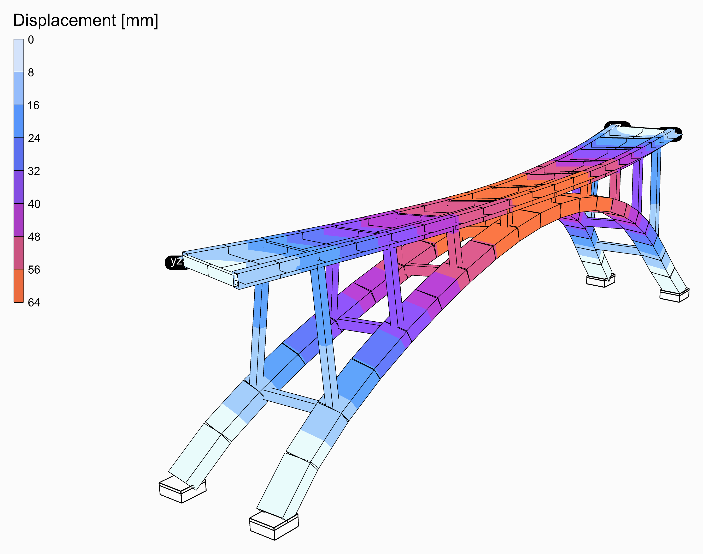
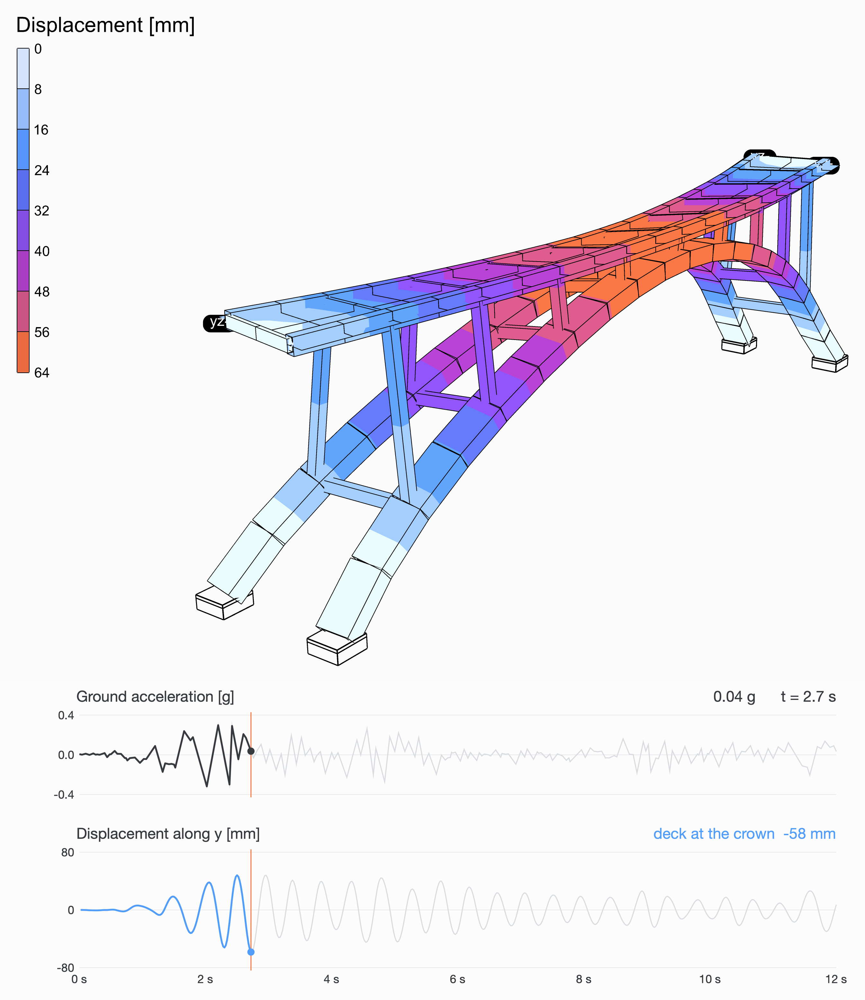

# 🌈 Arch Bridge in an Earthquake

<figure><figcaption></figcaption></figure>

[arch-bridge-earthquake](arch-bridge-earthquake.gh)

Two parabolic concrete box ribs, 80 m across and 20 m high, spring from the ground 12 m apart and lean in to 7 m at the crown, braced by a strut at every column. Nine pairs of spandrel columns, built into ribs and deck, carry the deck: a slab 11 m wide on two girders, joined by a floor beam on every pair. The deck runs on to the abutments at its ends, where it slides along, held across. The El Centro earthquake shakes the ground across the bridge.

<figure><video src="arch-bridge-earthquake-shaking.mp4" autoplay loop muted playsinline></video><figcaption>
The first 12 s of El Centro, as they happened, the movement drawn larger than it is. Under it, the ground's acceleration and the deck's movement across at the crown, over the same 12 s.
</figcaption></figure>

## The model

| Group | What it does |
| --- | --- |
| 1 - Geometry | The sliders, and a Python component that draws the bridge from them: the ribs, cut at every column and halfway between, the struts, the columns, the girders and floor beams, the slab's mesh, the springings and the abutments, and the point at the crown the charts follow. |
| 2 - Members | Concrete, C30/37: ribs 3 x 1.6 m, Rectangular Hollow; struts, columns 0.9 m square, girders 0.9 x 1.4 m and floor beams, Rectangular; all [ForceBeamColumn](../../docs/basics/elements/force-beam-column.md). A 250 mm slab as [ASD Shell](../../docs/basics/elements/shell.md)s. |
| 3 - Supports | The ribs built in at their springings; the deck's ends held up and across, free along. |
| 4 - Ground motion | The El Centro record from a Python component, its first **Duration** seconds times **Ground motion scale**; a Path Time Series of it; a Load Pattern of the UniformExcitation type, along the direction it shakes. |
| 5 - Transient analysis | [Assemble](../../docs/basics/assemble.md); [Damping](../../docs/basics/analysis/damping.md), Rayleigh's from **Damping** and its two frequencies; the Newmark [Integrator](../../docs/basics/analysis/integrator.md); [Analysis Step](../../docs/basics/analysis/analysis-step.md), a step a sample of the record; [Analysis Settings](../../docs/basics/analysis/analysis-settings.md) for a transient analysis with the Linear algorithm, one solve a step, as an elastic model needs; and Run Analysis. |
| 6 - Results | A [Model View](../../docs/basics/visualisation/model-view.md) of the analysed model at **Step**, deformed 100 times, its elements' edges and its supports drawn, its colours in iso-surfaces on the slabs over 0 to 64 mm for every step alike, with a [Legend](../../docs/basics/visualisation/legend.md); and one of it at rest, as light grey lines behind. Drag **Step** to go through the record. |

## The ground motion

El Centro, 18 May 1940, the north-south component: 0.32 g at its peak, 2 s in, the first 12 s of it. A [Path Time Series](../../docs/basics/time-history/path.md) of its accelerations shakes the ground under the whole structure through a [Load Pattern](../../docs/basics/loads/load-pattern.md)'s UniformExcitation type, and [Run Analysis](../../docs/basics/analysis/run-analysis.md) follows it step by step, 0.02 s at a time, a transient analysis with Newmark's average acceleration. The structure's own weight is its mass. Damping is Rayleigh's, 5% of critical at two frequencies that bracket the modes that matter. **Ground motion scale** makes the record stronger or weaker, **Duration** takes more or less of it.

## What it shows

The ribs and the deck sway across together, most at the crown: 62 mm at the most, 2.7 s in. Leaning in, and braced, the ribs make a frame across the bridge that holds it far more than one rib could. Make the arch higher and the columns longer, and it sways further.

<figure><figcaption>
The moment it moves the most, and the record up to then.
</figcaption></figure>
