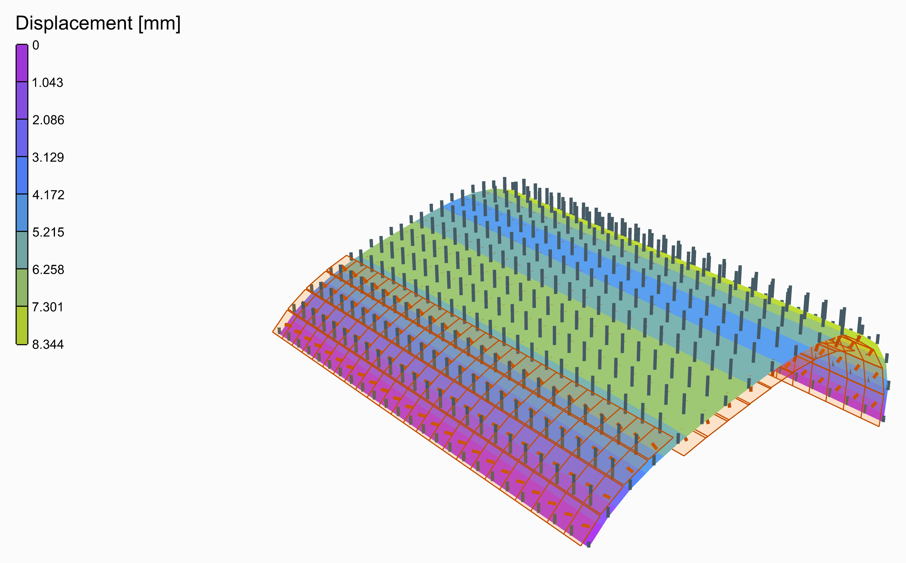
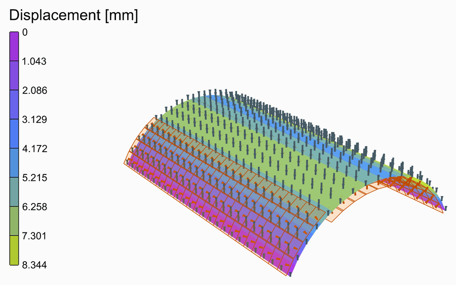
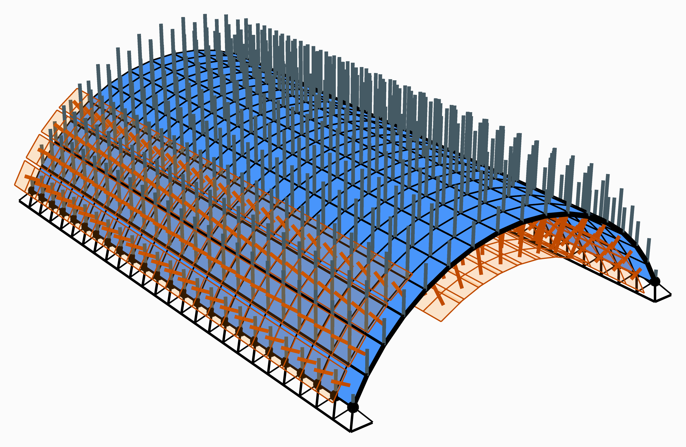

# 🌈 Barrel Vault

<figure><figcaption></figcaption></figure>

[barrel-vault](barrel-vault.gh)

A barrel vault 16 m across, 5 m high and 24 m long, of 120 mm of concrete, pinned along both long edges and free at its two ends. Its arc is cut into sixteen strips along its length: a strip's faces all face the same way, so a surface load on one strip acts along its normal. The wind blows across the vault, pushing on its windward quarter and pulling on the rest.

<figure><figcaption>
The deformed shape, from rest to its full size and back, its loads riding on it.
</figcaption></figure>

## The model

| Group | What it does |
| --- | --- |
| 1 - Geometry | The sliders, and a Python component that draws the geometry from them: the members as lines, each cut where another meets it, the points the structure is held at, and the widths its loads are worked out from. Open the component to see how. Span, rise, length, strips round the arc and divisions along it, and a pressure coefficient for each of the three zones. Each strip is named, Strip_0 onwards, and comes with its outward normal. |
| 2 - Members | Concrete, an [nD](../../docs/basics/materials/ND.md) material, 120 mm thick in a [Plate Fiber Section](../../docs/basics/sections/plate-fiber.md), on each strip's mesh as [ASD Shell](../../docs/basics/elements/shell.md)s, a strip an ElementId. |
| 3 - Supports | Every node along both long edges pinned. |
| 4 - Loads | Each strip's coefficient times the peak velocity pressure, along minus its normal, as one [Mesh Load](../../docs/basics/loads/shell-load.md) a strip, by its name; and the own weight. |
| 5 - Analysis | [Assemble](../../docs/basics/assemble.md) and [Run Analysis](../../docs/basics/analysis/run-analysis.md). |
| 6 - Results | A [Model View](../../docs/basics/visualisation/model-view.md) of the analysed vault, deformed 200 times and coloured by its displacement, with a [Legend](../../docs/basics/visualisation/legend.md); and one of the supports and the loads. |

## The loads

The wind is the peak velocity pressure, 0.8 kN/m², times a pressure coefficient for each zone: +0.6 on the windward quarter, −1.0 on the middle half and −0.4 on the leeward quarter, typed in from your code of practice. A positive coefficient pushes on the vault, a negative one pulls it away. A Mesh Load acts in one direction; one a strip, along its normal, puts the wind on the arc as it blows.

<figure><figcaption>
The supports and the loads, as <strong>Model View</strong> draws them: the own weight in its own colour, as OpenSees takes it. Tick <strong>Show Values</strong> in its Loads menu to write what each is worth.
</figcaption></figure>

## What it shows

The suction lifts the vault, most at its free ends, 8.3 mm, where nothing stiffens the arc. Close the ends with a gable, or try other coefficients.
