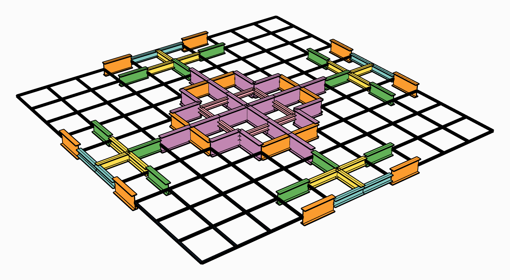

# 🔲 Beam Grid

<figure><figcaption></figcaption></figure>

[beam-grid](beam-grid.gh)

A 20 m square grid, ten bays each way, of steel beams cut at every crossing. It carries its own
weight and a point load at every node, as a slab would hand them down, on four pinned supports.
The [Section Optimiser](../../docs/basics/optimisation/section-optimiser.md) sizes every element
on its own within the family of the section it starts with, so the grid shows where the material
goes.

## The model

| Group | What it does |
| --- | --- |
| 1 - The grid | **Size**, **Bays**, the starting section (HEA300) and grade (S355), the node load, and **Supports, corner to centre**: the things to try. |
| 2 - Geometry | A line along X and one along Y at every grid line, each cut at every crossing, so that the beams meet at the nodes. |
| 3 - Beams | [Material Library Elastic](../../docs/basics/materials/MaterialDatabase.md), [Steel Section Library](../../docs/basics/sections/library.md) and the beams. |
| 4 - Supports | Four pinned supports on the diagonals: at the corners to begin with, walked one bay at a time towards the centre by the slider. |
| 5 - Loads | A point load at every node and the self-weight, in one [Load Pattern](../../docs/basics/loads/load-pattern.md). |
| 6 - Every element on its own, within its family | [Assemble](../../docs/basics/assemble.md), the Section Optimiser and **MaxUtilisation**, then two [Model Views](../../docs/basics/visualisation/model-view.md): the sized grid, a colour for each section, and its displacement with a [Legend](../../docs/basics/visualisation/legend.md). |

## What it shows

With the supports at the corners, the grid spans between them as a slab does, and the heaviest
beams run along its edges and into the corners. Walk the supports towards the centre and it
becomes a table on four legs, cantilevering out to its edges: the material moves to the beams
between the supports. **Mass** tells which layout is the lighter.
