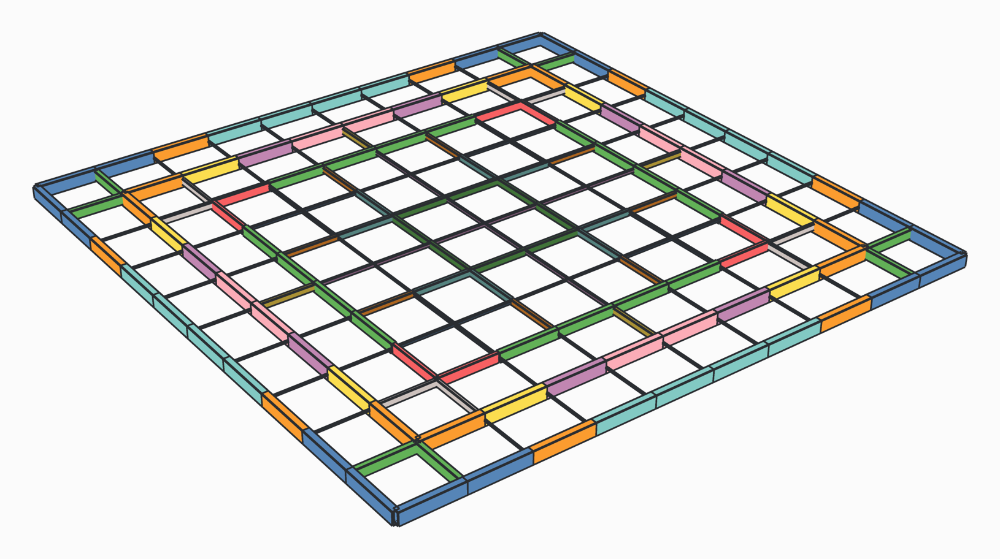

# 🔲 Beam Grid

<figure><figcaption></figcaption></figure>

[beam-grid](beam-grid.gh)

A 20 m square grid, ten bays each way, of steel beams cut at every crossing. It carries its own
weight and 7.5 kN at every node, as a slab would hand them down, on four pinned supports.
The [Section Optimiser](../../docs/basics/optimisation/section-optimiser.md) sizes every element
on its own within the family of the section it starts with, so the grid shows where the material
goes.

The beams are rectangular hollow sections. Joined rigidly at every node, each beam twists as the
beams across it bend. A closed section takes that torsion; an open one, such as an HEA, fails the
shear check reduced for torsion at any size, and the optimiser never settles. Switch the starting
section to HEA300 to see it.

## The model

| Group | What it does |
| --- | --- |
| 1 - The grid | **Size**, **Bays**, the starting section (RHS 300x200x10) and grade (S355), the node load (7.5 kN), and **Supports, corner to centre**: the things to try. |
| 2 - Geometry | A line along X and one along Y at every grid line, each cut at every crossing, so that the beams meet at the nodes. |
| 3 - Beams | [Material Library Elastic](../../docs/basics/materials/MaterialDatabase.md), [Steel Section Library](../../docs/basics/sections/library.md) and the beams. |
| 4 - Supports | Four pinned supports on the diagonals: at the corners to begin with, walked one bay at a time towards the centre by the slider. |
| 5 - Loads | A point load at every node and the self-weight, in one [Load Pattern](../../docs/basics/loads/load-pattern.md). |
| 6 - Every element on its own, within its family | [Assemble](../../docs/basics/assemble.md), the Section Optimiser with **MaxUtilisation** and **Iterations** (40: sized element by element, a grid takes a few dozen to settle), then two [Model Views](../../docs/basics/visualisation/model-view.md): the sized grid, a colour for each section, and its displacement with a [Legend](../../docs/basics/visualisation/legend.md). |

## What it shows

With the supports at the corners, the grid spans between them as a slab does: the heaviest beams
run along its edges and round a ring a bay inside them, 15.0 t of steel in all. Walk the supports
in and the grid gets lighter, to 5.2 t with them 4 m in from the edges. Further in, it becomes a
table on four legs, cantilevering out to its edges, and the material gathers in a cross between
the supports: 9.6 t with them 8 m in. **Mass** gives each layout's figure.
