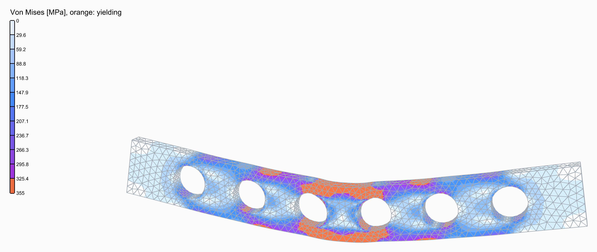
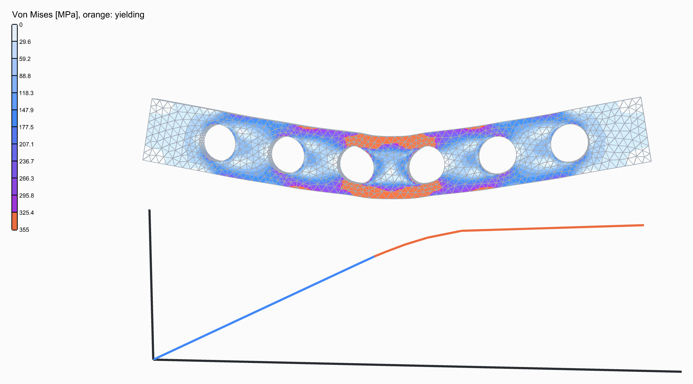
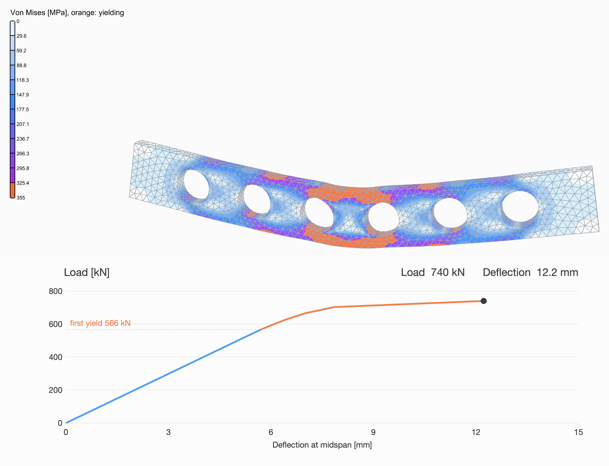

# 🟧 Steel Beam with Holes

<figure><figcaption></figcaption></figure>

[beam-with-holes](beam-with-holes.gh)

A simply supported S355 beam 2.4 m long, 300 mm deep and 80 mm thick, with six round holes 180 mm
across - the depth of a cellular beam's openings, 60% of the beam - loaded across its top at
midspan. Its steel is the [nD](../../docs/basics/materials/ND.md) component's **J2Plasticity** unit:
von Mises plasticity, elastic until the stress reaches 355 MPa, then yielding, so that the load
moves to the steel around it. Twenty steps take the load to 740 kN, well past the 566 kN at which
the first point yields.

<figure><video src="beam-with-holes-pushing.mp4" autoplay loop muted playsinline></video><figcaption>
The push, a step a frame, the beam drawn 15 times its deflection. Orange is steel at yield. Under it, the load-deflection curve so far: straight while the beam is elastic, bending over from first yield as the yielding spreads.
</figcaption></figure>

## The model

| Group | What it does |
| --- | --- |
| 1 - The beam in tetrahedra | The tetrahedra as gmsh wrote them - the nodes, and four node numbers per tetrahedron - made into meshes by List Item and Construct Mesh: 7 478 of them, finer round the holes. |
| 2 - S355 that yields | The [nD](../../docs/basics/materials/ND.md) component on its **J2Plasticity** unit: E 210 GPa, ν 0.3, Fy 355 MPa, no hardening. [Ten Node Tetrahedra](../../docs/basics/elements/ten-node-tetrahedron.md), which carry it best: they follow beam theory before yield and level off after it. |
| 3 - Supports | The beam rests on its end faces, as on end plates: every node of both faces holds Z, so they carry the shear and still turn, and Y. One node at the middle of the underside holds X; by symmetry it carries nothing. |
| 4 - Load | 740 kN on a strip 100 mm long across the top at midspan, shared among its nodes, as [Point Loads](../../docs/basics/loads/point-load.md) in a [Load Pattern](../../docs/basics/loads/load-pattern.md) with a [Linear Time Series](../../docs/basics/time-history/linear.md), so that the load grows step by step. |
| 5 - Assemble | [Assemble](../../docs/basics/assemble.md), with a tolerance of 1 mm, well under the distance between the tetrahedra's nodes. |
| 6 - Pushed in steps | Newton, a [Test](../../docs/basics/analysis/test.md) of the displacement increment to 1e-8 in at most 30 iterations, and 20 steps of [Load Control](../../docs/basics/analysis/integrator.md) of 5%, into [Run Analysis](../../docs/basics/analysis/run-analysis.md). |
| 7 - Von Mises, step by step | A [Model View](../../docs/basics/visualisation/model-view.md) of the Von Mises stress at the **Step** the slider picks, in iso-surfaces of Alpaca4d's colours: eleven bands from light blue through blue to purple for the elastic range, from 0 to 355 MPa, and orange for the top one, where the steel yields. A [Legend](../../docs/basics/visualisation/legend.md) beside it. |
| 8 - The curve | [Nodal Displacements](../../docs/basics/results/nodal-displacements.md) and [Brick Stresses](../../docs/basics/results/brick-stresses.md) at every step, and a Python component that reads the deflection at the middle of the underside and the largest Von Mises stress, and draws the load-deflection curve under the beam: light blue while it is elastic, orange from first yield. |

<figure><figcaption>
As the example opens: the beam at the last step, and the curve Grasshopper draws under it.
</figcaption></figure>

## What it shows

Up to 566 kN the beam is elastic: the curve is straight, and the load and the deflection grow
together. The first steel to yield is at the holes next to midspan, where the beam is narrowest and
the bending largest, and in the tees above and below them, which carry the shear across each hole
by bending too. From there the yielding spreads, and the beam softens: the last 31% of the load
doubles the deflection, from 5.7 mm at first yield to 12.2 mm at 740 kN, 1.6 times what an elastic
beam would sag. The orange bands show where the steel carries all it can and passes the rest on.

<figure><figcaption>
The beam at 740 kN, and the whole curve.
</figcaption></figure>

## Try

- Move **Step** to watch the yielding start at the holes and spread.
- **Load** higher: past about 755 kN the beam has no more to give, and the analysis stops
  converging. Load Control cannot follow a curve past its top; the last step that converged is close
  to the most the beam carries.
- **H**, the hardening, above 0 - 2 000 000 kN/m², say - and the curve keeps rising after yield.
- **Fy** lower, for a weaker steel: the curve bends over sooner.
- The tetrahedra need an OpenSees built from the master branch since 16 October 2026 (Alpaca4d >
  Settings > Set OpenSees Executable). The beam has 7 478 elements, so it needs a license.
