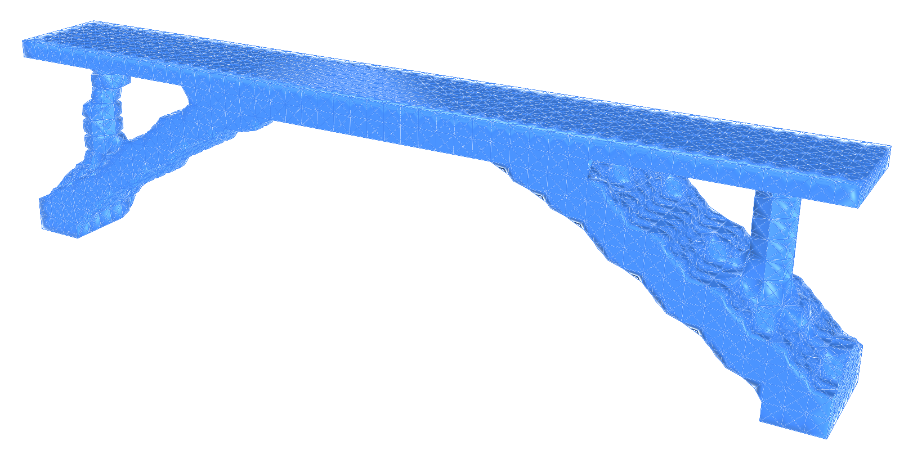
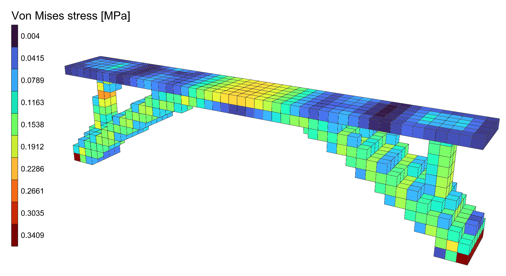

# 🪓 BESO Bridge

<figure><figcaption></figcaption></figure>

[beso-bridge](beso-bridge.gh)

The bridge of the [Topology Bridge](../topology-bridge/topology-bridge.md), carved out of its block
by [BESO Topology](../../docs/basics/optimisation/beso-topology.md). The block is steel, 16 m long, 2 m
wide and 4 m high, pinned along both ends of its bottom, its top layer a deck kept solid under
10 kN/m². BESO starts from the whole block and takes 2% of what is left away each iteration -
the bricks that work least go, and some come back - until a fifth of the block below the deck is
left. Every brick is solid or void all along, so every iteration is a design of its own.

::: info
Without a license, BESO Topology runs on models of up to 500 elements. At 3 bricks per metre this
one has 3 456, so it needs one; at 1 brick per metre, 128 bricks, it runs without.
:::

## The model

| Group | What it does |
| --- | --- |
| 1 - How fine | **Bricks per metre**, the same every way. The Expressions turn it into the bricks along and across, the height of a layer and the number of levels. |
| 2 - The design domain and the deck | The plan, a 16 x 2 m rectangle, meshed once with **Mesh Plane**, copied up level by level and made into bricks between each pair of levels by [Mesh Series to Brick](../../docs/basics/utility/mesh-series-to-brick.md). The domain runs from the bottom to the deck's underside; the deck is the one layer above. |
| 3 - Steel, and the bricks | An [nD](../../docs/basics/materials/ND.md) material, steel with E = 210 GPa and ν = 0.3. Two sets of [SSP Bricks](../../docs/basics/elements/brick.md), named **Domain** and **Deck** through their ElementId. |
| 4 - Pinned ends, and the deck load | The nodes along the bottom of both ends, held in X, Y and Z by a [Support](../../docs/basics/elements/support.md). The deck load, 10 kN/m² over 32 m², shared among the nodes of the deck's top as [Point Loads](../../docs/basics/loads/point-load.md), in a [Load Pattern](../../docs/basics/loads/load-pattern.md). |
| 5 - Assemble Model | [Assemble](../../docs/basics/assemble.md). [Model View](../../docs/basics/visualisation/model-view.md) is disabled: enable it to see the domain, the supports and the loads. |
| 6 - BESO Topology | **Keep** names the Deck. **VolumeFraction** 0.2, **Iterations** 200, **Run**, and **Step** to go through the designs. Panels show the compliance, the volume of each iteration, whether the run converged, and its history. |
| 7 - The design, analysed | [Run Analysis](../../docs/basics/analysis/run-analysis.md) on **AlpacaModel**, the design shown as a model of its own, and View Results colouring it by Von Mises stress, with a Legend. Run Analysis and Legend are disabled: enable them once the run has stopped. |

## Running it

1. Set **Run** to `true`. The run goes on its own thread, so Rhino stays free, and the **Surface**
   preview and the outputs follow it.
2. **Volume** comes down from 1 to 0.2 in about 80 iterations; then the design settles. At 3 bricks
   per metre the run converges after 105 iterations, in under 20 seconds on an Apple M2 Pro.
3. Drag **Step** back to go through the designs: each one is a bridge of the volume reached, from the
   whole block down. Choose the one you want.
4. Once the run has stopped, select **Run Analysis** and **Legend** and enable them. Disable Run
   Analysis again before dragging **Step**, or every design shown is analysed.

<figure><figcaption></figcaption></figure>

## What it shows

The steel goes into two inclined legs that rise from the supports into the deck, with a column up
to the deck near each end: a deck on two raking struts, every brick of it solid, with no grey
density to threshold.

Early on, the block opens a hole above mid-span and the underside comes away from the supports; by
half the volume the legs are there, and the rest of the run thins them.
