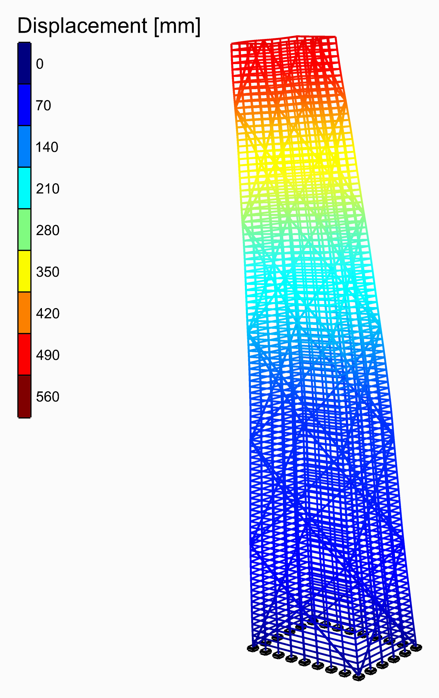
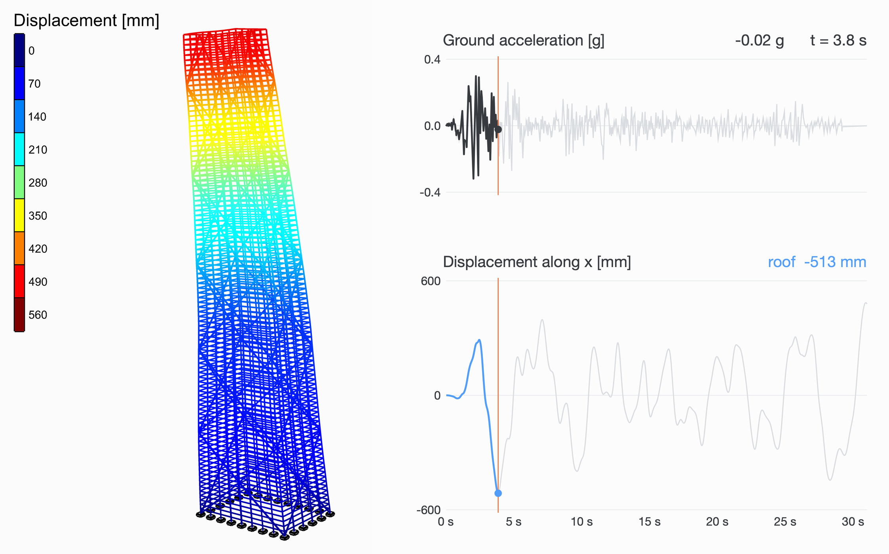

# ✖️ Braced Tube, after the John Hancock Center

<figure><figcaption></figcaption></figure>

[braced-tube-earthquake](braced-tube-earthquake.gh)

A tapering steel box of 100 storeys, 344 m tall: 80 by 50 m at the ground and 48 by 30 m at the roof. Its four faces are crossed by diagonals from corner to corner, an X every 18 storeys and half of one at the top, which make every wall a truss; the columns, eight bays along the long faces and five along the short ones, lean in with the taper. This is the structure of the John Hancock Center, now 875 North Michigan Avenue, in Chicago. The El Centro earthquake shakes the ground along x.

<figure><video src="braced-tube-earthquake-shaking.mp4" autoplay loop muted playsinline></video><figcaption>
The first 31 s of El Centro, as they happened, the movement drawn larger than it is. Beside it, the ground's acceleration and the movement along x of the corner of the roof, over the same 31 s.
</figcaption></figure>

## The model

| Group | What it does |
| --- | --- |
| 1 - Geometry | The sliders - the sides at the ground and at the roof, **Storeys**, **Storey height** and **Storeys an X** - and a Python component that draws the tower from them: the columns, the diagonals floor by floor, from where each crosses one floor to where it crosses the next, the spandrels, met by the diagonals at every floor, the columns' feet; each floor's nodes and the one it is driven from, for the diaphragms; each node's share of its floor's mass; and the corner of the roof the charts follow. |
| 2 - Members | S355 from [Material Library](../../docs/basics/materials/MaterialDatabase.md); box columns and diagonals 900 × 80 mm, [Rectangle Hollow CS](../../docs/basics/sections/rectangular-hollow.md)s, and HEM1000 spandrels from [Steel Section Library](../../docs/basics/sections/library.md), all as [ForceBeamColumn](../../docs/basics/elements/force-beam-column.md). |
| 3 - Supports and floors | Every column and wall built in at the ground, with a [Support](../../docs/basics/elements/support.md); and every floor a [Rigid Diaphragm](../../docs/basics/constraints/diaphragm.md) - its nodes move together in its plane, as a concrete floor makes them - driven from one of its nodes. |
| 4 - Ground motion and masses | The El Centro record, as in the other earthquakes, along x. A [Mass Point](../../docs/basics/loads/mass-point.md) at every node of every floor: **Floor mass** kg/m² of the floor's area - its slab, finishes, facade and some of what is in it - shared between its nodes. |
| 5 - Transient analysis | [Assemble](../../docs/basics/assemble.md), with an [MPCO Recorder](../../docs/basics/mpco-recorder.md) of the displacements alone, which is all the view reads; [Damping](../../docs/basics/analysis/damping.md), Rayleigh's from **Damping** and its two frequencies; the Newmark [Integrator](../../docs/basics/analysis/integrator.md); [Analysis Step](../../docs/basics/analysis/analysis-step.md), a step a sample of the record; [Analysis Settings](../../docs/basics/analysis/analysis-settings.md) for a transient analysis with the Linear algorithm, one solve a step, as an elastic model needs; and Run Analysis. |
| 6 - Results | A [Model View](../../docs/basics/visualisation/model-view.md) of the analysed model at **Step**, deformed 40 times, its supports drawn, its colours over 0 to 560 mm for every step alike, with a [Legend](../../docs/basics/visualisation/legend.md). Drag **Step** to go through the record. |

Its 6 700 elements are past the free limit of 50: it needs a licence. The analysis takes about two minutes on a laptop; then each step takes a second or a few to draw as you drag **Step**.

## The ground motion

El Centro, 18 May 1940, the north-south component: 0.32 g at its peak, 2 s in, the first 31 s of it. A [Path Time Series](../../docs/basics/time-history/path.md) of its accelerations shakes the ground under the whole structure through a [Load Pattern](../../docs/basics/loads/load-pattern.md)'s UniformExcitation type, and [Run Analysis](../../docs/basics/analysis/run-analysis.md) follows it step by step, 0.02 s at a time, a transient analysis with Newmark's average acceleration. Damping is Rayleigh's, 2% of critical at two frequencies that bracket the modes that matter. **Ground motion scale** makes the record stronger or weaker, **Duration** takes more or less of it.

## What it shows

The tower sways along x, its long way, more the higher up: its roof moves 513 mm at the most, 3.8 s in. Its first period is 7.2 s, along its short side; along its long side, the way it is shaken, 5.2 s. The diagonals carry the shear from floor to floor down to the ground as a truss would, so the tower bends rather than racks: its columns barely bend, but stretch and squash. It is a model of how the tower's structure works, made from its published shape and sizes, not a model of the tower itself: its members' sizes and its floors' mass are a designer's guesses, it is built in at the ground rather than standing on its foundations, and the real tower has much more in it.

<figure><figcaption>
The moment it moves the most, and the record up to then.
</figcaption></figure>

## Try

- **Storeys an X** at 9: twice as many Xs, steeper diagonals.
- **Long side at the roof** and **Short side at the roof** as at the ground: no taper.
- Take the diagonals out of Assemble: a frame of columns and spandrels alone, and see how far it sways.
