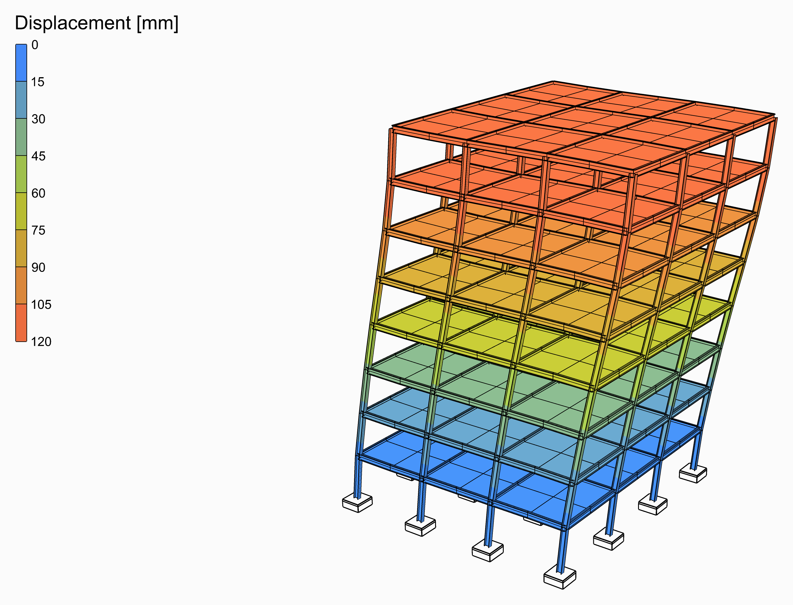
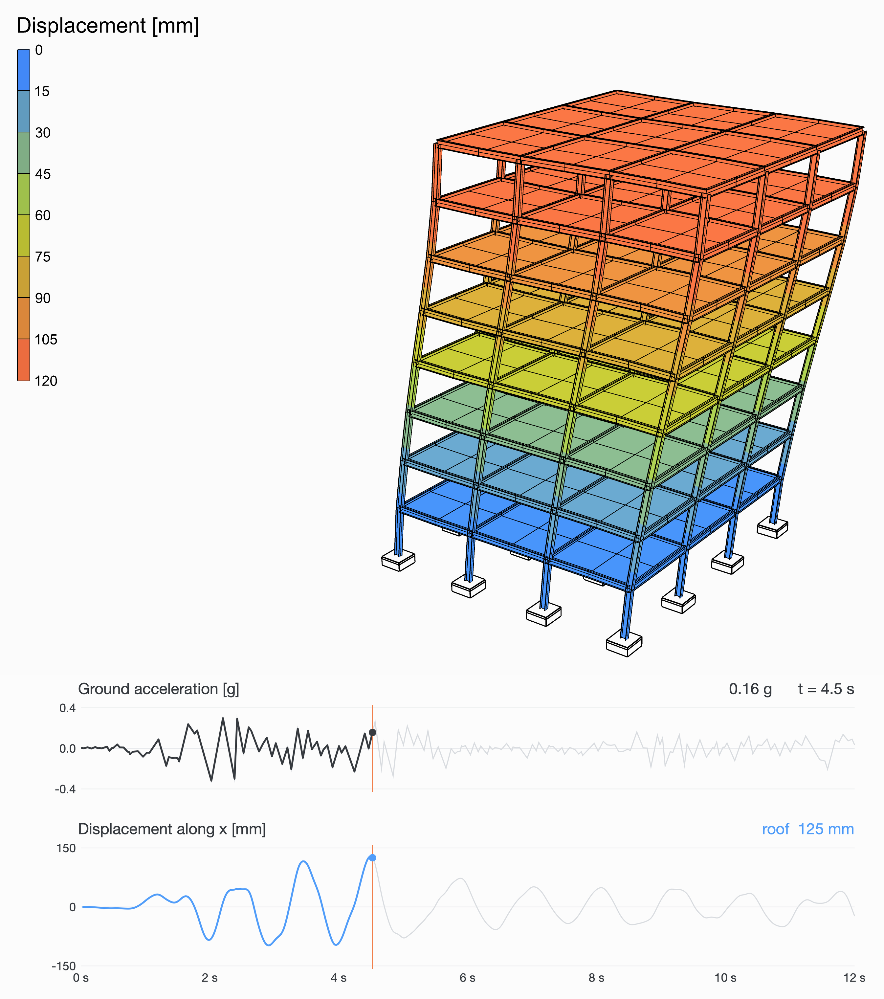

# 🏢 Building in an Earthquake

<figure><figcaption></figcaption></figure>

[building-earthquake](building-earthquake.gh)

A steel frame of eight storeys, three bays of 6 m each way: HEB400 columns built in at the ground, IPE450 beams and a 200 mm concrete slab at every floor, meshed twice a bay so that it shares the beams' nodes. The El Centro earthquake shakes the ground along x.

<figure><video src="building-earthquake-shaking.mp4" autoplay loop muted playsinline></video><figcaption>
The first 12 s of El Centro, as they happened, the movement drawn larger than it is. Under it, the ground's acceleration and the roof's movement along x, over the same 12 s: the roof swings back and forth about once a second, behind the ground.
</figcaption></figure>

## The model

| Group | What it does |
| --- | --- |
| 1 - Geometry | The sliders, and a Python component that draws the frame from them: the columns, the beams cut twice a bay, a slab mesh at every floor, the columns' feet, and the corner of the roof the charts follow. |
| 2 - Members | S355 HEB400 columns and IPE450 beams from [Steel Section Library](../../docs/basics/sections/library.md), as [ForceBeamColumn](../../docs/basics/elements/force-beam-column.md); 200 mm of concrete, a [Plate Fiber Section](../../docs/basics/sections/plate-fiber.md), as [ASD Shell](../../docs/basics/elements/shell.md)s. |
| 3 - Supports | Every column built in at the ground. |
| 4 - Ground motion | The El Centro record from a Python component, its first **Duration** seconds times **Ground motion scale**; a Path Time Series of it; a Load Pattern of the UniformExcitation type, along the direction it shakes. |
| 5 - Transient analysis | [Assemble](../../docs/basics/assemble.md); [Damping](../../docs/basics/analysis/damping.md), Rayleigh's from **Damping** and its two frequencies; the Newmark [Integrator](../../docs/basics/analysis/integrator.md); [Analysis Step](../../docs/basics/analysis/analysis-step.md), a step a sample of the record; [Analysis Settings](../../docs/basics/analysis/analysis-settings.md) for a transient analysis with the Linear algorithm, one solve a step, as an elastic model needs; and Run Analysis. |
| 6 - Results | A [Model View](../../docs/basics/visualisation/model-view.md) of the analysed model at **Step**, deformed 40 times, its elements' edges and its supports drawn, its colours in iso-surfaces on the slabs over 0 to 120 mm for every step alike, with a [Legend](../../docs/basics/visualisation/legend.md). Drag **Step** to go through the record. |

## The ground motion

El Centro, 18 May 1940, the north-south component: 0.32 g at its peak, 2 s in, the first 12 s of it. A [Path Time Series](../../docs/basics/time-history/path.md) of its accelerations shakes the ground under the whole structure through a [Load Pattern](../../docs/basics/loads/load-pattern.md)'s UniformExcitation type, and [Run Analysis](../../docs/basics/analysis/run-analysis.md) follows it step by step, 0.02 s at a time, a transient analysis with Newmark's average acceleration. The structure's own weight is its mass. Damping is Rayleigh's, 5% of critical at two frequencies that bracket the modes that matter. **Ground motion scale** makes the record stronger or weaker, **Duration** takes more or less of it.

## What it shows

The building sways along the shaking, more the higher up, its top 125 mm off at the most, 4.5 s in; the iso-surfaces on the slabs show each floor moving as one. Add storeys and it sways slower and further.

<figure><figcaption>
The moment it moves the most, and the record up to then.
</figcaption></figure>
