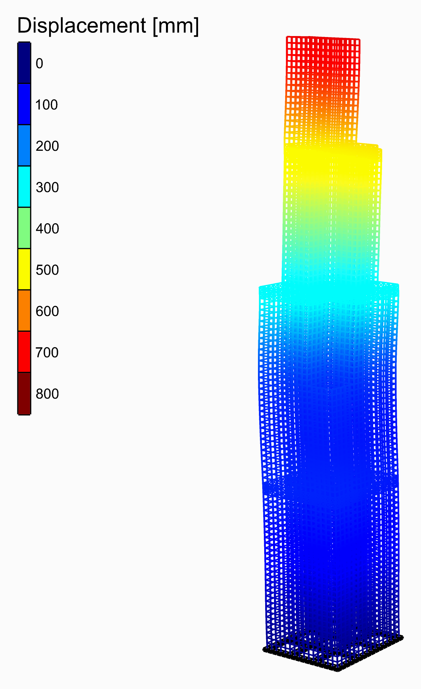
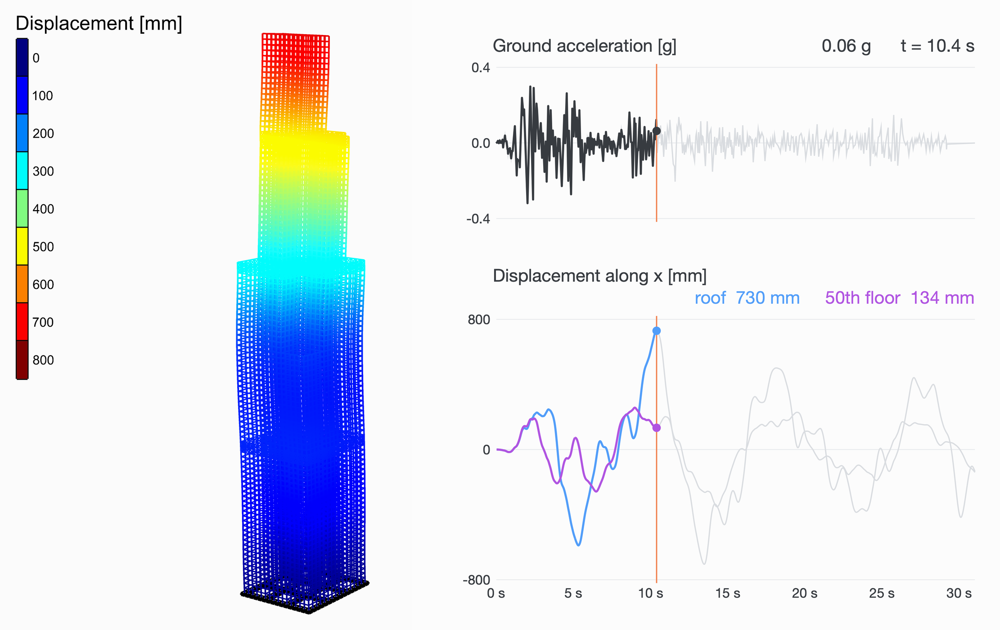

# 🗼 Bundled Tube, after the Willis Tower

<figure><figcaption></figcaption></figure>

[bundled-tube-earthquake](bundled-tube-earthquake.gh)

Nine square steel tubes of 22.9 m, three by three, bundled together: 108 storeys and 442 m to the roof. Each wall of each tube is a frame of columns 4.6 m apart tied by deep spandrels, and walls the tubes share are one; together they make one tube, stiff as a box, cut into nine. Two tubes stop at the 50th floor, two at the 66th, three at the 90th, and two go on to the top. Belt trusses brace the walls over two storeys at three floors. This is the structure of the Willis Tower, once the Sears Tower, in Chicago. The El Centro earthquake shakes the ground along x.

<figure><video src="bundled-tube-earthquake-shaking.mp4" autoplay loop muted playsinline></video><figcaption>
The first 31 s of El Centro, as they happened, the movement drawn larger than it is. Beside it, the ground's acceleration and the movement along x of the roof and of the top of a 50-storey tube, over the same 31 s.
</figcaption></figure>

## The model

| Group | What it does |
| --- | --- |
| 1 - Geometry | The sliders - **Tube**, **Columns a tube side**, **Storeys** and **Storey height** - and a Python component that draws the tower from them: the columns of every tube still standing on each floor, the spandrels between them, the belt trusses, the columns' feet; each floor's nodes and the one it is driven from, for the diaphragms; each node's share of its floor's mass; and the points the charts follow. |
| 2 - Members | S355 from [Material Library](../../docs/basics/materials/MaterialDatabase.md); box columns 900 × 60 mm and belt truss braces 600 × 40 mm, [Rectangle Hollow CS](../../docs/basics/sections/rectangular-hollow.md)s, and HEM1000 spandrels from [Steel Section Library](../../docs/basics/sections/library.md), all as [ForceBeamColumn](../../docs/basics/elements/force-beam-column.md). |
| 3 - Supports and floors | Every column and wall built in at the ground, with a [Support](../../docs/basics/elements/support.md); and every floor a [Rigid Diaphragm](../../docs/basics/constraints/diaphragm.md) - its nodes move together in its plane, as a concrete floor makes them - driven from one of its nodes. |
| 4 - Ground motion and masses | The El Centro record, as in the other earthquakes, along x. A [Mass Point](../../docs/basics/loads/mass-point.md) at every node of every floor: **Floor mass** kg/m² of the floor's area - its slab, finishes, facade and some of what is in it - shared between its nodes. |
| 5 - Transient analysis | [Assemble](../../docs/basics/assemble.md), with an [MPCO Recorder](../../docs/basics/mpco-recorder.md) of the displacements alone, which is all the view reads; [Damping](../../docs/basics/analysis/damping.md), Rayleigh's from **Damping** and its two frequencies; the Newmark [Integrator](../../docs/basics/analysis/integrator.md); [Analysis Step](../../docs/basics/analysis/analysis-step.md), a step a sample of the record; [Analysis Settings](../../docs/basics/analysis/analysis-settings.md) for a transient analysis with the Linear algorithm, one solve a step, as an elastic model needs; and Run Analysis. |
| 6 - Results | A [Model View](../../docs/basics/visualisation/model-view.md) of the analysed model at **Step**, deformed 30 times, its supports drawn, its colours over 0 to 800 mm for every step alike, with a [Legend](../../docs/basics/visualisation/legend.md). Drag **Step** to go through the record. |

Its 20 900 elements are past the free limit of 50: it needs a licence. The analysis takes about four minutes on a laptop; then each step takes a second or a few to draw as you drag **Step**.

## The ground motion

El Centro, 18 May 1940, the north-south component: 0.32 g at its peak, 2 s in, the first 31 s of it. A [Path Time Series](../../docs/basics/time-history/path.md) of its accelerations shakes the ground under the whole structure through a [Load Pattern](../../docs/basics/loads/load-pattern.md)'s UniformExcitation type, and [Run Analysis](../../docs/basics/analysis/run-analysis.md) follows it step by step, 0.02 s at a time, a transient analysis with Newmark's average acceleration. Damping is Rayleigh's, 2% of critical at two frequencies that bracket the modes that matter. **Ground motion scale** makes the record stronger or weaker, **Duration** takes more or less of it.

## What it shows

The tower sways along x, slowly: its first period is 8.4 s, and the record is over before it has swung four times. Its roof moves 730 mm at the most, 10.4 s in; the top of the tubes that stop at the 50th floor, 352 mm. The tubes that go on above them sway further, and whip a little on the shorter ones, but the tower bends as one: the tubes are bundled, so their walls share the bending, the walls along the shaking stretching and squashing the most. It is a model of how the tower's structure works, made from its published shape and sizes, not a model of the tower itself: its members' sizes and its floors' mass are a designer's guesses, it is built in at the ground rather than standing on its foundations, and the real tower has much more in it.

<figure><figcaption>
The moment it moves the most, and the record up to then.
</figcaption></figure>

## Try

- **Columns a tube side** at 3: half as many columns, a softer tube, and a quicker analysis.
- **Floor mass** at 1 000 kg/m²: a heavier floor, a slower sway.
- **Duration** at 12 s for a first look, quicker to run.
