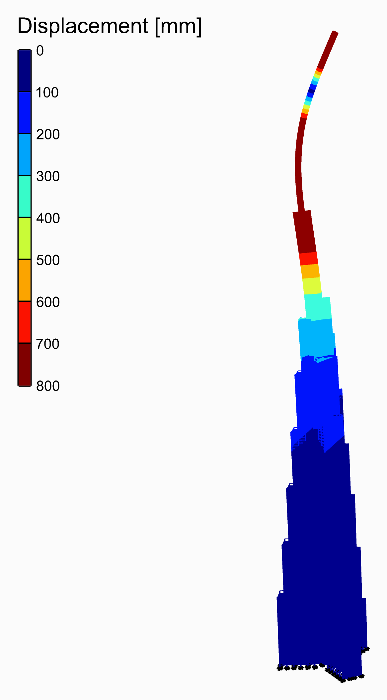
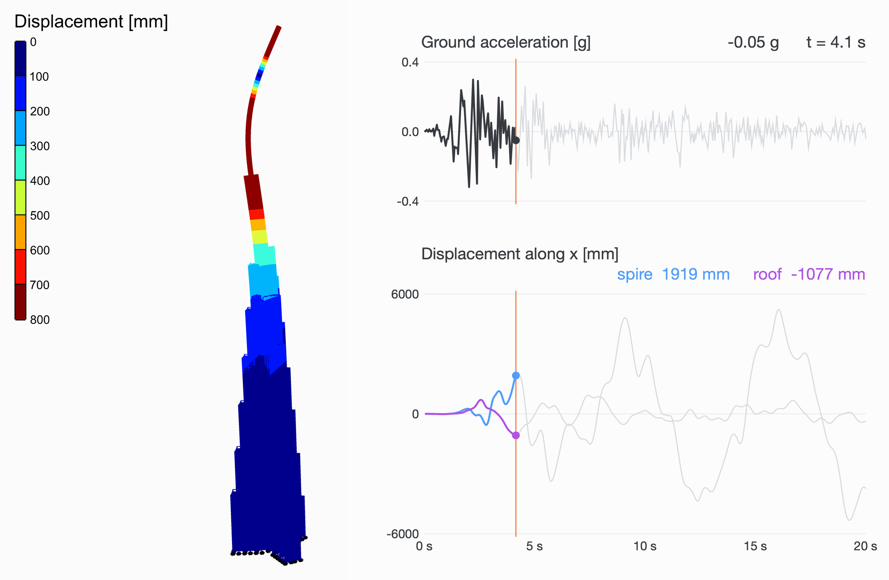

# 🔱 Buttressed Core, after the Burj Khalifa

<figure><figcaption></figcaption></figure>

[buttressed-core-earthquake](buttressed-core-earthquake.gh)

A hexagonal core of concrete walls and three wings round it, each two corridor walls with a hammerhead wall across its end and columns down its faces: the wings buttress the core, and the core holds the wings. The wings step back 9 m at a time, one after another round the tower, until only the core is left at the top of its 160 storeys, 592 m up, where a steel spire goes on for another 220 m. This is the structure of the Burj Khalifa in Dubai. The El Centro earthquake shakes the ground along x.

<figure><video src="buttressed-core-earthquake-shaking.mp4" autoplay loop muted playsinline></video><figcaption>
The first 20 s of El Centro, as they happened, the movement drawn larger than it is. Beside it, the ground's acceleration and the movement along x of the spire's tip and of the roof, over the same 20 s.
</figcaption></figure>

## The model

| Group | What it does |
| --- | --- |
| 1 - Geometry | The sliders - **Core**, **Corridor walls apart**, **Wing width**, **Module**, **Modules a wing**, **Storeys**, **Storey height** and **Spire** - and a Python component that draws the tower from them: each storey's walls as a mesh of panels, a storey tall and up to two modules long; the columns and beams of the wings; the spire, a mast held at each of the top eight floors by spokes from the core's corners; the feet; each floor's nodes and the one it is driven from, for the diaphragms; each node's share of its floor's mass; and the spire's tip and the roof, which the charts follow. |
| 2 - Members | The walls 800 mm of concrete, a [Plate Fiber Section](../../docs/basics/sections/plate-fiber.md) of an [nD material](../../docs/basics/materials/ND.md), as [ASD Shell](../../docs/basics/elements/shell.md)s; Concrete C30/37 from [Material Library](../../docs/basics/materials/MaterialDatabase.md) for columns 1.2 × 1.2 m and beams 0.6 × 1 m, [RectangleCS](../../docs/basics/sections/rectangular.md) sections; the spire a steel tube 8 m across and 60 mm thick, a [CircleCS](../../docs/basics/sections/circular.md); all as [ForceBeamColumn](../../docs/basics/elements/force-beam-column.md). |
| 3 - Supports and floors | Every column and wall built in at the ground, with a [Support](../../docs/basics/elements/support.md); and every floor a [Rigid Diaphragm](../../docs/basics/constraints/diaphragm.md) - its nodes move together in its plane, as a concrete floor makes them - driven from one of its nodes. |
| 4 - Ground motion and masses | The El Centro record, as in the other earthquakes, along x. A [Mass Point](../../docs/basics/loads/mass-point.md) at every node of every floor: **Floor mass** kg/m² of the floor's area - its slab, finishes, facade and some of what is in it - shared between its nodes. |
| 5 - Transient analysis | [Assemble](../../docs/basics/assemble.md), with an [MPCO Recorder](../../docs/basics/mpco-recorder.md) of the displacements alone, which is all the view reads; [Damping](../../docs/basics/analysis/damping.md), Rayleigh's from **Damping** and its two frequencies; the Newmark [Integrator](../../docs/basics/analysis/integrator.md); [Analysis Step](../../docs/basics/analysis/analysis-step.md), a step a sample of the record; [Analysis Settings](../../docs/basics/analysis/analysis-settings.md) for a transient analysis with the Linear algorithm, one solve a step, as an elastic model needs; and Run Analysis. |
| 6 - Results | A [Model View](../../docs/basics/visualisation/model-view.md) of the analysed model at **Step**, deformed 20 times, its supports drawn, its colours over 0 to 800 mm for every step alike, with a [Legend](../../docs/basics/visualisation/legend.md). Drag **Step** to go through the record. |

Its 10 100 elements are past the free limit of 50: it needs a licence. The analysis takes about eight minutes, its walls the most of it on a laptop; then each step takes a second or a few to draw as you drag **Step**.

## The ground motion

El Centro, 18 May 1940, the north-south component: 0.32 g at its peak, 2 s in, the first 20 s of it. A [Path Time Series](../../docs/basics/time-history/path.md) of its accelerations shakes the ground under the whole structure through a [Load Pattern](../../docs/basics/loads/load-pattern.md)'s UniformExcitation type, and [Run Analysis](../../docs/basics/analysis/run-analysis.md) follows it step by step, 0.02 s at a time, a transient analysis with Newmark's average acceleration. Damping is Rayleigh's, 2% of critical at two frequencies that bracket the modes that matter. **Ground motion scale** makes the record stronger or weaker, **Duration** takes more or less of it.

## What it shows

The tower's walls sway as one, slowly - its first period is 7.5 s - and its roof moves 1.1 m at the most. The spire, thin and light on a heavy tower, whips about on top of it: its tip moves 5.3 m at the most, 19.3 s in, still swinging wider as the 20 s end, far more than the roof under it - and past the top of the colours, which stop at 800 mm so that the tower's own movement shows. It is a model of how the tower's structure works, made from its published shape and sizes, not a model of the tower itself: its members' sizes and its floors' mass are a designer's guesses, it is built in at the ground rather than standing on its foundations, and the real tower has much more in it.

<figure><figcaption>
The moment it moves the most, and the record up to then.
</figcaption></figure>

## Try

- **Spire** at 0: the tower alone.
- **Modules a wing** at 4: shorter wings, a slimmer tower that sways further.
- **Duration** at 31 s, the whole record: it takes half as long again.
