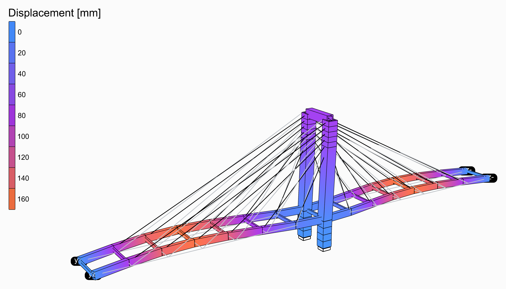
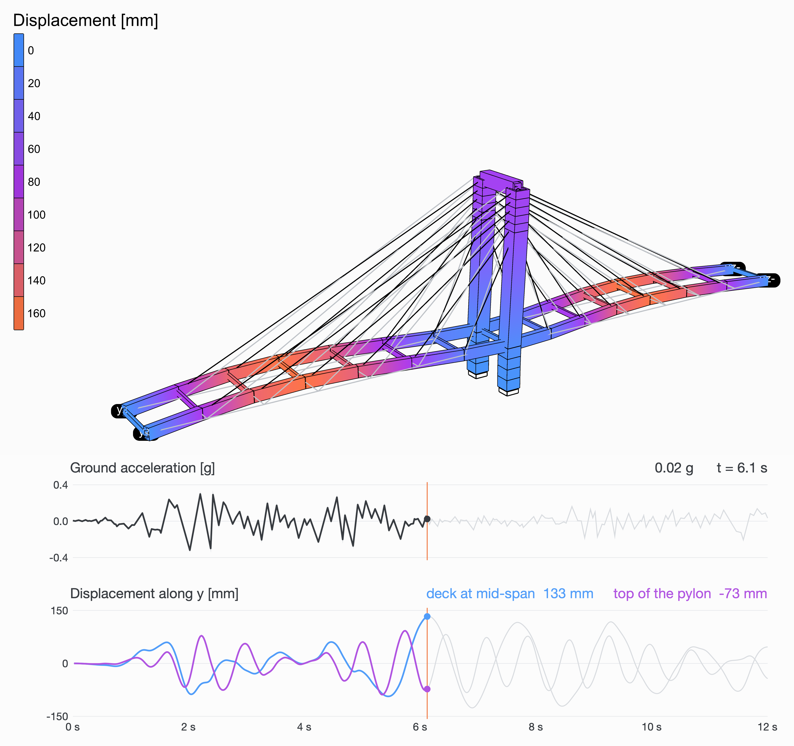

# 🌁 Cable-Stayed Bridge in an Earthquake

<figure><figcaption></figcaption></figure>

[cable-stayed-bridge-earthquake](cable-stayed-bridge-earthquake.gh)

Two spans of 80 m hang from one H-shaped concrete pylon, 35 m above the deck. The deck is two concrete edge girders joined by floor beams wherever a stay holds them; the steel stays fan in two planes from the top of the pylon's legs. The girders are built into the legs and slide along their abutments. The El Centro earthquake shakes the ground across the bridge.

<figure><video src="cable-stayed-bridge-earthquake-shaking.mp4" autoplay loop muted playsinline></video><figcaption>
The first 12 s of El Centro, as they happened, the movement drawn larger than it is. Under it, the ground's acceleration, and the movement across of the deck in the middle of a span and of the top of the pylon, over the same 12 s.
</figcaption></figure>

## The model

| Group | What it does |
| --- | --- |
| 1 - Geometry | The sliders, and a Python component that draws the bridge from them: the girders, the floor beams, the pylon's legs and cross beam, the stays, where the pylon stands and where the deck's ends rest, and the points the charts follow. |
| 2 - Members | Concrete, C30/37: girders 1.5 x 2.5 m and floor beams 0.6 x 1.2 m, [Rectangular](../../docs/basics/sections/rectangular.md); pylon legs 3.5 m square and a cross beam, Rectangular Hollow. Steel stays 110 mm across, Circular, as [ForceBeamColumn](../../docs/basics/elements/force-beam-column.md)'s Truss type. |
| 3 - Supports | The pylon's legs built in; the girders' ends held up and across, free along. |
| 4 - Ground motion | The El Centro record from a Python component, its first **Duration** seconds times **Ground motion scale**; a Path Time Series of it; a Load Pattern of the UniformExcitation type, along the direction it shakes. |
| 5 - Transient analysis | [Assemble](../../docs/basics/assemble.md); [Damping](../../docs/basics/analysis/damping.md), Rayleigh's from **Damping** and its two frequencies; the Newmark [Integrator](../../docs/basics/analysis/integrator.md); [Analysis Step](../../docs/basics/analysis/analysis-step.md), a step a sample of the record; [Analysis Settings](../../docs/basics/analysis/analysis-settings.md) for a transient analysis with the Linear algorithm, one solve a step, as an elastic model needs; and Run Analysis. |
| 6 - Results | A [Model View](../../docs/basics/visualisation/model-view.md) of the analysed model at **Step**, deformed 40 times, its elements' edges and its supports drawn, its colours over 0 to 160 mm for every step alike, with a [Legend](../../docs/basics/visualisation/legend.md); and one of it at rest, as light grey lines behind. Drag **Step** to go through the record. |

## The ground motion

El Centro, 18 May 1940, the north-south component: 0.32 g at its peak, 2 s in, the first 12 s of it. A [Path Time Series](../../docs/basics/time-history/path.md) of its accelerations shakes the ground under the whole structure through a [Load Pattern](../../docs/basics/loads/load-pattern.md)'s UniformExcitation type, and [Run Analysis](../../docs/basics/analysis/run-analysis.md) follows it step by step, 0.02 s at a time, a transient analysis with Newmark's average acceleration. The structure's own weight is its mass. Damping is Rayleigh's, 5% of critical at two frequencies that bracket the modes that matter. **Ground motion scale** makes the record stronger or weaker, **Duration** takes more or less of it.

## What it shows

The pylon sways across and the deck with it, held at its ends, most in the middle of each span: 159 mm at the most, 6.1 s in. Raise the pylon and it sways slower.

<figure><figcaption>
The moment it moves the most, and the record up to then.
</figcaption></figure>
