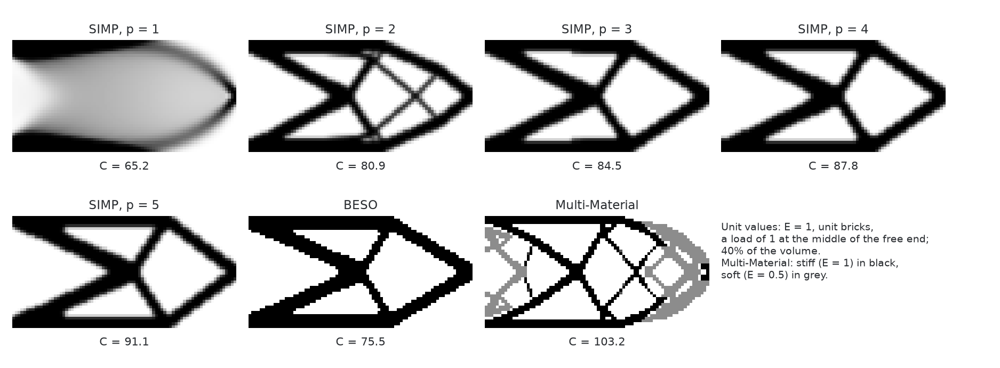
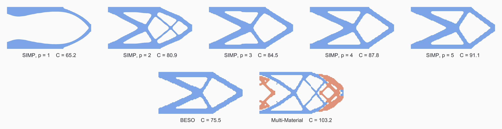

# 🎚️ Cantilever, Penalty 1 to 5

<figure><figcaption></figcaption></figure>

[cantilever-penalties](cantilever-penalties.gh)

The problem papers on new methods of topology optimisation compare themselves on: a cantilever
twice as long as it is high, held along one end and loaded at the middle of the other. Their tables
run SIMP at penalties 1 to 5 beside their own method; this example runs the same problem with all
three methods of [Topology Optimisation](../../docs/basics/optimisation/topology-optimisation.md):

- **SIMP** at every penalty from 1 to 5, five components side by side;
- **BESO**, every brick solid or void;
- **Multi-Material**, with a stiff material and a soft one.

It is in unit values, as the papers have it: Young's modulus 1, Poisson's ratio 0.3, bricks 1 a
side, and a load of 1. The domain is 80 x 40 bricks, one deep, and every method keeps 40% of it.

::: info
Without a license, Topology Optimisation runs on models of up to 500 elements. This one has 3 200,
so it needs one.
:::

## The model

| Group | What it does |
| --- | --- |
| 1 - The domain | The side of the cantilever meshed in unit squares with **Mesh Plane**, a copy moved 1 along y, and [SSP Bricks](../../docs/basics/elements/brick.md) between the two by [Mesh Series to Brick](../../docs/basics/utility/mesh-series-to-brick.md). |
| 2 - Unit values | The material, E = 1 and Poisson's ratio 0.3; and a softer one, E = 0.5, for Multi-Material. |
| 3 - Held and loaded | A [Support](../../docs/basics/elements/support.md) on every node of the left end; a [Point Load](../../docs/basics/loads/point-load.md) of 1 down at the middle of the free end, half on each face. |
| 4 - Assemble Model | [Assemble](../../docs/basics/assemble.md). [Model View](../../docs/basics/visualisation/model-view.md) is disabled: enable it to see the supports and the load. |
| 5 - Three ways | Five Topology Optimisation components on SIMP, **Penalty** 1 to 5 in their Settings menu, one **Run SIMP** for all five; one on BESO with **Run BESO**; one on Multi-Material with **Run Multi-Material**, 60% of the volume in the stiff material and 40% in the soft. **VolumeFraction** and **Iterations** are shared. A panel beside each shows its compliance. |
| 6 - Side by side | SIMP's five designs in a column on the left, p = 1 at the top; BESO's on the right; Multi-Material draws its own, in its materials' colours, where the model is. Each is named with a **Text Tag 3D**. |

## Running it

1. Set **Run SIMP**, **Run BESO** and **Run Multi-Material** to `true`, together or one after the
   other. Each component runs on its own thread, and its design draws in group 6 as it goes.
   Run together on an M2 Pro, all seven finish in about a minute.
2. **Compliance**, the work of the load, is in unit values, as the papers give it.

<figure><figcaption>
The densities, black solid and white void, as the papers draw them; Multi-Material's soft material in grey.
</figcaption></figure>

## What it shows

<figure><figcaption>
The designs from the front, as Grasshopper draws them.
</figcaption></figure>

| Method | Iterations | Compliance | Grey elements |
| --- | --- | --- | --- |
| SIMP, p = 1 | 28 | 65.2 | 72% |
| SIMP, p = 2 | 184 | 80.9 | 26% |
| SIMP, p = 3 | 216 | 84.5 | 20% |
| SIMP, p = 4 | 164 | 87.8 | 20% |
| SIMP, p = 5 | 120 | 91.1 | 20% |
| BESO | 74 | 75.5 | none |
| Multi-Material | 260 | 103.2 | |

Grey elements are those with a density between 0.1 and 0.9.

At penalty 1 most of the densities stay grey. The stiffness of an element is then in proportion to
its density, so spreading the material thinly costs nothing: the lowest compliance of the table, and
no design at all - drawn where the density passes 0.5, it is only the two chords and the arc round
the load. From penalty 2 on, a grey element is stiff for less than the volume it takes, and members
form: at 2 a V from the support and crossed diagonals near the load; from 3 on, the V and a diamond
to the load. Each step up makes the design a little softer, the price of pushing it to solid and
void; past 3 the grey stays at the fifth of the elements round the edges of the members.

BESO's design is solid or void at every iteration, and the stiffest of the designs that are one or
the other, for the same volume: SIMP's grey band round each member takes volume, and at penalty 3 a
density of one half gives an eighth of the stiffness. Multi-Material is the softest, as two fifths of
its volume is the soft material, half as stiff: the stiff one makes the chords and the middle of the
cantilever, and the soft one a lattice by the support and an arc round the load.

## Good to know

- The papers' compliances are not these numbers: they depend on the mesh, the volume and the
  filter, and the papers solve in two dimensions where this is one brick deep. The shapes are what
  to compare.
- **FilterRadius** is 1.5 bricks for SIMP and Multi-Material, top3d's; BESO uses its own default,
  two bricks.
- The same problem runs without Grasshopper in the Alpaca4d repository's tests, `./run.sh bench
  classic cantilever` in `Alpaca4d.Test/TopologyMethods`, and gives the same iterations and
  compliances.
