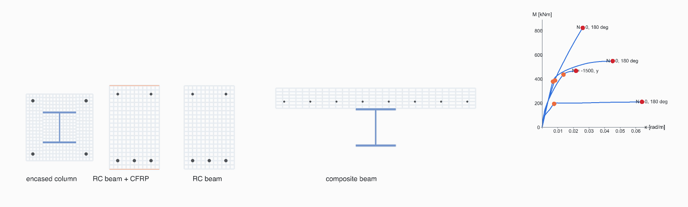

# 📈 Composite Sections

<figure><figcaption></figcaption></figure>

[composite-sections](composite-sections.gh)

A fibre section can hold any mix of materials, each fibre with its own law. This example draws four:

1. a **composite beam**, a HEA 240 under a 1200 × 120 mm slab;
2. a **concrete-encased column**, a HEA 200 in a 400 × 400 mm section;
3. a **concrete beam with a carbon fibre laminate** along its bottom and its top;
4. the same beam **without the laminate**.

Each is a [Fiber Section](../../docs/basics/moment-curvature/fiber-section.md) of [Patch](../../docs/basics/moment-curvature/patch.md)es and
[Fiber Point](../../docs/basics/moment-curvature/fiber-point.md)s, with the laws of
[Concrete](../../docs/basics/moment-curvature/concrete.md), [Steel](../../docs/basics/moment-curvature/steel.md) and
[Other Laws](../../docs/basics/moment-curvature/other-laws.md). A [Moment Curvature](../../docs/basics/moment-curvature/moment-curvature.md)
and an [Interaction Domain](../../docs/basics/moment-curvature/interaction-domain.md) follow each, and one diagram draws the curves.

## The model

| Group | What it does |
| --- | --- |
| 1 - Laws | Concrete02 for the slab and the beams, Concrete04 for the encasing, Steel02 for the HEA, ReinforcingSteel for the bars, and Other Laws' **Elastic** for the laminate: linear, E 160 GPa, rupturing at a strain of 1.7 %. |
| 2 - The sections | Each rolled section as three rectangles, the slab and the encasing as rectangles around it, the laminate as a thin patch 3 mm thick on each face. Full interaction between the materials, as fibres imply: there is no slip. |
| 3 - Moment Curvature | The beams bent with **Direction** 180 so that the slab is in compression, and so that the bottom bars are in tension, under no axial force; the column under 1500 kN of compression. The domain of each. |
| 4 - Results | One diagram of the four curves, an N–M cut of each domain, and panels with the ultimate moment, ductility and what failed first. |

## What it shows

| Section | My kNm | Mu kNm | Ductility | Fails when |
| --- | --- | --- | --- | --- |
| Composite beam | 379 | 548 | 6.6 | the slab's concrete crushes |
| Encased column | 435 | 467 | 1.6 | the encasing's concrete crushes |
| RC beam with CFRP | 388 | 824 | 3.2 | the concrete crushes |
| RC beam | 195 | 211 | 8.5 | the concrete crushes |

* **The laminate** nearly quadruples the beam's ultimate moment, 211 to 824 kNm, and doubles its moment at first yield,
  at the price of ductility: from 8.5 to 3.2. The laminate does not rupture: it is stiff and strong enough that the
  concrete in compression gives out first, at a curvature of 0.026 against 0.064 for the beam alone.
* **The slab** puts the compression where concrete is: the composite beam reaches 548 kNm with a ductility of 6.6, and
  fails when the slab's top fibre crushes.
* **The encased column** under 1500 kN: 467 kNm, with a ductility of only 1.6, the concrete governing as it does in
  every compressed section. Its domain reaches 8198 kN in compression and 3007 kN in tension.

::: info
The sections share their coordinates, so only the first one draws in Rhino; the diagram and the N–M cuts are all
there. The picture above places them side by side for show.
:::

## Things to try

* **Change the laminate.** Its thickness, 3 mm, is in the patch's rectangle; its rupture strain is **RuptureTension** in
  Other Laws' Elastic. A thinner or weaker one ruptures first, and the section ends there, with a ductility of its own.
* **Take the laminate off one face.** Delete the top patch: the section is no longer symmetric in its stiffness.
* **Widen the slab.** `rectangle(... -0.6, 0.115, 0.6, 0.235 ...)` in `FibreSections.py`.
* **Add axial force.** **Axial** on the beams, from 0 to −500 kN.
