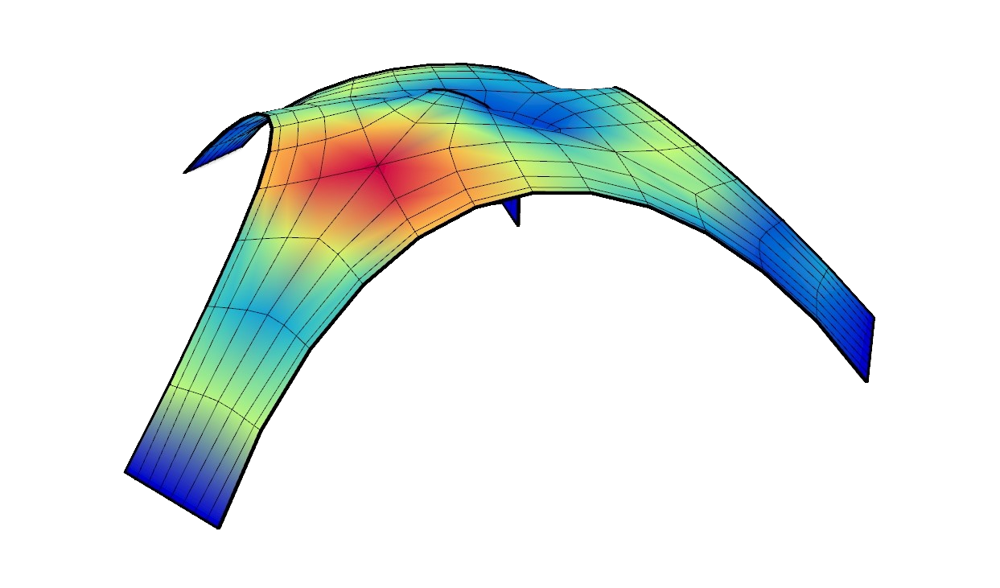

# 🐚 Compressed Shell

The grasshopper script shows how to perform a form-finding in order to find a shell that works purely in compression with the use of Kangaroo2 and to analyse the structural behaviour with the use of **Alpaca4d**.

<figure><figcaption></figcaption></figure>

[compressed-shell](compressed-shell.gh)
