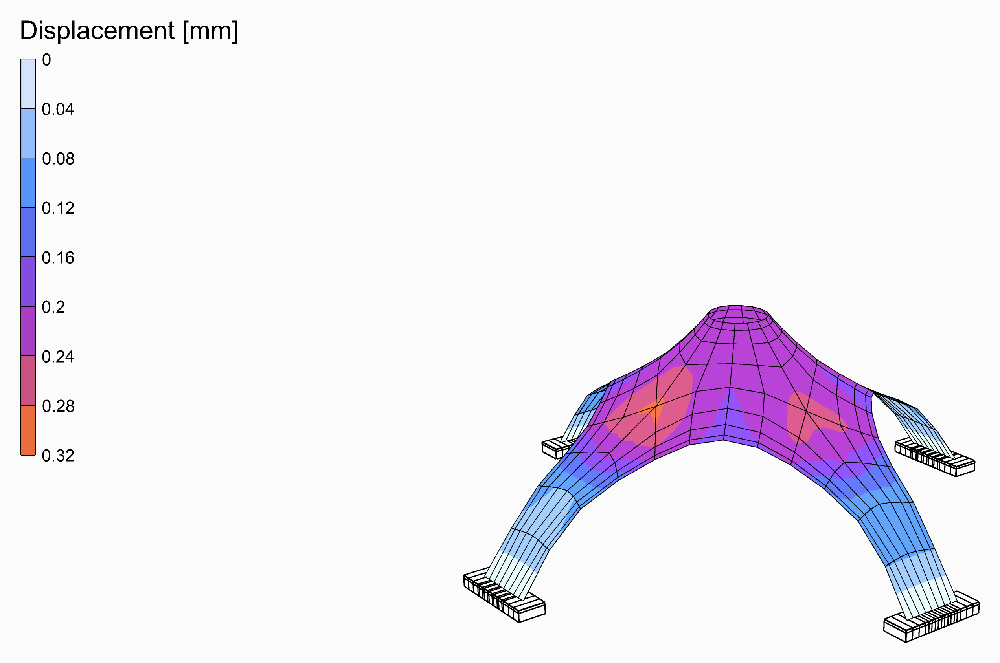
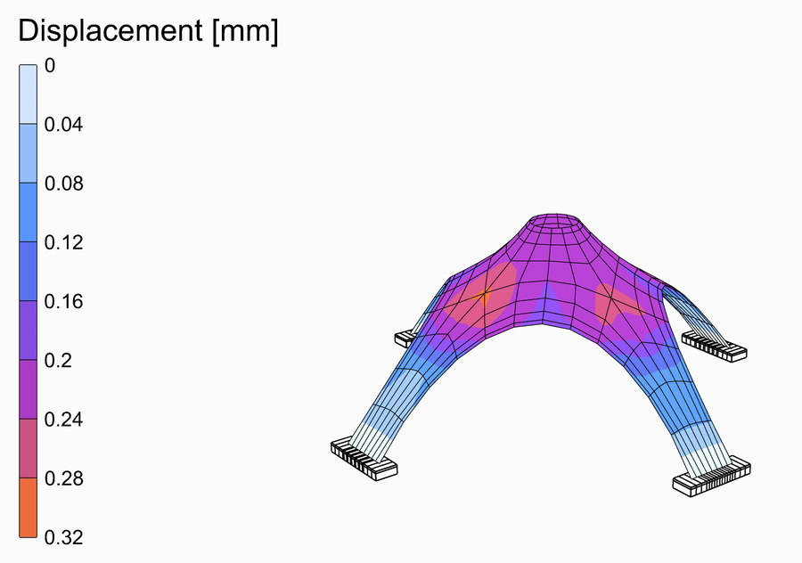
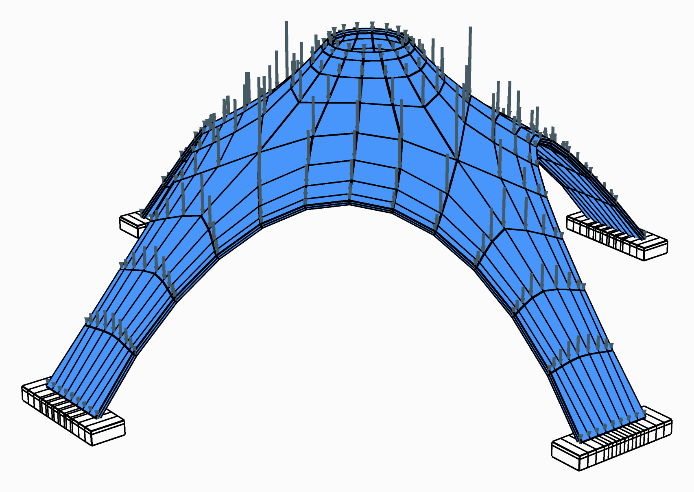

# 🐚 Compressed Shell

<figure><figcaption></figcaption></figure>

[compressed-shell](compressed-shell.gh)

A shell of four legs, 20 m from the end of one to the end of the one opposite, its crown 8 m up. Its form is not drawn but found: Kangaroo pushes a net up against strings that pull its edges in, held at the ends of its legs, until the two balance. A net that holds an upward load in tension alone, turned over, carries a load like its own weight in compression alone, as a hanging chain turned over makes an arch. Alpaca4d then makes it a concrete shell and checks that it does.

<figure><figcaption>
The deformed shape, from rest to its full size and back, drawn 2000 times larger than it is.
</figcaption></figure>

## The model

| Group | What it does |
| --- | --- |
| 1 - Geometry | **Span**, and a Python component that draws the shell's plan from it: a coarse net of 16 quads, a cross of four legs, and the straight edge at the end of each leg, where it will stand. |
| 2 - Form finding | Kangaroo's Refine splits each quad into 16. Its edges become strings that pull in, each a Length(Line) goal shortening towards nothing with a strength of **Edge strength**; every node is pushed up by **Lift** with a Load goal; the nodes on the leg ends are held with Anchor; Show hands the net back. The Zombie Solver runs them to a balance, and List Item takes the net, the first thing out. **Lift** sets how high it rises: 0.6 raises the crown 8 m. |
| 3 - Shell | The form in concrete, **Thickness** thick (150 mm): [nD](../../docs/basics/materials/ND.md) concrete, a [Plate Fiber Section](../../docs/basics/sections/plate-fiber.md), as [ASD Shell](../../docs/basics/elements/shell.md)s, 256 of them. |
| 4 - Supports | Built in at every node on the ends of its legs, where the net was held. |
| 5 - Load | Its own weight, 63.5 t, with [Gravity Load](../../docs/basics/loads/gravity.md) in a [Load Pattern](../../docs/basics/loads/load-pattern.md). |
| 6 - Analysis | [Assemble](../../docs/basics/assemble.md) and [Run Analysis](../../docs/basics/analysis/run-analysis.md). |
| 7 - Results | A [Model View](../../docs/basics/visualisation/model-view.md) of the analysed shell, deformed 2000 times and coloured by its displacement in iso-surfaces - eight bands of 0.04 mm - with its edges and supports drawn and a [Legend](../../docs/basics/visualisation/legend.md); and one of the shell with its supports and its own weight. |

<figure><figcaption>
The supports and the load, as <strong>Model View</strong> draws them: its own weight, as OpenSees takes it.
</figcaption></figure>

## What it shows

Under its own 63.5 t the shell moves at most 0.29 mm, on the shell between its legs, just below the crown. The concrete works almost entirely in compression, in its own plane, and so hardly bends: 150 mm of it spans 20 m. The iso-surfaces show it in bands of equal movement, still at the feet and growing up the legs.

## Try

- **Lift** lower, for a flatter shell: the same weight, less rise, and so more thrust and more movement.
- **Edge strength** changes how the strings share the load: a weaker pull rises higher for the same Lift.
- **Thickness**: a shell that works in compression barely needs it. Halve it and see how little changes.
- The definition needs Kangaroo2, which Rhino 7 and 8 come with.
