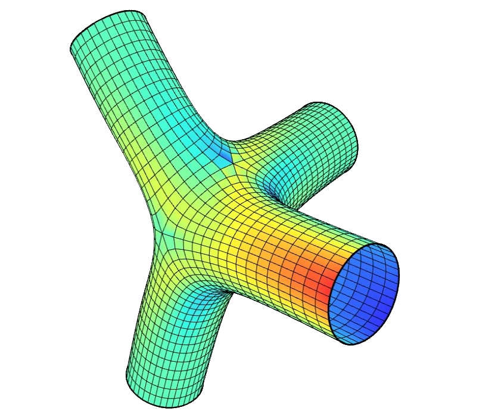

# 🔒 Connection Design

<figure><figcaption></figcaption></figure>

[connection-design](connection-design.gh)

This example focuses on the detailed modelling of a steel connection.  
Use it to study how local refinement of elements, materials and boundary conditions affects forces and deformations in the connection region, and as a template for building your own connection‑design workflows in Alpaca4d.
