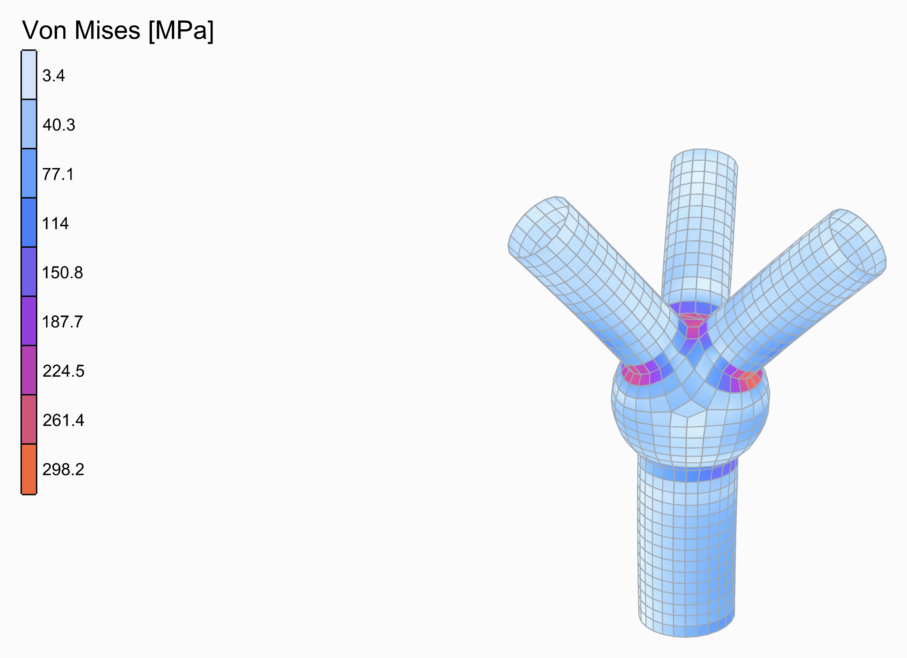
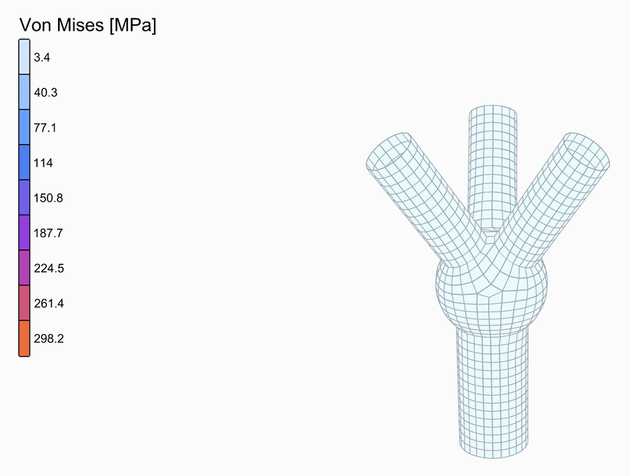
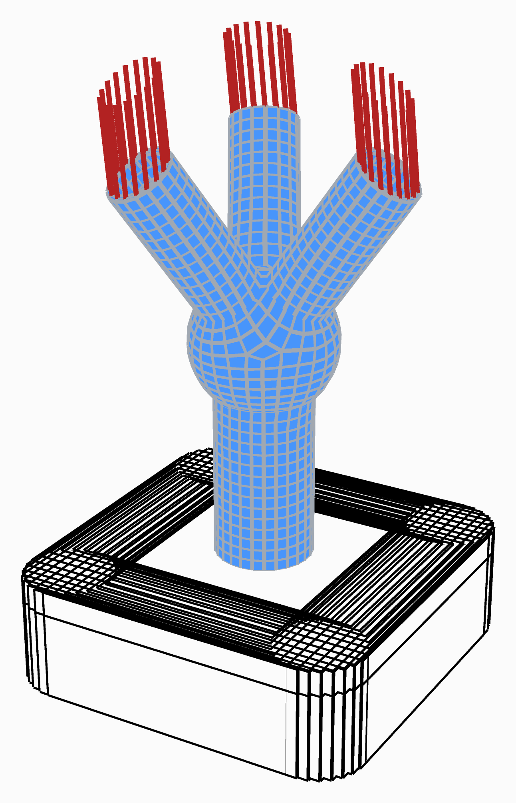

# 🔒 Connection Design

<figure><figcaption></figcaption></figure>

[connection-design](connection-design.gh)

The node of a steel tree column, where a trunk splits into branches. A trunk tube 323.9 mm across meets a steel sphere 500 mm across, and three branches 219.1 mm across leave it, each leaning 35° out. A Python component joins the sphere and the tubes into one solid and cuts away the tubes' flat ends. What's left is the steel's surface, with the welds kept as edges. That surface is meshed in quads and modelled as shells 25 mm thick. Use it as a template for a detailed connection of your own: a surface, a mesher, shells, and the nodes where it's held and loaded found by position.

<figure><figcaption>
The deformed shape, from rest to 50 times its size and back, the camera turning.
</figcaption></figure>

## The model

| Group | What it does |
| --- | --- |
| 1 - Geometry | The sliders: trunk and branch diameters and lengths, the branches' lean and count, the sphere. A Python component joins the sphere and the tubes, opens the tube ends, and gives the plane at the end of each tube. |
| 2 - Steel | **Mesh Brep** meshes the surface in quads about 40 mm across, keeping the welds as edges. S355 is an [nD](../../docs/basics/materials/ND.md) material in a [Plate Fiber Section](../../docs/basics/sections/plate-fiber.md) 25 mm thick, on [ASD Shells](../../docs/basics/elements/shell.md). |
| 3 - Supports | Every node round the trunk's end built in, with a [Support](../../docs/basics/elements/support.md). A second Python component finds them, and a panel counts them: 26 held. |
| 4 - Loads | Each branch's load, shared over the nodes round its end (52 in all) as [Point Loads](../../docs/basics/loads/point-load.md), in one [Load Pattern](../../docs/basics/loads/load-pattern.md). |
| 5 - Analysis | [Assemble](../../docs/basics/assemble.md) and [Run Analysis](../../docs/basics/analysis/run-analysis.md). |
| 6 - Results | A [Model View](../../docs/basics/visualisation/model-view.md) of the node deformed, coloured by Von Mises stress at the shells' top face, with a [Legend](../../docs/basics/visualisation/legend.md). A second one draws the supports and the loads. |

## The loads

Each branch carries the roof it holds up: 250 kN down and 25 kN sideways along +x, shared evenly over the nodes round its end. The trunk carries the three branches' loads, 750 kN, down to its built-in end.

<figure><figcaption>
The supports and the loads, as <strong>Model View</strong> draws them.
</figcaption></figure>

## What it shows

The stress gathers where each branch meets the sphere, on the side facing the other branches, and peaks at 298 MPa, under S355's 355 MPa. Most of the tubes stay under 100 MPa. For the trunk, away from the sphere, a hand check gives 750 kN over its 235 cm²: 32 MPa of compression, plus the bending from the sideways loads.

The peak sits at a sharp corner, where a tube's shells meet the sphere's. Refine the mesh and it climbs, because a shell model can't settle a stress at a corner. A design check reads the stress some distance from the weld, as the hot-spot method does. Try a mesh size of 0.02 m to see that. Try a wall of 16 mm to see the peak pass the steel's yield, or a branch lean of 50°.
