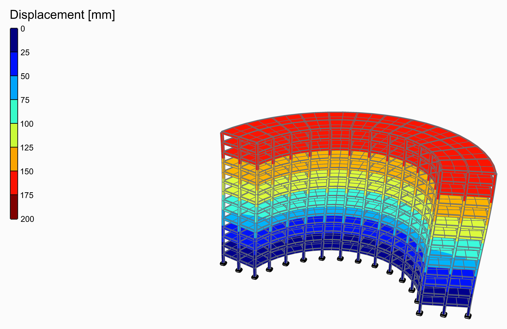
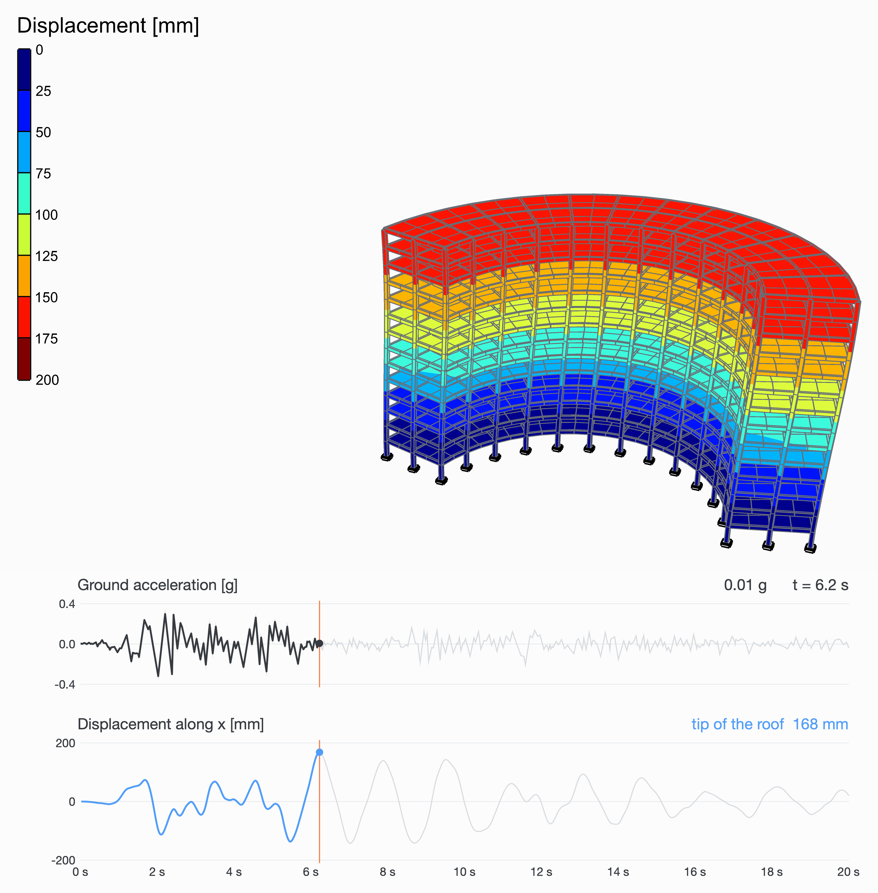

# 🌙 Crescent in an Earthquake

<figure><figcaption></figcaption></figure>

[crescent-earthquake](crescent-earthquake.gh)

Fourteen storeys of a concrete frame curved in plan, a block twelve bays long that follows 150° of a ring 30 m from its middle, two bays of 7.5 m deep, with a 220 mm slab at every floor. The El Centro earthquake shakes the ground along x, across its middle.

<figure><video src="crescent-earthquake-shaking.mp4" autoplay loop muted playsinline></video><figcaption>
The first 20 s of El Centro, as they happened, the movement drawn larger than it is. Beside it, the ground's acceleration and the movement along x of a tip of the roof, over the same 20 s.
</figcaption></figure>

## The model

| Group | What it does |
| --- | --- |
| 1 - Geometry | The sliders - **Bays along it**, **Bays deep**, **Bay**, **Inner radius**, **Sweep**, **Storeys** and **Storey height** - and a Python component that draws the frame from them: its grid bent round the ring, the beams cut twice a bay and following its curve, a slab mesh at every floor, the columns' feet, and a tip of the roof the charts follow. |
| 2 - Members | Concrete C30/37 from [Material Library](../../docs/basics/materials/MaterialDatabase.md); columns 0.7 × 0.7 m and beams 0.4 × 0.7 m, [RectangleCS](../../docs/basics/sections/rectangular.md) sections, as [ForceBeamColumn](../../docs/basics/elements/force-beam-column.md); 220 mm of concrete, a [Plate Fiber Section](../../docs/basics/sections/plate-fiber.md), as [ASD Shell](../../docs/basics/elements/shell.md)s. |
| 3 - Supports | Every column built in at the ground, with a [Support](../../docs/basics/elements/support.md). |
| 4 - Ground motion | The El Centro record from a Python component, its first **Duration** seconds times **Ground motion scale**; a Path Time Series of it; a Load Pattern of the UniformExcitation type, along the direction it shakes. |
| 5 - Transient analysis | [Assemble](../../docs/basics/assemble.md), with an [MPCO Recorder](../../docs/basics/mpco-recorder.md) of the displacements alone, which is all the view reads; [Damping](../../docs/basics/analysis/damping.md), Rayleigh's from **Damping** and its two frequencies; the Newmark [Integrator](../../docs/basics/analysis/integrator.md); [Analysis Step](../../docs/basics/analysis/analysis-step.md), a step a sample of the record; [Analysis Settings](../../docs/basics/analysis/analysis-settings.md) for a transient analysis with the Linear algorithm, one solve a step, as an elastic model needs; and Run Analysis. |
| 6 - Results | A [Model View](../../docs/basics/visualisation/model-view.md) of the analysed model at **Step**, deformed 25 times, its elements' edges and its supports drawn, its colours in iso-surfaces on the slabs over 0 to 200 mm for every step alike, with a [Legend](../../docs/basics/visualisation/legend.md). Drag **Step** to go through the record. |

Its 3 600 elements are past the free limit of 50: it needs a licence. The analysis takes about three minutes on a laptop; then each step takes a second or a few to draw as you drag **Step**.

## The ground motion

El Centro, 18 May 1940, the north-south component: 0.32 g at its peak, 2 s in, the first 20 s of it. A [Path Time Series](../../docs/basics/time-history/path.md) of its accelerations shakes the ground under the whole structure through a [Load Pattern](../../docs/basics/loads/load-pattern.md)'s UniformExcitation type, and [Run Analysis](../../docs/basics/analysis/run-analysis.md) follows it step by step, 0.02 s at a time, a transient analysis with Newmark's average acceleration. Damping is Rayleigh's, 5% of critical at two frequencies that bracket the modes that matter. **Ground motion scale** makes the record stronger or weaker, **Duration** takes more or less of it.

## What it shows

The block sways along x almost as one, its floors tied together by their slabs: the tips of its roof move 168 mm at the most, 6.2 s in, and the middle of its outer face 3% less. Its first three periods come close together, at 1.6 s, 1.6 s and 1.5 s.

<figure><figcaption>
The moment it moves the most, and the record up to then.
</figcaption></figure>

## Try

- **Sweep** at 270: nearly a ring.
- **Bays deep** at 3: a deeper block, stiffer across.
- Shake it along y, across the other way: type Y into the ground motion's Load Pattern.
