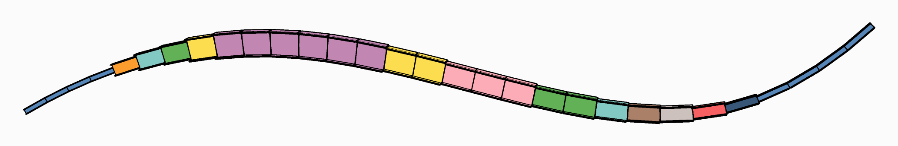

# 〰️ Curved Beam

<figure><figcaption></figcaption></figure>

[curved-beam](curved-beam.gh)

A 12 m steel beam curves up and down in a vertical plane. It is built in at its start, held up at
two more points along its first third, and free beyond them, where a 50 kN load hangs near the far
end: a continuous beam that ends in a long cantilever, under its own weight too. Two
[Section Optimisers](../../docs/basics/optimisation/section-optimiser.md) size it from the same
model: one element by element, one as a single section for the whole beam.

## The model

| Group | What it does |
| --- | --- |
| 1 - The beam | **Length**, **Rise**, **Number of elements**, the starting section and grade, where the second and third supports are, and where the load is and what it is worth: the things to try. |
| 2 - Geometry | A curve through five points, divided into the elements. |
| 3 - Member | IPE300 in S355 to begin with, from [Material Library Elastic](../../docs/basics/materials/MaterialDatabase.md) and [Steel Section Library](../../docs/basics/sections/library.md), every element with the ElementId `Beam`. |
| 4 - Supports and loads | Built in at the start, held up at two more nodes; the point load and the self-weight in one [Load Pattern](../../docs/basics/loads/load-pattern.md). |
| 5 - Model | [Assemble](../../docs/basics/assemble.md). |
| 6 - Each element on its own, within its family | A Section Optimiser with no design group: each element takes the smallest IPE that works for it. **MaxUtilisation** and the distance between lateral restraints are sliders. [Model View](../../docs/basics/visualisation/model-view.md) draws the result, a colour for each section. |
| 7 - One section for the whole beam | A [Design Group](../../docs/basics/optimisation/design-group.md) over every element, from a list of IPEs in the order to try them: the whole beam takes the first that every element can have. |

## What it shows

Sized element by element, the beam grows over the supports, where the moments are largest, and
thins out towards both ends. As one section, it takes the one its worst element needs, and is
heavier: compare the two **Mass** panels. Move the supports or the load and watch both answers
change.
