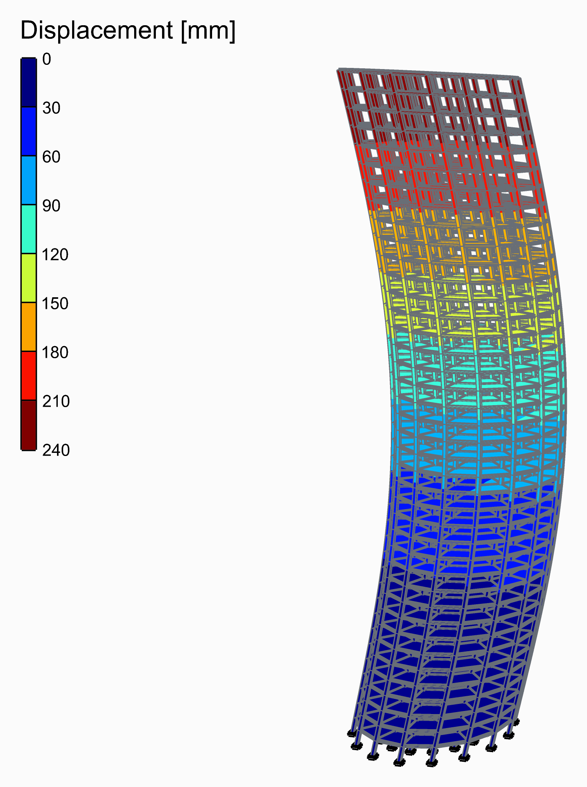
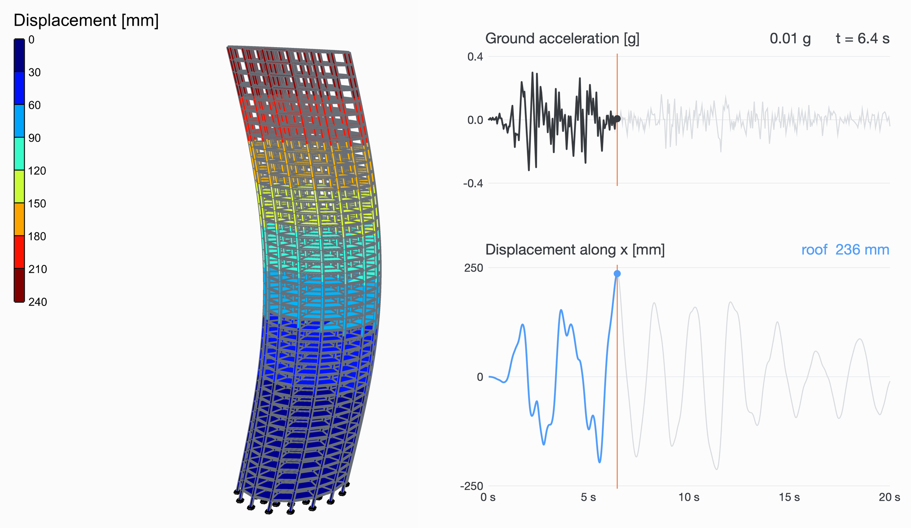

# 🏹 Curving Tower in an Earthquake

<figure><figcaption></figcaption></figure>

[curving-tower-earthquake](curving-tower-earthquake.gh)

Forty storeys of a round steel tower, 36 m across, whose floors move out along x and back as it rises: 12 m out half way up, and back over its foot at the roof. Three rings of sixteen columns stand round an open core, with ring and radial beams and a 200 mm slab at every floor. The El Centro earthquake shakes the ground along x, the way it bows.

<figure><video src="curving-tower-earthquake-shaking.mp4" autoplay loop muted playsinline></video><figcaption>
The first 20 s of El Centro, as they happened, the movement drawn larger than it is. Beside it, the ground's acceleration and the movement along x of the edge of the roof, over the same 20 s.
</figcaption></figure>

## The model

| Group | What it does |
| --- | --- |
| 1 - Geometry | The sliders - **Columns round it**, **Radius**, **Core radius**, **Storeys**, **Storey height** and **Bend** - and a Python component that draws the frame from them: three rings of columns, from the core's to the outside's, each floor moved along x by **Bend** times the sine of its height over the tower's times π, ring and radial beams, a slab mesh round the core at every floor, the columns' feet, and the edge of the roof the charts follow. |
| 2 - Members | S355 from [Material Library](../../docs/basics/materials/MaterialDatabase.md); box columns 700 × 40 mm, a [Rectangle Hollow CS](../../docs/basics/sections/rectangular-hollow.md), and IPE600 beams from [Steel Section Library](../../docs/basics/sections/library.md), as [ForceBeamColumn](../../docs/basics/elements/force-beam-column.md); 200 mm of concrete, a [Plate Fiber Section](../../docs/basics/sections/plate-fiber.md), as [ASD Shell](../../docs/basics/elements/shell.md)s. |
| 3 - Supports | Every column built in at the ground, with a [Support](../../docs/basics/elements/support.md). |
| 4 - Ground motion | The El Centro record from a Python component, its first **Duration** seconds times **Ground motion scale**; a Path Time Series of it; a Load Pattern of the UniformExcitation type, along the direction it shakes. |
| 5 - Transient analysis | [Assemble](../../docs/basics/assemble.md), with an [MPCO Recorder](../../docs/basics/mpco-recorder.md) of the displacements alone, which is all the view reads; [Damping](../../docs/basics/analysis/damping.md), Rayleigh's from **Damping** and its two frequencies; the Newmark [Integrator](../../docs/basics/analysis/integrator.md); [Analysis Step](../../docs/basics/analysis/analysis-step.md), a step a sample of the record; [Analysis Settings](../../docs/basics/analysis/analysis-settings.md) for a transient analysis with the Linear algorithm, one solve a step, as an elastic model needs; and Run Analysis. |
| 6 - Results | A [Model View](../../docs/basics/visualisation/model-view.md) of the analysed model at **Step**, deformed 25 times, its elements' edges and its supports drawn, its colours in iso-surfaces on the slabs over 0 to 240 mm for every step alike, with a [Legend](../../docs/basics/visualisation/legend.md). Drag **Step** to go through the record. |

Its 6 400 elements are past the free limit of 50: it needs a licence. The analysis takes about three minutes on a laptop; then each step takes a second or a few to draw as you drag **Step**.

## The ground motion

El Centro, 18 May 1940, the north-south component: 0.32 g at its peak, 2 s in, the first 20 s of it. A [Path Time Series](../../docs/basics/time-history/path.md) of its accelerations shakes the ground under the whole structure through a [Load Pattern](../../docs/basics/loads/load-pattern.md)'s UniformExcitation type, and [Run Analysis](../../docs/basics/analysis/run-analysis.md) follows it step by step, 0.02 s at a time, a transient analysis with Newmark's average acceleration. Damping is Rayleigh's, 5% of critical at two frequencies that bracket the modes that matter. **Ground motion scale** makes the record stronger or weaker, **Duration** takes more or less of it.

## What it shows

The tower sways along x, its roof 236 mm off at the most, 6.4 s in. Bowed, it is a little softer the way it bows - its first period is 2.2 s that way, and 2.0 s across, against 1.9 s both ways with **Bend** at 0: its columns lean, first out and then back in, and lean columns stiffen a frame less than straight ones.

<figure><figcaption>
The moment it moves the most, and the record up to then.
</figcaption></figure>

## Try

- **Bend** at 0 for a straight tower, at 25 for one that bows out twice as far.
- **Columns round it** at 24: more columns, a stiffer tower.
- **Core radius** larger: a bigger hole, and less floor.
