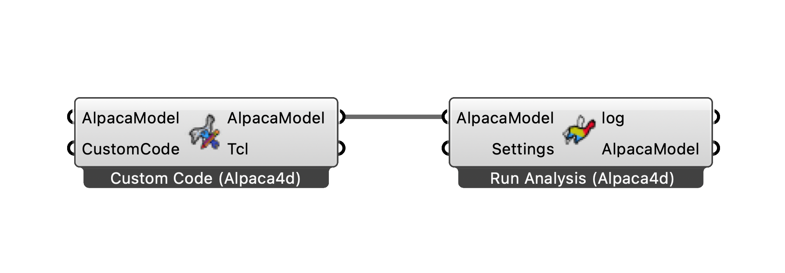

# 💐 Custom Script

The following workflow allows to run any OpenSees tcl script within Grasshopper.

<figure><figcaption></figcaption></figure>

[custom-code](custom-script.gh)

You can use this setup as a starting point whenever you need an OpenSees feature that is not yet wrapped by Alpaca4d components.  
Simply replace the example `.tcl` content with your own script and keep the same I/O structure to run and post‑process results directly in Grasshopper.
