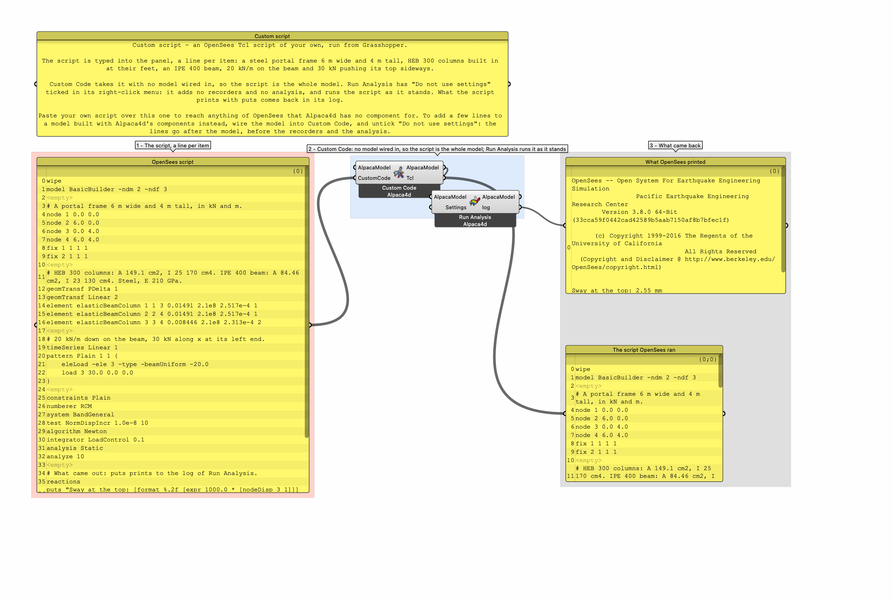

# 💐 Custom Script

<figure><figcaption></figcaption></figure>

[custom-script](custom-script.gh)

Run any OpenSees Tcl script from Grasshopper, and get back what it prints. Here the script is a steel portal frame, 6 m wide and 4 m tall. HEB 300 columns are built in at their feet, an IPE 400 beam spans between them, and the frame carries 20 kN/m on the beam and 30 kN pushing its top sideways. [Custom Code](../../docs/basics/utility/custom-code.md) takes the script with no model wired in, so the script is the whole model. [Run Analysis](../../docs/basics/analysis/run-analysis.md) has **Do not use settings** ticked in its right-click menu, so it adds no recorders and no analysis of its own and runs the script as it stands. What the script prints with `puts` comes back in its **log**.

Use it to reach anything of OpenSees that Alpaca4d has no component for. Paste your own script over this one.

## The definition

| Group | What it does |
| --- | --- |
| 1 - The script, a line per item | A panel holding the script, one line per item (its Multiline Data is off). The model, the loads, the analysis, and `puts` lines for what to read back. |
| 2 - Custom Code | **Custom Code** with no model wired in, its lines the whole deck. **Run Analysis**, set not to use its settings, runs it. |
| 3 - What came back | The log of Run Analysis, with the script's `puts` lines at its end, and the deck as Custom Code wrote it. |

## What it shows

OpenSees prints a sway of 2.55 mm at the top and a base shear of 30.0 kN. It gives vertical reactions of 52.1 and 67.9 kN and moments at the feet of 14.2 and 58.8 kNm. A stiffness-matrix solution by hand of the same frame, linear, gives 2.54 mm, 52.2 and 67.8 kN, and 14.1 and 58.8 kNm. The small difference is the columns' P-Delta transformation in the script.

## Adding lines to a model of Alpaca4d's

To add a few lines to a model built with Alpaca4d's components (a material, an element or a recorder it has no component for), wire the model into Custom Code and untick **Do not use settings**. Your lines then go after the model and before the recorders and the analysis that Run Analysis adds. The tags are Alpaca4d's, so pick yours well above the ones in the deck: read it in Custom Code's **Tcl** output.
