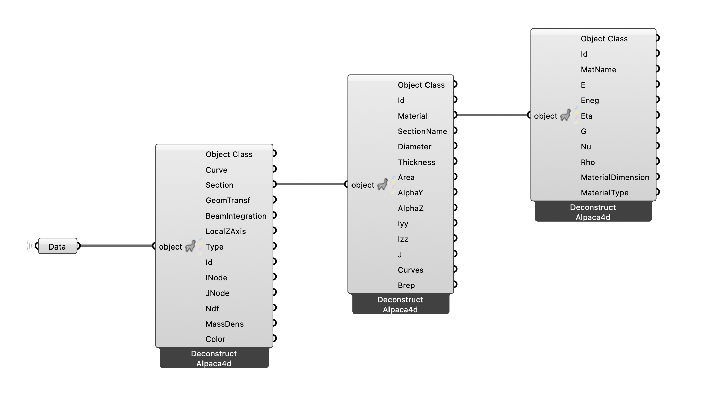

# 🏗️ Deconstruct Anything

<figure><figcaption></figcaption></figure>

[deconstruct-anything](deconstruct-anything.gh)

[Deconstruct](../../docs/basics/utility/deconstruct.md) takes any object of Alpaca4d (an element, a section, a material, a load, a model or a result) and gives each of its fields and properties an output of its own, named after it. The first output, **Object Class**, says what the object is.

Here a cantilever is opened up piece by piece: an IPE 300 of S355, 4 m long, built in and loaded 10 kN at its tip. Each Deconstruct is fed from the one before: the beam, then the section it carries, then the section's material. Then the point load, the assembled model, and every node in it. One Deconstruct takes a list of the same kind of object too.

## The definition

| Group | What it does |
| --- | --- |
| 1 - A cantilever | Two points and a line; S355 from the [Material Library](../../docs/basics/materials/MaterialDatabase.md); an IPE 300 from the [Steel Section Library](../../docs/basics/sections/library.md); a [Force Beam Column](../../docs/basics/elements/force-beam-column.md); a rigid [Support](../../docs/basics/elements/support.md) at its start. |
| 2 - The load and the model | A [Point Load](../../docs/basics/loads/point-load.md) of 10 kN down at the tip, its [Load Pattern](../../docs/basics/loads/load-pattern.md), and [Assemble](../../docs/basics/assemble.md). |
| 3 - The beam opened | The beam's Deconstruct, its **Section** output into a second, and that one's **Material** into a third. Panels show the section's area and second moments, and the material's E and density. |
| 4 - The load opened | The point load's position, force, moment and pattern. |
| 5 - The model opened | The assembled model's Deconstruct, then its **Nodes** into one more: each node's position, tag and degrees of freedom. |

## What it shows

The IPE 300's area is 51.9 cm², the section as drawn, without the catalogue's root fillets (53.8 cm² with them). Its second moments are Iyy = 6.03·10⁻⁶ m⁴ (603 cm⁴) and Izz = 8.0·10⁻⁵ m⁴ (8 000 cm⁴). On a horizontal beam Alpaca4d's local y points up, so Izz is the strong axis and Mz the moment that bends it. The material gives E = 2.1·10⁸ kN/m² and a density of 7 850 kg/m³. The model has two nodes, tags 1 and 2, at (0, 0, 0) and (4, 0, 0), each with 6 degrees of freedom.

Use it to check what reached a component, to read a number Alpaca4d keeps but shows nowhere else, or to pick objects out for filters and views of your own. Plug something else into any Deconstruct, and its outputs change to that object's.
