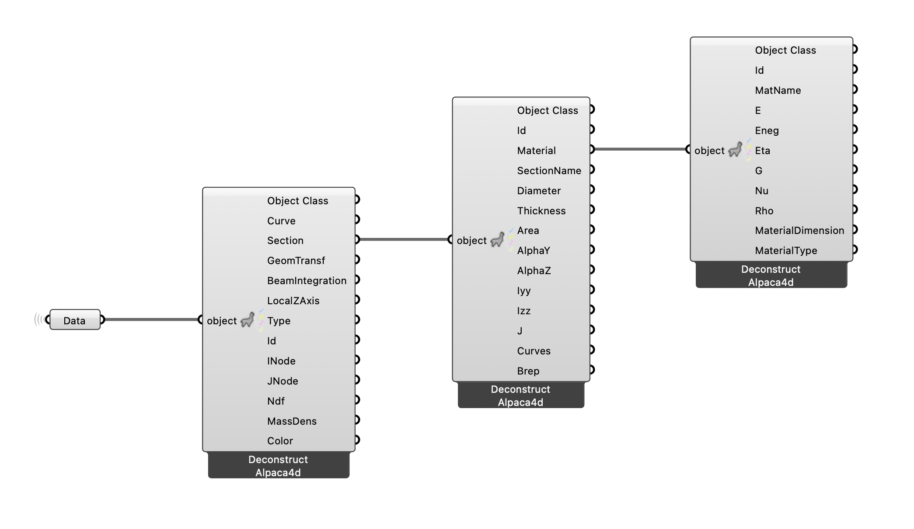

# 🏗️ Deconstruct Anything

<figure><figcaption></figcaption></figure>

[deconstruct-anything](deconstruct-anything.gh)

This example demonstrates how to use the **Deconstruct (Alpaca4d)** utility to inspect complex Alpaca4d objects.  
Open the script, plug different objects into the component, and see how fields and properties are exposed so you can build your own custom filters and visualisations.
