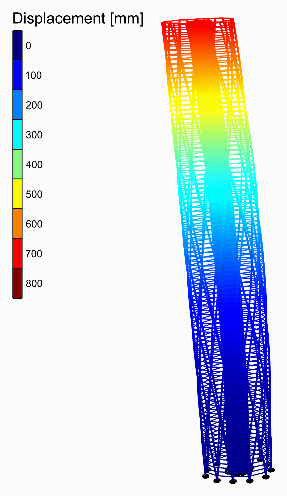
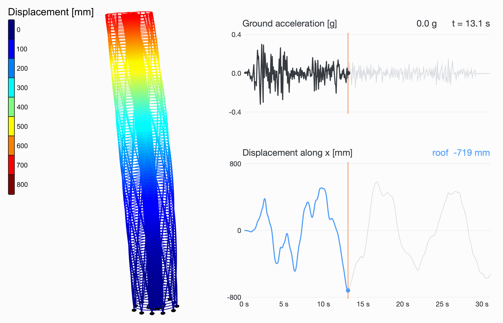

# 💠 Diagrid, after the Guangzhou IFC

<figure><figcaption></figcaption></figure>

[diagrid-tower-earthquake](diagrid-tower-earthquake.gh)

A tube of steel diagonals round a concrete core, a tube in a tube: 103 storeys, 440 m tall. The diagonals cross each other every 12 storeys, twelve diamonds round the tower, and pass through every floor, where a ring beam meets them; they carry both the weight and the sway, as a lattice. Its plan is a triangle with rounded corners, bulging half way up. This is the structure of the Guangzhou International Finance Center. The El Centro earthquake shakes the ground along x.

<figure><video src="diagrid-tower-earthquake-shaking.mp4" autoplay loop muted playsinline></video><figcaption>
The first 31 s of El Centro, as they happened, the movement drawn larger than it is. Beside it, the ground's acceleration and the movement along x of the edge of the roof, over the same 31 s.
</figcaption></figure>

## The model

| Group | What it does |
| --- | --- |
| 1 - Geometry | The sliders - **Radius**, **Bulge half way up**, **Diamonds round it**, **Storeys**, **Storey height**, **Storeys a diamond** and **Core** - and a Python component that draws the tower from them: the diagonals floor by floor, the ring beams, the core's walls as a mesh a storey; the feet; each floor's nodes and the one it is driven from, for the diaphragms; each node's share of its floor's mass; and the edge of the roof the charts follow. |
| 2 - Members | S355 from [Material Library](../../docs/basics/materials/MaterialDatabase.md); the diagonals tubes 1.8 m across, a [CircleCS](../../docs/basics/sections/circular.md) 180 mm thick, which stands for a thinner tube filled with concrete; HEM1000 ring beams from [Steel Section Library](../../docs/basics/sections/library.md); all as [ForceBeamColumn](../../docs/basics/elements/force-beam-column.md). The core's walls 1 m of concrete, a [Plate Fiber Section](../../docs/basics/sections/plate-fiber.md), as [ASD Shell](../../docs/basics/elements/shell.md)s. |
| 3 - Supports and floors | Every column and wall built in at the ground, with a [Support](../../docs/basics/elements/support.md); and every floor a [Rigid Diaphragm](../../docs/basics/constraints/diaphragm.md) - its nodes move together in its plane, as a concrete floor makes them - driven from one of its nodes. |
| 4 - Ground motion and masses | The El Centro record, as in the other earthquakes, along x. A [Mass Point](../../docs/basics/loads/mass-point.md) at every node of every floor: **Floor mass** kg/m² of the floor's area - its slab, finishes, facade and some of what is in it - shared between its nodes. |
| 5 - Transient analysis | [Assemble](../../docs/basics/assemble.md), with an [MPCO Recorder](../../docs/basics/mpco-recorder.md) of the displacements alone, which is all the view reads; [Damping](../../docs/basics/analysis/damping.md), Rayleigh's from **Damping** and its two frequencies; the Newmark [Integrator](../../docs/basics/analysis/integrator.md); [Analysis Step](../../docs/basics/analysis/analysis-step.md), a step a sample of the record; [Analysis Settings](../../docs/basics/analysis/analysis-settings.md) for a transient analysis with the Linear algorithm, one solve a step, as an elastic model needs; and Run Analysis. |
| 6 - Results | A [Model View](../../docs/basics/visualisation/model-view.md) of the analysed model at **Step**, deformed 40 times, its supports drawn, its colours over 0 to 800 mm for every step alike, with a [Legend](../../docs/basics/visualisation/legend.md). Drag **Step** to go through the record. |

Its 6 100 elements are past the free limit of 50: it needs a licence. The analysis takes about five minutes on a laptop; then each step takes a second or a few to draw as you drag **Step**.

## The ground motion

El Centro, 18 May 1940, the north-south component: 0.32 g at its peak, 2 s in, the first 31 s of it. A [Path Time Series](../../docs/basics/time-history/path.md) of its accelerations shakes the ground under the whole structure through a [Load Pattern](../../docs/basics/loads/load-pattern.md)'s UniformExcitation type, and [Run Analysis](../../docs/basics/analysis/run-analysis.md) follows it step by step, 0.02 s at a time, a transient analysis with Newmark's average acceleration. Damping is Rayleigh's, 2% of critical at two frequencies that bracket the modes that matter. **Ground motion scale** makes the record stronger or weaker, **Duration** takes more or less of it.

## What it shows

The tower sways along x, its roof 719 mm off at the most, 13.1 s in; its first period is 8.7 s. The diagonals along the shaking work as the web of a tube, those across it as its flanges, stretching and squashing as the tower bends. It is a model of how the tower's structure works, made from its published shape and sizes, not a model of the tower itself: its members' sizes and its floors' mass are a designer's guesses, it is built in at the ground rather than standing on its foundations, and the real tower has much more in it.

<figure><figcaption>
The moment it moves the most, and the record up to then.
</figcaption></figure>

## Try

- **Storeys a diamond** at 6: flatter diagonals, which carry the sway better.
- **Diamonds round it** at 8 or 24: fewer, heavier diamonds, or more.
- **Bulge half way up** at 0: a straight tower.
