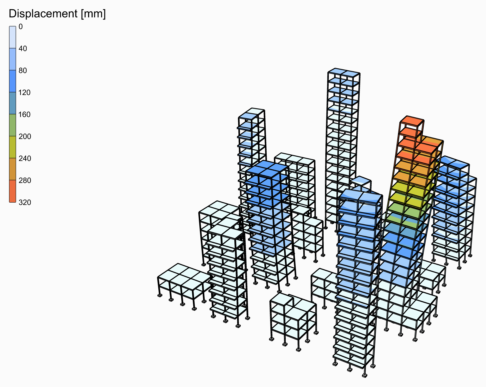
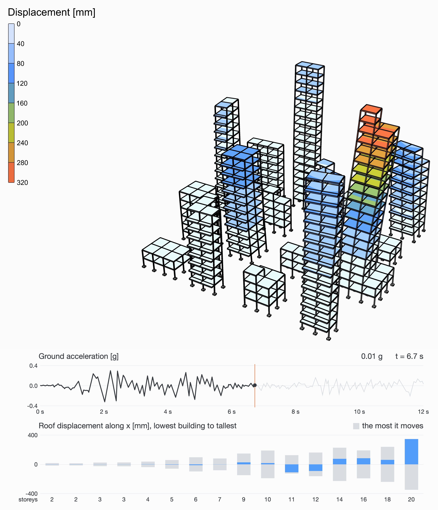

# 🏙️ A Tiny City in an Earthquake

<figure><figcaption></figcaption></figure>

[earthquake-city](earthquake-city.gh)

Sixteen buildings in four rows, from two storeys to twenty, on a grid of 5 m bays: rectangles, Ls, blocks with a penthouse on top, a tower on a wide podium, slabs with balconies along their south face. Every one is a steel frame of HEB300 columns and IPE400 beams with a concrete slab at every floor. The El Centro earthquake shakes the ground under all of them at once, along x.

<figure><video src="earthquake-city-shaking.mp4" autoplay loop muted playsinline></video><figcaption>
The first 12 s of El Centro, as they happened, the movement drawn larger than it is. Under it, the ground's acceleration and a bar for each building's roof, lowest to tallest: where it is now, over the most it moves either way.
</figcaption></figure>

## The model

| Group | What it does |
| --- | --- |
| 1 - Geometry | The sliders, and a Python component that draws the city from them: each building's columns, beams and slabs, floor by floor from a list of footprints, storeys, tops, podiums and balconies, the columns' feet, a corner of each roof, which the chart follows, and each building's storeys. |
| 2 - Members | S355 HEB300 columns and IPE400 beams, as [ForceBeamColumn](../../docs/basics/elements/force-beam-column.md); 200 mm concrete slabs as [ASD Shell](../../docs/basics/elements/shell.md)s. |
| 3 - Supports | Every column built in at the ground. |
| 4 - Ground motion | The El Centro record from a Python component, its first **Duration** seconds times **Ground motion scale**; a Path Time Series of it; a Load Pattern of the UniformExcitation type, along the direction it shakes. |
| 5 - Transient analysis | [Assemble](../../docs/basics/assemble.md); [Damping](../../docs/basics/analysis/damping.md), Rayleigh's from **Damping** and its two frequencies; the Newmark [Integrator](../../docs/basics/analysis/integrator.md); [Analysis Step](../../docs/basics/analysis/analysis-step.md), a step a sample of the record; [Analysis Settings](../../docs/basics/analysis/analysis-settings.md) for a transient analysis with the Linear algorithm, one solve a step, as an elastic model needs; and Run Analysis. |
| 6 - Results | A [Model View](../../docs/basics/visualisation/model-view.md) of the analysed model at **Step**, deformed 20 times, its elements' edges and its supports drawn, its colours in iso-surfaces on the slabs over 0 to 320 mm for every step alike, with a [Legend](../../docs/basics/visualisation/legend.md). Drag **Step** to go through the record. |

## The ground motion

El Centro, 18 May 1940, the north-south component: 0.32 g at its peak, 2 s in, the first 12 s of it. A [Path Time Series](../../docs/basics/time-history/path.md) of its accelerations shakes the ground under the whole structure through a [Load Pattern](../../docs/basics/loads/load-pattern.md)'s UniformExcitation type, and [Run Analysis](../../docs/basics/analysis/run-analysis.md) follows it step by step, 0.02 s at a time, a transient analysis with Newmark's average acceleration. The structure's own weight is its mass. Damping is Rayleigh's, 5% of critical at two frequencies that bracket the modes that matter. **Ground motion scale** makes the record stronger or weaker, **Duration** takes more or less of it.

## What it shows

The same ground, sixteen ways to move. A low building is stiff and quick: it follows the ground and hardly bends. A tall one is soft and slow: it sways far, and lags behind the ground. The Ls, and the tower off the middle of its podium, twist as they sway. The buildings whose period falls where the record is strongest shake the most: 347 mm at the most, 6.7 s in. Change the list in the component and watch who moves.

<figure><figcaption>
The moment it moves the most, and the record up to then.
</figcaption></figure>
