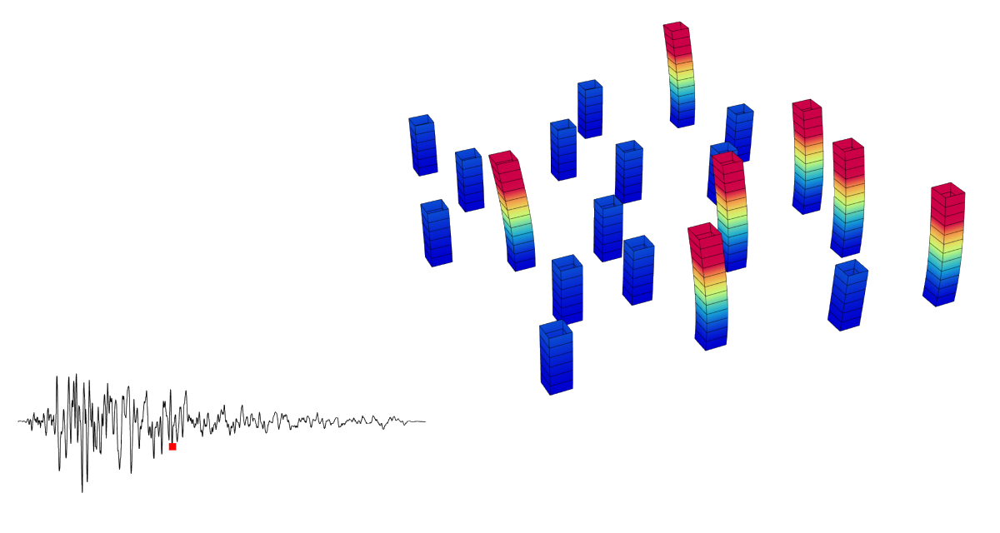

# 🕙 Earthquake

<figure><figcaption></figcaption></figure>

[earthquake](earthquake.gh)

This example illustrates a simple nonlinear dynamic analysis under earthquake loading.  
Use it to understand how to combine time series, uniform excitation load patterns and recorders, and then adjust the ground‑motion input or structural properties to study changes in the dynamic response.
