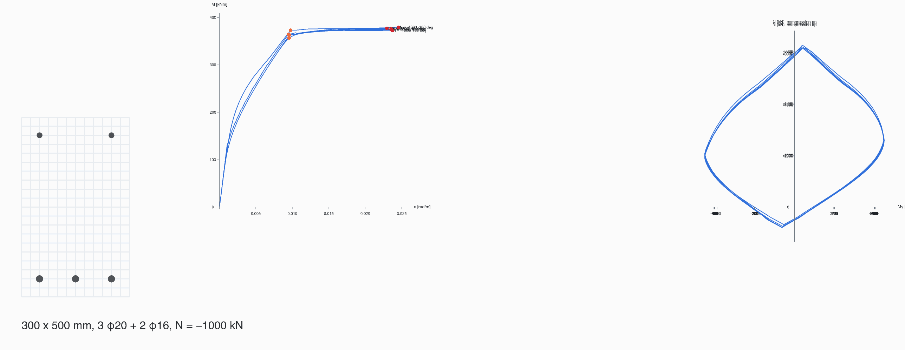

# 📈 Fibre Laws

<figure><figcaption></figcaption></figure>

[fibre-laws](fibre-laws.gh)

One 300 × 500 mm reinforced concrete section, six times over. Each row takes another law for its concrete or
its steel from [Concrete](../../docs/basics/moment-curvature/concrete.md),
[Steel](../../docs/basics/moment-curvature/steel.md) and
[Other Laws](../../docs/basics/moment-curvature/other-laws.md), and has its own
[Moment Curvature](../../docs/basics/moment-curvature/moment-curvature.md) and
[Interaction Domain](../../docs/basics/moment-curvature/interaction-domain.md). One Moment Curvature Diagram draws the six
curves together. Use it to see what each law changes, and what it does not, before you pick one for your own section.

## The model

| Group | What it does |
| --- | --- |
| 1 - Laws | A Concrete and a Steel (or Other Laws) component for each row, each on the law its **Law** menu names, with fcm 38 MPa and B500 steel. |
| 2 - The section | One outline, 300 × 500 mm, meshed 12 × 20: a [Patch](../../docs/basics/moment-curvature/patch.md) of concrete a row, one fibre a face. 3 φ20 bars along the bottom and 2 φ16 along the top, a [Fiber Point](../../docs/basics/moment-curvature/fiber-point.md) each. |
| 3 - Moment Curvature | **Axial** −1000 kN, held while the curvature grows, **Direction** 180, so that the three bars are in tension, until a fibre reaches its ultimate strain (steel 5 %, concrete's own crushing strain). The domain of each section beside it. |
| 4 - Results | The six curves on one diagram, each domain's N–M cut, and panels with the ultimate moment, the curvature ductility and what failed. |

## What it shows

| Concrete | Steel | Mu kNm | My kNm | Ductility | Nt kN |
| --- | --- | --- | --- | --- | --- |
| Concrete01 | Steel01 | 374.8 | 362.4 | 2.45 | 800 |
| Concrete02 (ft 3 MPa) | Steel01 | 376.4 | 372.6 | 2.35 | 800 |
| Concrete04 (ft 3 MPa) | Steel01 | 378.3 | 363.8 | 2.59 | 800 |
| Concrete01 | Steel02 | 374.6 | 356.3 | 2.46 | 800 |
| Concrete01 | ElasticPP | 371.9 | 362.4 | 2.47 | 672 |
| Concrete01 | Hysteretic, 3 points | 375.2 | 362.4 | 2.45 | 750 |

The concrete crushes at its top corner in every row, so the six curves lie within 2 % of each other at the ultimate
state. What differs is smaller and in the right place:

* **Tensile strength** moves the moment at first yield: Concrete02's 3 MPa raises it by 3 % (373 against 362 kNm),
  Concrete04's tension branch by 0.4 %. At the ultimate state it changes the moment by less than 1 %.
* **Steel02** turns smoothly where Steel01 has a corner, so its first yield, read from the first fibre at fy/E, comes
  earlier, 356 kNm against 362 kNm.
* **ElasticPP** has no hardening: its tension capacity Nt is the yield force, 672 kN, while the hardening
  laws reach 750 to 800 kN at the same strain limit.
* **Hysteretic** backbone, rising to 1.08 fy at 2 % and 1.15 fy at 8 %, hardens less than Steel01's
  1 % slope: its Nt is 750 kN against 800 kN.

::: info
Every steel here is held to a strain of 5 %. ElasticPP and Hysteretic have no ultimate strain of their own, so the
domain and Moment Curvature hold them to that limit, set by **εud** on both.
:::

## Things to try

* **Change a law.** Right click a Concrete or Steel component, **Law**, and pick another: the inputs change with it.
* **Take the axial force off.** **Axial** from −1000 to 0, and see which laws still lie together.
* **Switch the tension off.** Concrete02's **ft** to 0, and it becomes Concrete01.
* **Bend it the other way.** **Direction** 0 puts the two φ16 bars in tension.
* **Refine the mesh.** Mesh Plane's counts are the fibre density.
