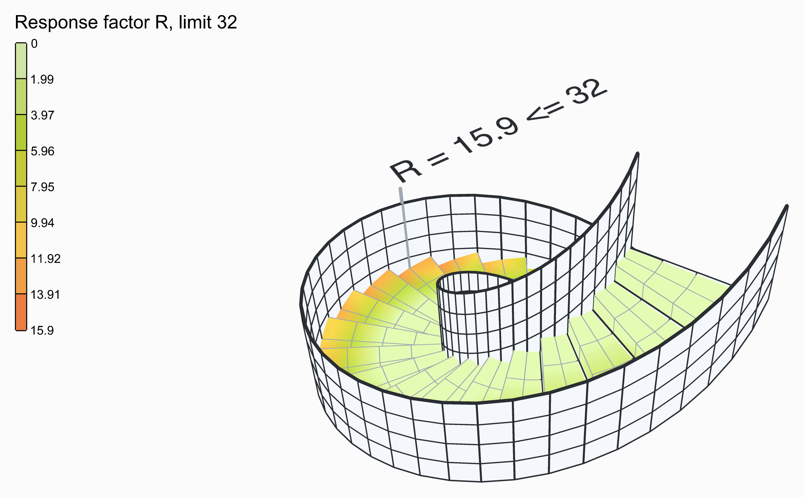
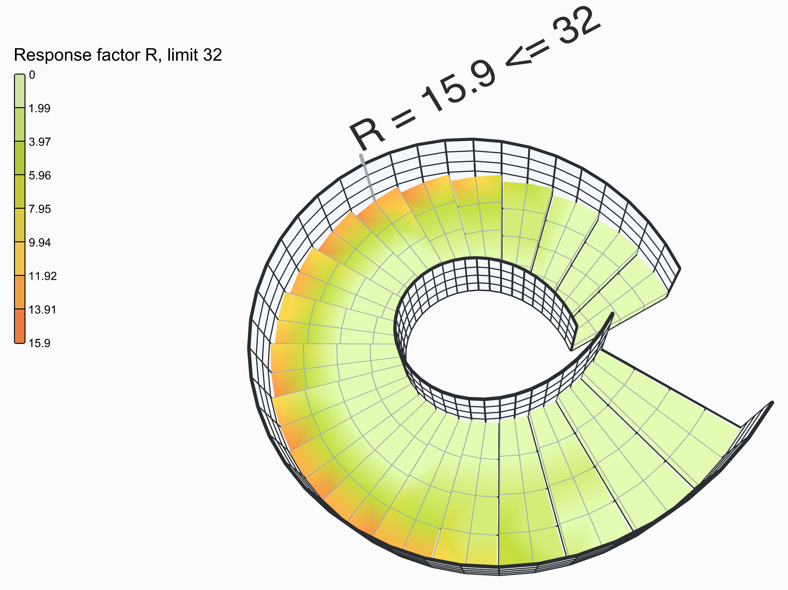
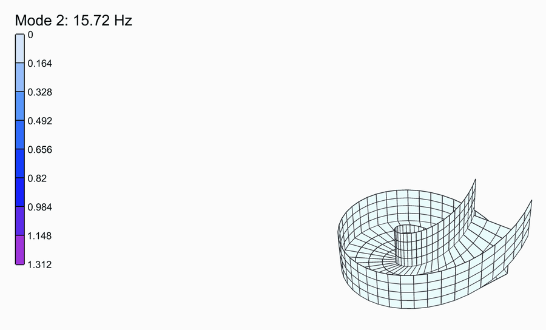
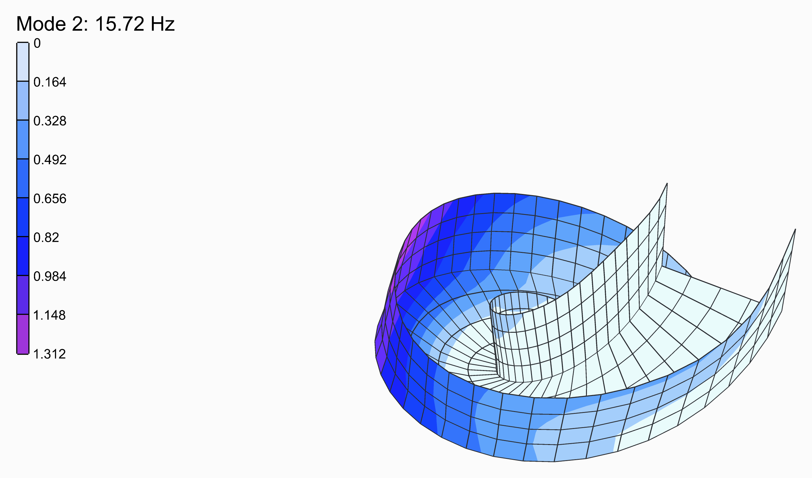

# 🌀 Footfall on a Helical Stair of Shells

<figure><figcaption></figcaption></figure>

[footfall-helical-stair](footfall-helical-stair.gh)

A stair with no column and no stringers. A steel ribbon climbs round an open well between two parapets, curved steel walls that rise with it, one round the well and one round the outside. The parapets are not a balustrade added on: they are the structure, deep curved beams that carry the ribbon from the floor at its foot to the floor it arrives at. Everything is a plate, and every plate is a shell.

A [Footfall Analysis](../../docs/basics/analysis/footfall.md) walks a person up and down it and colours every step by its **response factor** R, green to orange up to the limit you accept and red past it. SCI P354 accepts 32 on a stair in light use and 24 in heavy use.

## The model

| Group | What it does |
| --- | --- |
| 1 - Geometry | The sliders - **Height**, **Risers**, **Turn**, **Inner radius**, **Width** and **Parapet height**, and the thickness of the **Ribbon** and the **Parapets** - and a Python component, **Helical stair**, that draws it. The ribbon is the helicoid between the two radii, meshed two elements to a step round and about 300 mm across; each parapet is a cylindrical band rising from the ribbon's edge, meshed on the same angles, so they share their nodes. The steps, drawn on the ribbon, are for the picture only. |
| 2 - Members | S355 steel as an [nD material](../../docs/basics/materials/ND.md), two [Plate Fiber Sections](../../docs/basics/sections/plate-fiber.md) - the ribbon **Ribbon** thick and the parapets **Parapet** thick - and the plates as [ASD Shells](../../docs/basics/elements/shell.md). No beam anywhere. |
| 3 - Supports | [Supports](../../docs/basics/elements/support.md), built in, at both ends: the end of the ribbon and both parapets' end edges, on the floor at its foot and into the floor it arrives at. |
| 4 - Mass | The steel's own weight, and [Mass Points](../../docs/basics/loads/mass-point.md) at the ribbon's nodes for the steps and finishes and a tenth of the **Imposed** load, as P354 asks. |
| 5 - Analysis | [Assemble](../../docs/basics/assemble.md), [Natural Vibration](../../docs/basics/analysis/natural-vibration.md) for the first 12 modes, **Limit R**, and [Footfall Analysis](../../docs/basics/analysis/footfall.md): a 76 kg walker at every node in turn, P354's Fourier coefficients for stairs (Table 3.2), paces from 1.2 to 4.5 steps a second, 0.5% damping for welded steel, the 12 Hz cut-off for stairs, and the steps all the way up as **Footsteps**. |
| 6 - Results | **Response map** colours the steps by the response factor of the ribbon under them, green to orange up to **Limit R** and red past it; a [Legend](../../docs/basics/visualisation/legend.md), a tag and a dark marker show the largest. A [Model View](../../docs/basics/visualisation/model-view.md) draws the stair, and another the mode **Mode** picks, in blues, its frequency in its legend. |

Its 480 shells are past the free limit of 50 elements: it needs a licence. It solves in about a second.

## What it shows

<figure><figcaption>
From above: the steps shake most on the outside, about a quarter of the way up.
</figcaption></figure>

As it opens - 3.6 m in 20 risers, turning 300 degrees round a well 1.6 m across, a 15 mm ribbon between parapets of 12 mm steel a metre tall - its first two modes, at 12.3 and 13.9 Hz, sway it sideways. The first that moves up and down, at **15.7 Hz**, is its fundamental: the ribbon and the outer parapet dip together on the far side of the well.

<figure><figcaption>
The fundamental, 15.7 Hz, in blues - the colours of a mode, never of a response - drawn far larger than it moves.
</figcaption></figure>

The fundamental is above the 12 Hz cut-off for stairs, so the steady state takes the modes up to twice it. The largest response factor is **R = 15.9**, on the outside of the ribbon a quarter of the way up, at a pace of 4.5 steps a second: half of P354's limit for a stair in light use, 32, and under the 24 of a busy one.

The ribbon carries the walker to the parapets, and its thickness is what counts:

| Ribbon | Fundamental | Largest R |
| --- | --- | --- |
| 10 mm | 12.4 Hz | 36.8: past both limits |
| 15 mm | 15.7 Hz | 15.9 |
| 20 mm | 18.4 Hz | 10.1 |
| 25 mm | 20.5 Hz | 7.4 |
| 30 mm | 22.3 Hz | 5.8 |
| 40 mm | 16.4 Hz | 3.7 |

At 40 mm the heavier ribbon brings another mode down to be the first that moves up and down, but the response keeps falling. The parapets' height matters far less: from 0.3 to 1.2 m the largest R stays between 15.8 and 20.2, as taller walls are stiffer and heavier at once.

<figure><figcaption>
The fundamental mode, still, its frequency in the legend's title.
</figcaption></figure>

## Try

- **Ribbon** down to 10 mm and watch the steps turn red; **Limit R** to 24, for a busy stair.
- **Parapet height**: taller walls are stiffer, but heavier too.
- **Turn** up, for a longer span; **Inner radius** down, for a tighter well.
- **Parapet** thicker.
- **Mode** through the modes, their frequency in the legend.
