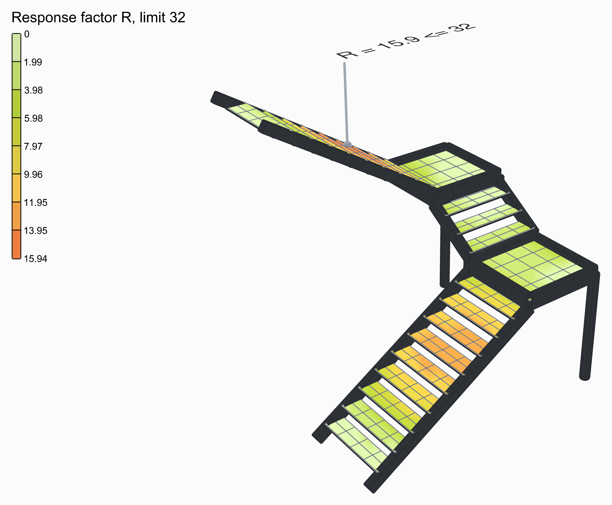
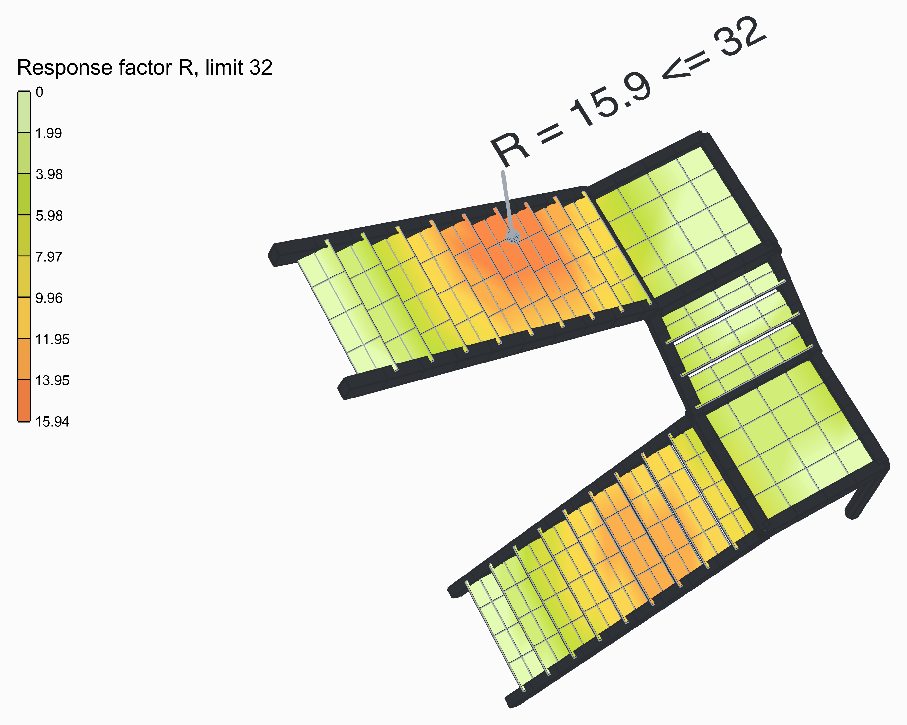
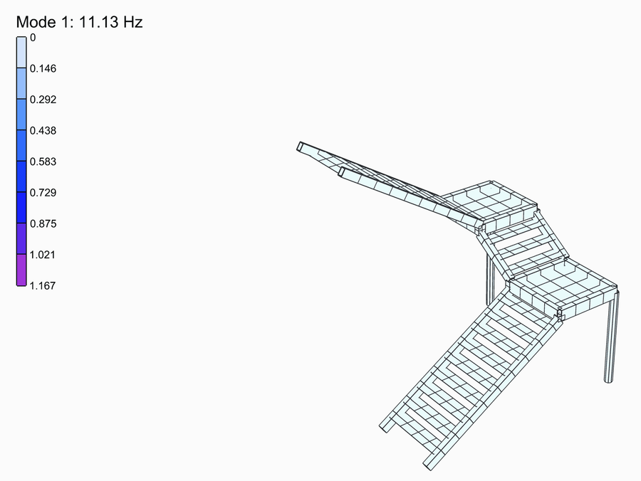
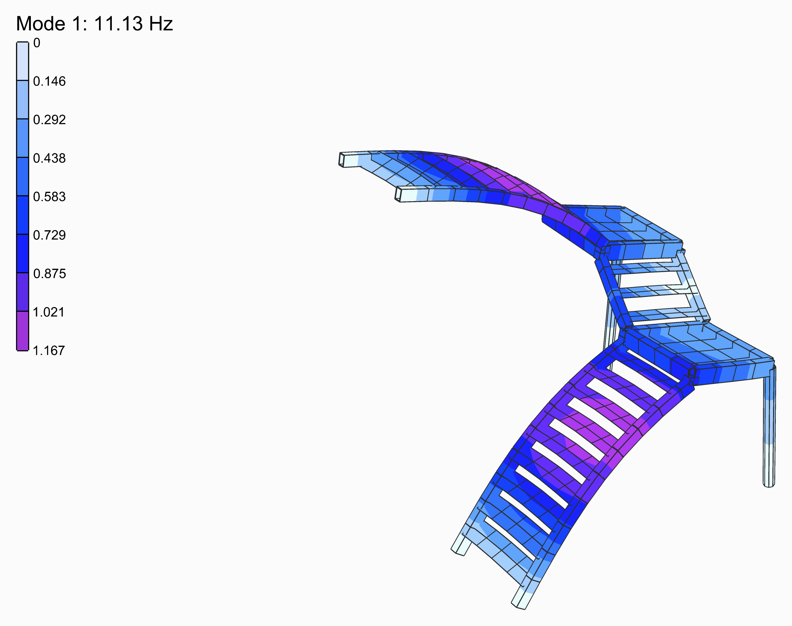

# 🚶 Footfall on a Double Landing Stair

<figure><figcaption></figcaption></figure>

[footfall-stair](footfall-stair.gh)

A steel stair between two floors 4.2 m apart. It climbs in a U: a long flight up, a quarter landing, a short flight across, a second quarter landing, and a long flight back up to the floor above. Every flight hangs between two steel stringers, and its open treads are steel plates. A [Footfall Analysis](../../docs/basics/analysis/footfall.md) walks a person up and down it and colours every tread and landing by its **response factor** R: how many times over the threshold of perception it shakes. SCI P354 accepts 32 on a stair in light use, such as an office's, and 24 on one in heavy use.

The stringers' depth is a slider. Deepen them and watch the colours fade.

## The model

| Group | What it does |
| --- | --- |
| 1 - Geometry | The sliders - **Width**, the **Risers** of the long flights and of the middle one, **Rise**, **Going**, **Stringer depth** and **Plate** - and a Python component, **Footfall stair**, that draws the stair from them. Each flight's two stringers run straight through the middle of every tread's ends, with half a rise up or down to the landings, so each tread is fixed to them at the middle of its two ends. The treads are open, with no risers. Each landing is a plate on a frame of four edge beams, with a post under its free corner. |
| 2 - Members | S355 steel. The stringers are [Rectangle Hollow](../../docs/basics/sections/rectangular-hollow.md) sections 100 mm wide and **Stringer depth** deep, 8 mm thick. The landings' edge beams are 200 x 100 x 8 and the posts 139.7 x 8 hollow sections from the [Section Library](../../docs/basics/sections/library.md), all [ForceBeamColumn](../../docs/basics/elements/force-beam-column.md)s. The treads and landings are steel plates **Plate** thick, an [nD material](../../docs/basics/materials/ND.md) through a [Plate Fiber Section](../../docs/basics/sections/plate-fiber.md), as [ASD Shell](../../docs/basics/elements/shell.md)s: beams and shells in one model. |
| 3 - Supports | [Supports](../../docs/basics/elements/support.md), pinned: at the foot of the stringers and the posts, and where the top flight lands on the floor above. |
| 4 - Mass | What the stair weighs in use, as P354 asks: the steel's own weight, from its density, and [Mass Points](../../docs/basics/loads/mass-point.md) at the nodes of the plates for the **Finishes** and a tenth of the **Imposed** load. |
| 5 - Analysis | [Assemble](../../docs/basics/assemble.md), [Natural Vibration](../../docs/basics/analysis/natural-vibration.md) for the first 12 modes, by ARPACK on Mumps, **Limit R** (32, P354's for a stair in light use), and [Footfall Analysis](../../docs/basics/analysis/footfall.md): a 76 kg walker at every node in turn (self excitation), P354's Fourier coefficients for stairs (Table 3.2) at paces from 1.2 to 4.5 steps a second, 0.5% damping for welded steel, the 12 Hz cut-off for stairs, and **Footsteps** the stair's risers, so that the response builds up over the whole climb. Its **Frequency data** menu is open, to show them. |
| 6 - Results | A Python component, **Response map**, colours the treads and landings by the response factor at their nodes, in **Bands** from pale green through yellow to orange up to **Limit R**, the response factor accepted, and red past it; a [Legend](../../docs/basics/visualisation/legend.md), a tag and a dark marker show the largest. A [Model View](../../docs/basics/visualisation/model-view.md) draws the stair, steel dark and plates light, and another the mode **Mode** picks, in blues so that it is never read as a response, its number and frequency in its legend's title. |

Its 290 elements, 90 beams and 200 shells, are past the free limit of 50: it needs a licence. Natural Vibration and Footfall Analysis take about a second together.

## What it shows

<figure><figcaption>
From above: the long flights shake most at mid-span, the landings on their posts hardly at all.
</figcaption></figure>

With the stringers 140 mm deep, as it opens, the stair's first mode, at 4.2 Hz, sways it sideways on its posts. The first that moves up and down is its fundamental for footfall: at 11.1 Hz the two long flights bounce together, and the short flight between the landings hardly moves.

<figure><figcaption>
The fundamental, 11.1 Hz, drawn far larger than it moves.
</figcaption></figure>

Footfall Analysis finds the largest response factor in the middle of the top flight: **R = 15.8**, at a pace of 4.5 steps a second, a fast descent. Its second harmonic, at 9 Hz, comes closest to the flights' 11.1 Hz. That is under both of P354's limits for a stair, 32 in light use and 24 in heavy use. The landings, held by their posts, stay under 6.

The fundamental is below the 12 Hz cut-off for stairs, so P354 would check the transient response too; SCI's Advisory Desk note AD 406 finds that check does not apply to stairs, and the component checks the steady state alone. The walker climbs the whole stair, 24 steps, so the response builds up to 0.53 of its steady state.

Drag **Stringer depth** and the stair stiffens:

| Stringer depth | Fundamental | Largest R |
| --- | --- | --- |
| 120 mm | 9.8 Hz | 40.4: too lively even for an office |
| 140 mm | 11.1 Hz | 15.8 |
| 160 mm | 12.4 Hz | 12.2 |
| 180 mm | 13.7 Hz | 9.0 |
| 200 mm | 15.0 Hz | 7.1 |
| 250 mm | 18.0 Hz | 4.5 |
| 300 mm | 20.6 Hz | 3.4 |

Below 140 mm the bounce comes within reach of the second harmonic of a fast descent, and R more than doubles. The treads are 20 mm plates, standing for folded steel trays: thin flat plates have modes of their own, at a few tens of hertz, that a walker standing on one tread picks up on its own.

<figure><figcaption>
The fundamental mode, still.
</figcaption></figure>

## Try

- **Stringer depth** down to 120 mm and watch the long flights turn red; **Limit R** to 24, for a stair in heavy use.
- **Plate** thicker, or **Width** narrower.
- **Finishes** up: more mass, a lower frequency, and a smaller response for the same force.
- **Mode** through the modes: mode 0 sways the stair sideways on its posts, mode 1 bounces its long flights.
