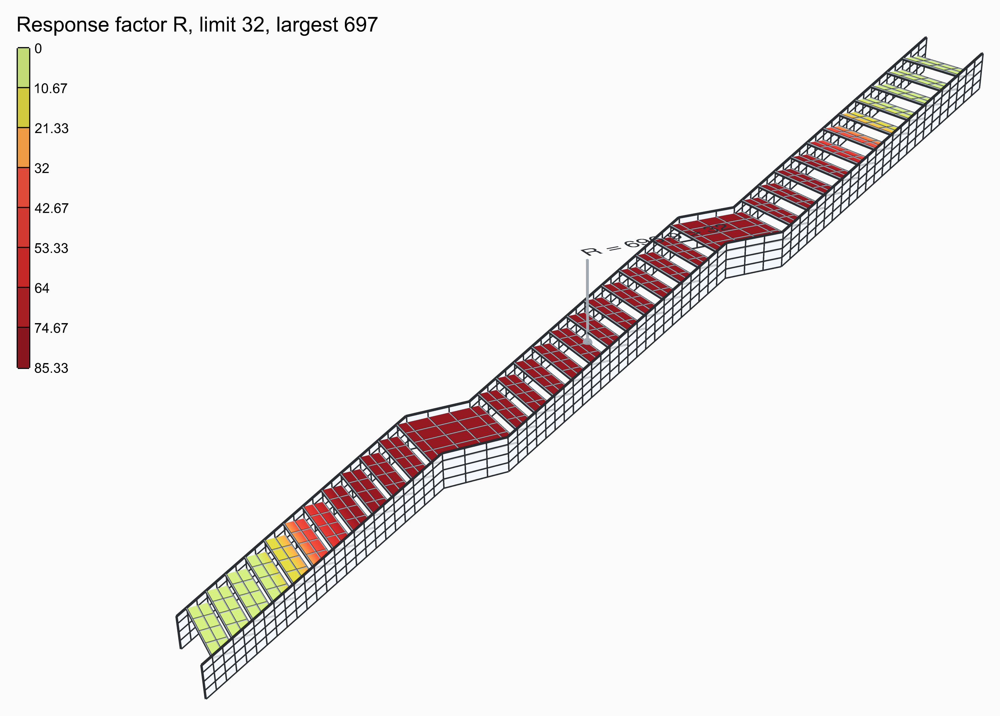
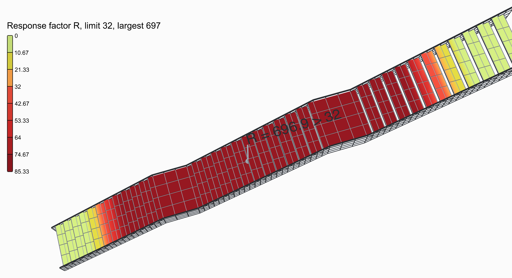
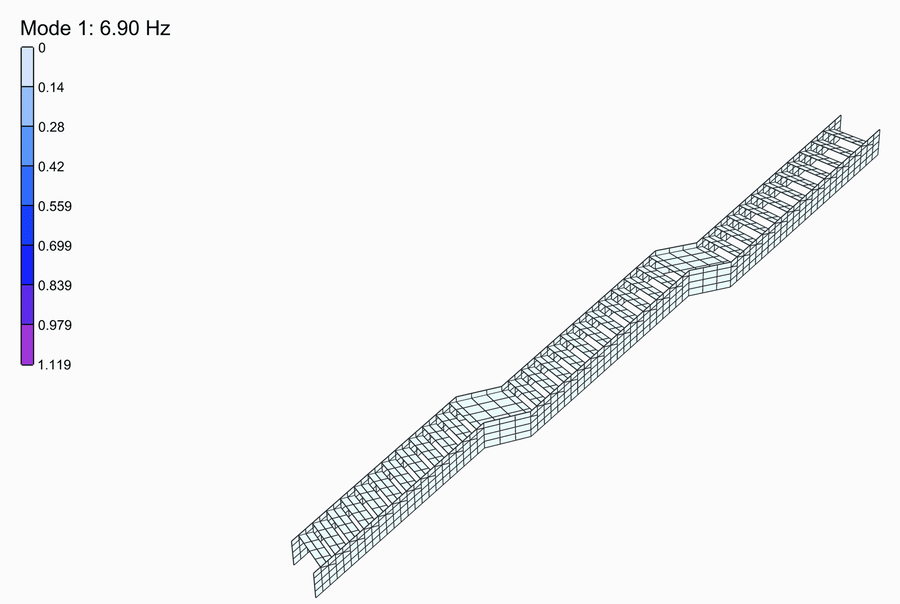
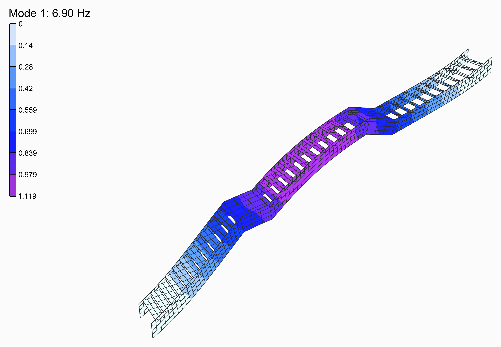

# 📏 Footfall on a Long Straight Stair

<figure><figcaption></figcaption></figure>

[footfall-straight-stair](footfall-straight-stair.gh)

Thirty-six steps in a straight line: three flights of twelve, with a landing between each two, rising 6.3 m over about 11.5 m. Nothing holds it between the two floors, no post and no hanger. Two steel plate stringers run its whole length, and the open treads and the landings are steel plates between them. Every plate is a shell.

A [Footfall Analysis](../../docs/basics/analysis/footfall.md) walks a person up and down it and colours every tread and landing by its **response factor** R, green to orange up to the limit you accept and red past it. SCI P354 accepts 32 on a stair in light use and 24 in heavy use.

## The model

| Group | What it does |
| --- | --- |
| 1 - Geometry | The sliders - **Width**, **Risers a flight**, **Flights**, **Rise**, **Going**, **Landing**, **Stringer depth**, and the thickness of the **Stringer plate** and the **Tread plate** - and a Python component, **Straight stair**, that draws it. Each stringer is a plate in the stair's side, from **Stringer depth** below the line through the middle of the treads to 100 mm above it, flat along the landings; each tread is fixed to the stringers at the middle of its ends, and each landing along its sides. |
| 2 - Members | S355 steel as an [nD material](../../docs/basics/materials/ND.md), two [Plate Fiber Sections](../../docs/basics/sections/plate-fiber.md), and the stringers, treads and landings as [ASD Shells](../../docs/basics/elements/shell.md). Each tread is welded to the stringers along its ends: it shares the node at the middle of each end with them, and a [Rigid Link](../../docs/basics/constraints/rigid-link.md) ties each of its corners to the stringer node half a rise below or above it. Without them a tread would hang from one node a side, and the two tall, thin stringers would flap sideways. |
| 3 - Supports | [Supports](../../docs/basics/elements/support.md) along the end edges of both stringers, on the floor and at the floor above, pinned: nowhere between. |
| 4 - Mass | The steel's own weight, and [Mass Points](../../docs/basics/loads/mass-point.md) at the nodes of the treads and landings for the **Finishes** and a tenth of the **Imposed** load. |
| 5 - Analysis | [Assemble](../../docs/basics/assemble.md), [Natural Vibration](../../docs/basics/analysis/natural-vibration.md) for the first 15 modes, **Limit R**, and [Footfall Analysis](../../docs/basics/analysis/footfall.md): a 76 kg walker at every node in turn, P354's Fourier coefficients for stairs (Table 3.2), paces from 1.2 to 4.5 steps a second, 0.5% damping for welded steel, the 12 Hz cut-off for stairs, and the 36 steps as **Footsteps**. |
| 6 - Results | **Response map** colours the treads and landings by the response factor, green to orange up to **Limit R** and red past it; a [Legend](../../docs/basics/visualisation/legend.md), a tag and a dark marker show the largest. A [Model View](../../docs/basics/visualisation/model-view.md) draws the stair, and another the mode **Mode** picks, in blues, its frequency in its legend. |

Its 928 shells and 132 rigid links are past the free limit of 50 elements: it needs a licence. It solves in about a second.

## What it shows

<figure><figcaption>
From above: everything between the first few and the last few treads is past the limit.
</figcaption></figure>

As it opens, the stringers 400 mm deep, its first mode, at 4.2 Hz, sways it sideways. The first that moves up and down is at **6.9 Hz**: the whole stair bows down in the middle, the second flight most.

<figure><figcaption>
The fundamental, 6.9 Hz, in blues, drawn far larger than it moves.
</figcaption></figure>

Walking down at 3.45 steps a second, the second harmonic of the footfall is at 6.9 Hz, right on that bounce. With 0.5% damping the response builds up over all 36 steps to **R = 697**: twenty times the 32 P354 accepts on a stair in light use. The legend stops at a few bands past the limit, every one red; its title gives the largest.

This is what a stair held only at its ends has to clear. Fast walking down a stair is up to 4.5 steps a second, so its second harmonic reaches 9 Hz, and with 0.5% damping a bounce below that is in resonance. Deepen the stringers and the frequency climbs:

| Stringer depth | Fundamental | Largest R |
| --- | --- | --- |
| 300 mm | 5.1 Hz | 1 101 |
| 400 mm | 6.9 Hz | 697 |
| 500 mm | 8.8 Hz | 665 |
| 600 mm | 10.7 Hz | 22.3 |
| 800 mm | 14.7 Hz | 7.1 |
| 1 000 mm | 18.8 Hz | 4.7 |

Between 500 and 600 mm the fundamental clears 9 Hz and the largest R drops thirtyfold, under both of P354's limits. A post under a landing, which this stair does without, is the other way out.

<figure><figcaption>
The fundamental mode, still, its frequency in the legend's title.
</figcaption></figure>

## Try

- **Stringer depth** up to 600 mm, and watch the red go.
- **Flights** down to two, or **Landing** longer.
- **Stringer plate** thicker.
- **Mode** through the modes, their frequency in the legend.
