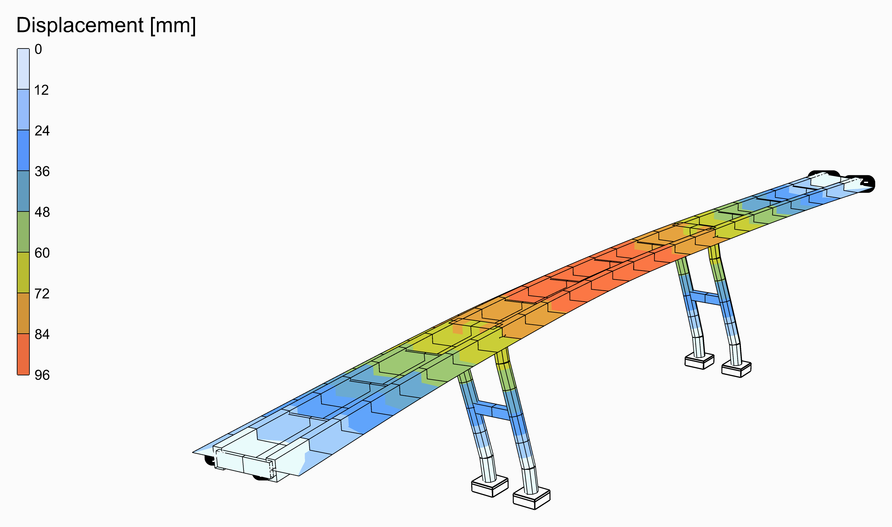
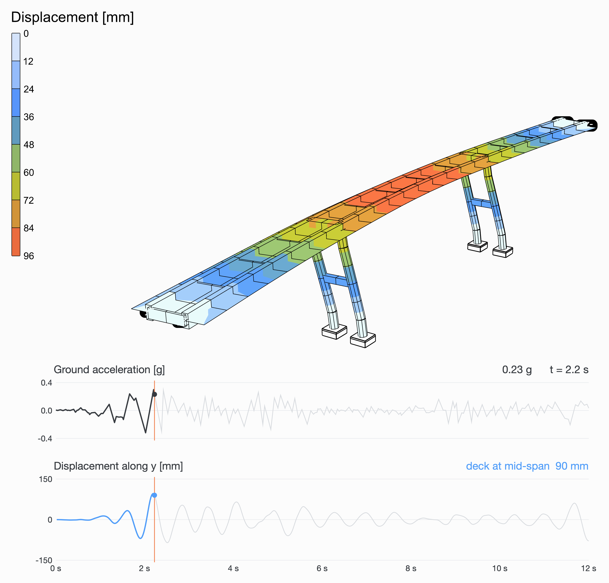

# 🌉 Girder Bridge in an Earthquake

<figure><figcaption></figcaption></figure>

[girder-bridge-earthquake](girder-bridge-earthquake.gh)

A concrete deck runs over three spans, 40, 50 and 40 m: a slab 12 m wide on two girders 6 m apart, joined by a cross girder every 10 m. Each of its two piers is a frame of two round columns 18 m tall, one under each girder, braced by a strut halfway up and capped by a deep cross girder; the deck is built into them. At its ends it slides along on bearings, held there across. The El Centro earthquake shakes the ground across the bridge, and a transient analysis follows the bridge through it.

<figure><video src="girder-bridge-earthquake-shaking.mp4" autoplay loop muted playsinline></video><figcaption>
The first 12 s of El Centro, as they happened, the movement drawn larger than it is. Under it, the ground's acceleration and the deck's movement across in the middle of the main span, over the same 12 s.
</figcaption></figure>

## The model

| Group | What it does |
| --- | --- |
| 1 - Geometry | The sliders, and a Python component that draws the bridge from them: the girders, cut every element length, the cross girders, the piers' columns, struts and caps, the slab's mesh on the girders' nodes, where the columns stand and where the deck's ends rest, and the point in the middle of the deck the charts follow. |
| 2 - Members | C30/37 from [Material Library Elastic](../../docs/basics/materials/MaterialDatabase.md): girders 1 x 2.2 m, cross girders 0.4 x 1.6 m, caps 2 x 2.2 m and struts, [Rectangular](../../docs/basics/sections/rectangular.md); columns 1.6 m across, [Circular](../../docs/basics/sections/circular.md); all [ForceBeamColumn](../../docs/basics/elements/force-beam-column.md). A 250 mm slab, a [Plate Fiber Section](../../docs/basics/sections/plate-fiber.md), as [ASD Shell](../../docs/basics/elements/shell.md)s. |
| 3 - Supports | The columns built in; the deck's ends held up and across, free along: [Support](../../docs/basics/elements/support.md). |
| 4 - Ground motion | The El Centro record from a Python component, its first **Duration** seconds times **Ground motion scale**; a Path Time Series of it; a Load Pattern of the UniformExcitation type, along the direction it shakes. |
| 5 - Transient analysis | [Assemble](../../docs/basics/assemble.md); [Damping](../../docs/basics/analysis/damping.md), Rayleigh's from **Damping** and its two frequencies; the Newmark [Integrator](../../docs/basics/analysis/integrator.md); [Analysis Step](../../docs/basics/analysis/analysis-step.md), a step a sample of the record; [Analysis Settings](../../docs/basics/analysis/analysis-settings.md) for a transient analysis with the Linear algorithm, one solve a step, as an elastic model needs; and Run Analysis. |
| 6 - Results | A [Model View](../../docs/basics/visualisation/model-view.md) of the analysed model at **Step**, deformed 60 times, its elements' edges and its supports drawn, its colours in iso-surfaces on the slabs over 0 to 96 mm for every step alike, with a [Legend](../../docs/basics/visualisation/legend.md); and one of it at rest, as light grey lines behind. Drag **Step** to go through the record. |

## The ground motion

El Centro, 18 May 1940, the north-south component: 0.32 g at its peak, 2 s in, the first 12 s of it. A [Path Time Series](../../docs/basics/time-history/path.md) of its accelerations shakes the ground under the whole structure through a [Load Pattern](../../docs/basics/loads/load-pattern.md)'s UniformExcitation type, and [Run Analysis](../../docs/basics/analysis/run-analysis.md) follows it step by step, 0.02 s at a time, a transient analysis with Newmark's average acceleration. The structure's own weight is its mass. Damping is Rayleigh's, 5% of critical at two frequencies that bracket the modes that matter. **Ground motion scale** makes the record stronger or weaker, **Duration** takes more or less of it.

## What it shows

The piers sway across, both ways, as the ground does, and the deck bends sideways between its ends, held, and the piers: it moves the most in the middle of the main span, 90 mm at the most, 2.2 s in. Make the piers taller and the bridge sways slower, and further.

<figure><figcaption>
The moment it moves the most, and the record up to then.
</figcaption></figure>
