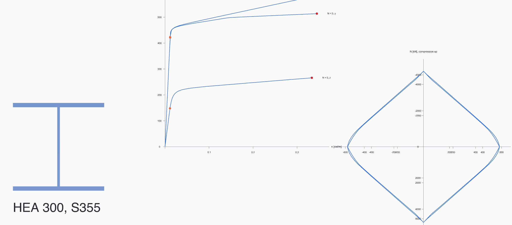

# 📈 HEA Section

<figure><figcaption></figcaption></figure>

[hea-section](hea-section.gh)

A rolled steel section in fibres: a HEA 300 as two flanges and a web, bent about its strong axis in three steel laws and
about its weak axis once. It shows the curve a steel section follows from its first yield to the strain you let it
reach, and the domain around it. Use it as the start for a steel section of your own: the three rectangles at the
top of `FibreSections.py` are the whole shape.

## The model

| Group | What it does |
| --- | --- |
| 1 - Steel | [Steel02](../../docs/basics/moment-curvature/steel.md) (smooth knee, 1 % hardening), Steel01 (sharp knee, 1 %) and a Hysteretic backbone from [Other Laws](../../docs/basics/moment-curvature/other-laws.md), rising to 1.08 fy at 2 % and 1.15 fy at 8 %. S355. |
| 2 - The section | Two flanges, 300 × 14 mm, meshed 24 × 2, and a web, 8.5 × 262 mm, meshed 2 × 18, a [Patch](../../docs/basics/moment-curvature/patch.md) each, and the same patches for every law. The root radii are left out. |
| 3 - Moment Curvature | **Axial** 0, **Direction** 0 about the strong axis for each law, and 90 for Steel02 about the weak axis, until a fibre reaches 5 % strain. The domain of each. |
| 4 - Results | The curves on one diagram, the N–M cuts, a My–Mz diagram of the first law at N = 0 and at 1000 kN of compression, and panels with the ultimate moment, ductility and what failed. |

## What it shows

| Law | Axis | My kNm | Mu kNm | Nt kN |
| --- | --- | --- | --- | --- |
| Steel02 | strong | 421 | 584 | 4851 |
| Steel01 | strong | 423 | 584 | 4851 |
| Hysteretic | strong | 423 | 514 | 4206 |
| Steel02 | weak | 149 | 266 | 4851 |

* **Strong axis, first yield at 421 kNm**, the outer fibre of the flange at fy, and then the whole section
  yields: by a strain of 5 % in the outer fibre the moment has risen to 584 kNm, 1.39 times the yield moment, from
  the plastic reserve of the shape and the hardening together. Steel01 and Steel02 give the same ultimate moment;
  Steel02's smooth knee only rounds the curve around the yield.
* **The Hysteretic backbone hardens less** than a 1 % slope does, so it ends at 514 kNm.
* **Weak axis**: 266 kNm, less than half, with a larger plastic reserve, 1.79 times its yield moment, because the flanges
  carry most of the bending there.
* **The domain**: the N–M cut and the My–Mz diagram, at N = 0 and under 1000 kN of compression, shrink as the
  compression grows.

::: info
Every law here hardens. A perfectly plastic one (ElasticPP) leaves a fully yielded section with no stiffness, and
the analysis can not go on past it: give it a small hardening, or stop at the ultimate state with **StopAtUltimate**.
:::

## Things to try

* **Bend it off its axes.** **Direction** 45: the moment keeps its direction and the neutral axis turns.
* **Add axial force.** **Axial** −2000, and watch the curve and the My–Mz diagram change.
* **Change the section.** `i_section(h, b, tw, tf)` at the top of `FibreSections.py` takes any rolled I section.
* **Change the strain limit.** **εud** from 0.05 to 0.02 stops the curve earlier.
