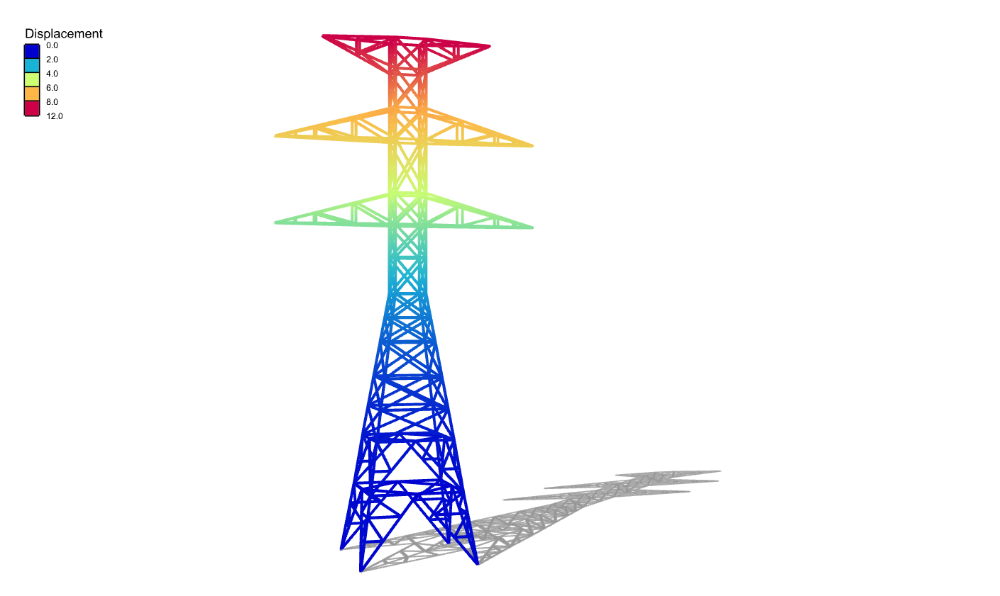

# 🔋 High Tension Tower

<figure><figcaption></figcaption></figure>

[high-tension-tower](high-tension-tower.gh)

This example models a lattice high‑tension tower using beam elements.  
Inspect how the structural layout, bracing pattern and boundary conditions are defined, then experiment with load cases or member properties to see their effect on the global stability and member forces.
