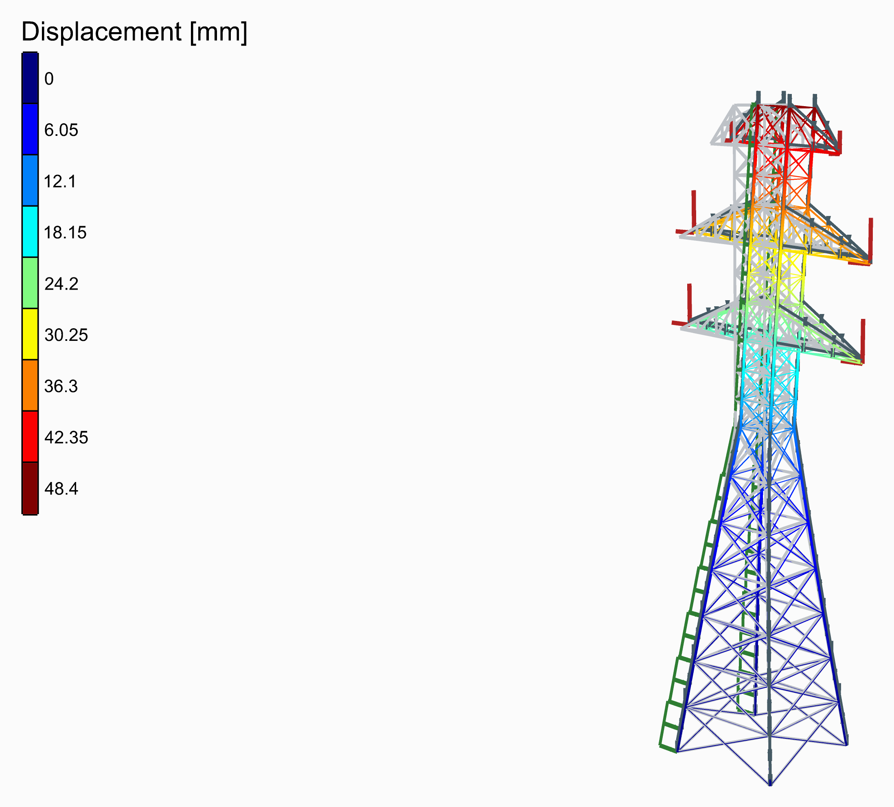
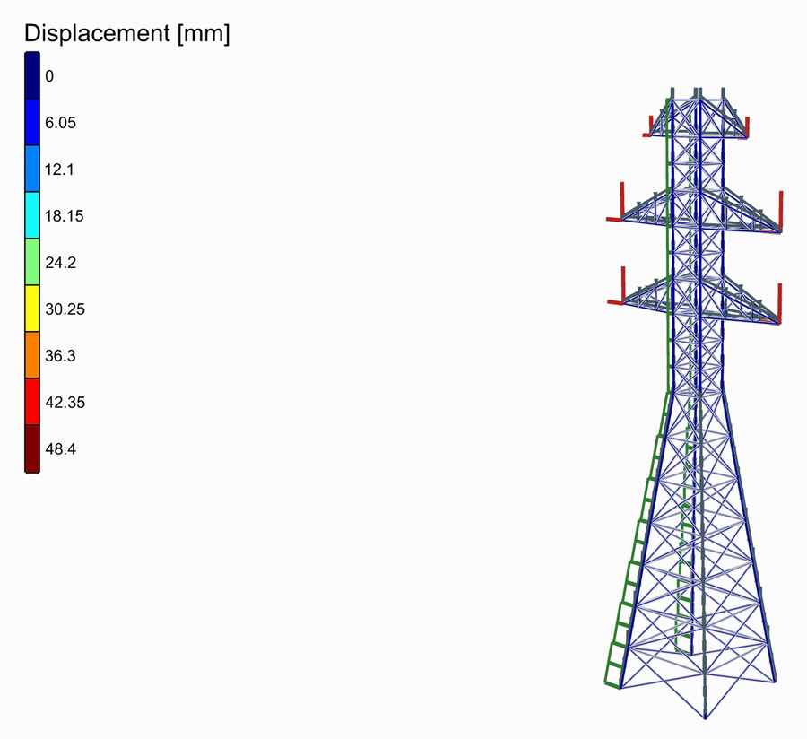
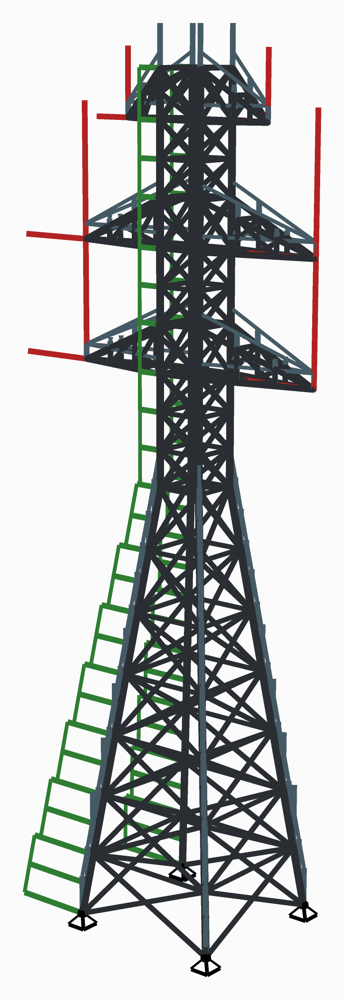

# 🔋 High-Tension Tower

<figure><figcaption></figcaption></figure>

[high-tension-tower](high-tension-tower.gh)

A steel lattice pylon 42 m tall. A square body tapers from feet 8 m apart to a shaft 2.4 m wide at 22 m, and the shaft rises to the top. Two pairs of arms 7 m long carry four conductors, one at each tip, and a shorter pair at the top carries the earth wire. The legs and the arms' chords are beams that run unbroken through every node. The bracing and the struts are trusses, which only pull and push. Its height, widths, panels and arms are sliders, and a Python component draws the geometry from them.

<figure><figcaption>
The deformed shape, from rest to 40 times its size and back, its loads riding on it.
</figcaption></figure>

## The model

| Group | What it does |
| --- | --- |
| 1 - Geometry | The sliders, and a Python component that draws the members as lines from them, along with the feet, the arms' tips and the width of tower each windward leg takes wind from. Open the component to see how. A panel gives the count: 423 members on 18 levels, the arms at 27.6, 33.6 and 39.6 m. |
| 2 - Members | Steel tubes of S355 from the [Steel Section Library](../../docs/basics/sections/library.md). The legs are CHS 193.7x10 and the arms' chords CHS 114.3x6.3, both [Force Beam Columns](../../docs/basics/elements/force-beam-column.md). The bracing (CHS 76.1x4) and the struts (CHS 60.3x4) are trusses. |
| 3 - Supports | Each foot pinned, with a [Support](../../docs/basics/elements/support.md). |
| 4 - Loads | The own weight ([Gravity Load](../../docs/basics/loads/gravity.md)). At each arm tip, a [Point Load](../../docs/basics/loads/point-load.md) for the wires' weight and another for the wind on them. The wind on the tower is a [Linear Load](../../docs/basics/loads/beam-load.md) on its windward legs. A [Load Pattern](../../docs/basics/loads/load-pattern.md) for the permanent loads and one for the wind. |
| 5 - Analysis | [Assemble](../../docs/basics/assemble.md) and [Run Analysis](../../docs/basics/analysis/run-analysis.md), both patterns together. |
| 6 - Results | A [Model View](../../docs/basics/visualisation/model-view.md) of the tower deformed and coloured by its displacement, with a [Legend](../../docs/basics/visualisation/legend.md). A second one draws the axial forces, with their range in a panel, and a third the supports and the loads. |

## The loads

Each conductor hangs 20 kN at the tip of its arm: the wire, its insulators and ice, over half the span on either side. The wind blowing across the line pushes each conductor 12 kN along +x. The earth wire takes half of both. The wind on the tower itself, 1.0 kN/m², falls on the two windward legs. Each takes half the face's width times a quarter of it, the share of a lattice face that is steel.

<figure><figcaption>
The supports and the loads, as <strong>Model View</strong> draws them. Tick <strong>Show Values</strong> in its Loads menu to write what each is worth.
</figcaption></figure>

## What it shows

The top moves 48 mm, most of it along the wind: about h/870. The tower works as a cantilever, so the wind pulls on the windward legs and pushes on the leeward ones. The axial forces run from 227 kN of compression, at the foot of a leeward leg, to 103 kN of tension. Turn on the **Axial forces** view to see them as a diagram along each member, red pulled and blue pushed.

Try an arm reach of 9 m and watch the chords take more, or a base width of 5 m and watch the legs work harder. With the wind on a conductor at 0, you see what the wires' weight alone does.
