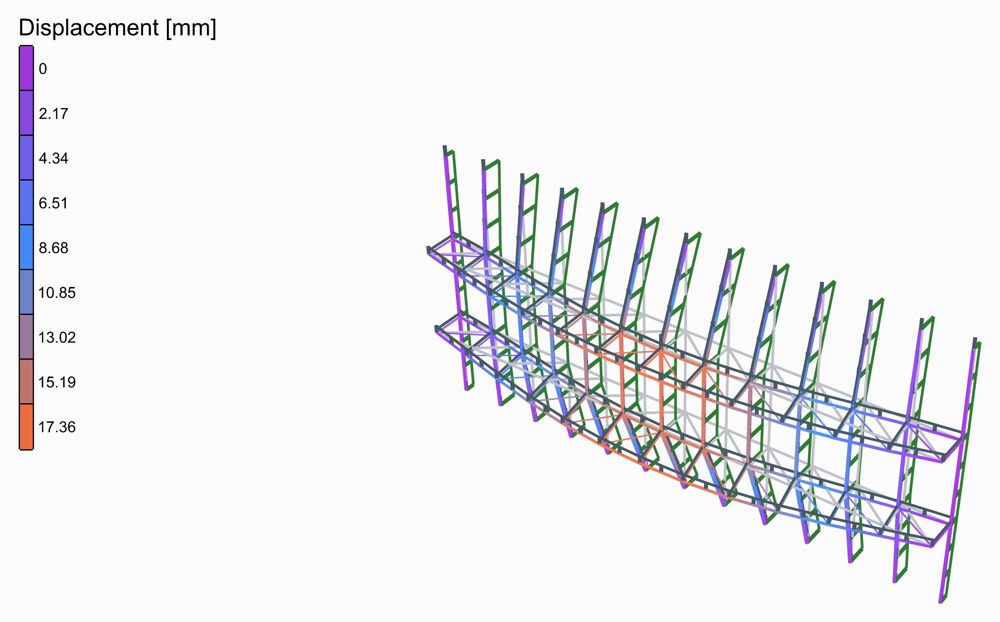
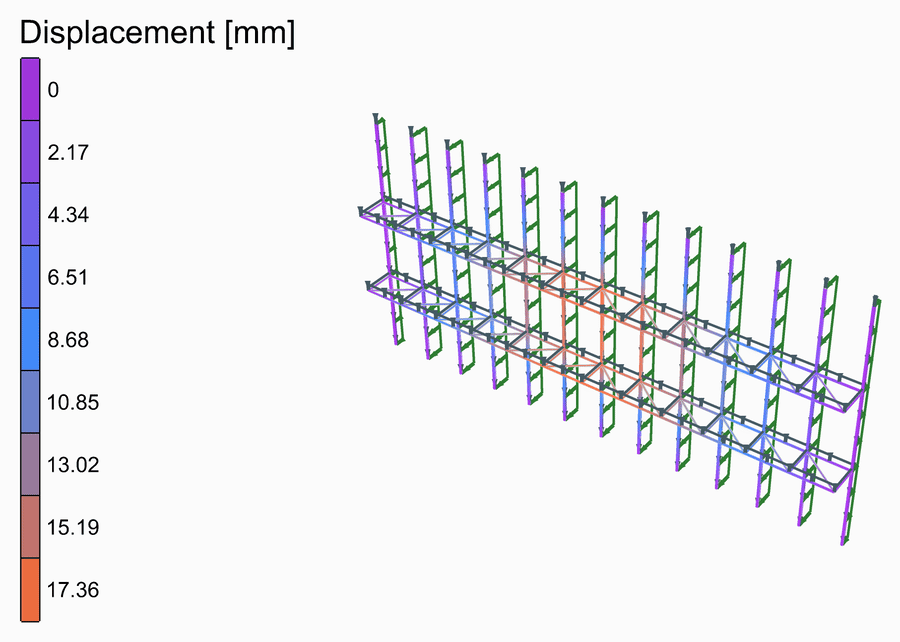
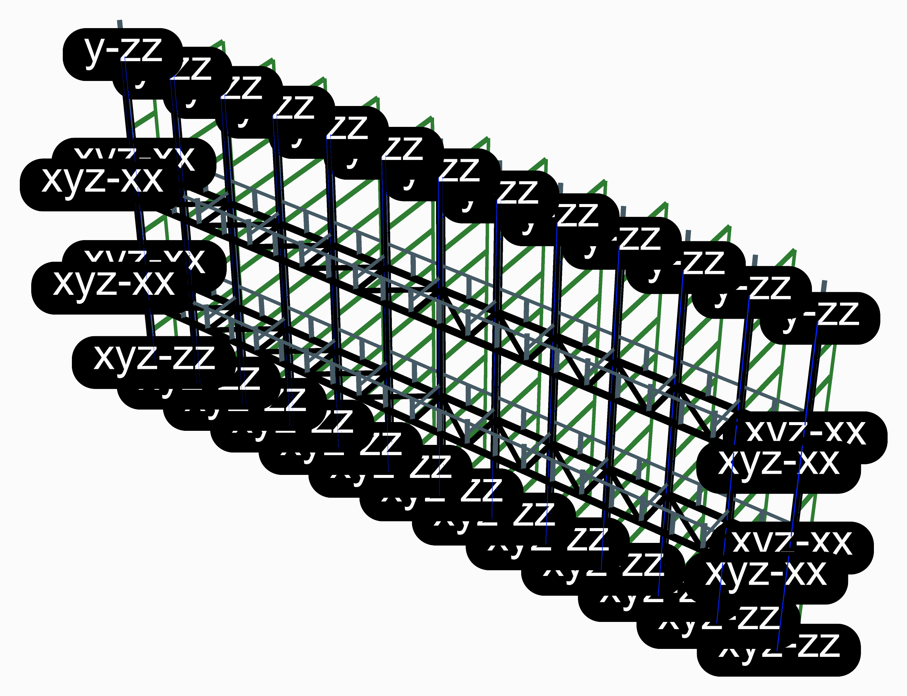

# 🪟 Horizontal Truss Facade

<figure><figcaption></figcaption></figure>

[horizontal-truss-facade](horizontal-truss-facade.gh)

A glass facade 24 m wide and 12 m tall, its mullions 2 m apart standing on their feet and held across the facade at the top. Between, two horizontal trusses behind the facade take them: each spans the whole width between the building's columns at its ends, its outer chord running through the mullions, its inner chord 1.5 m behind, with a post at every mullion and diagonals between.

<figure><figcaption>
The deformed shape, from rest to its full size and back, its loads riding on it.
</figcaption></figure>

## The model

| Group | What it does |
| --- | --- |
| 1 - Geometry | The sliders, and a Python component that draws the geometry from them: the members as lines, each cut where another meets it, the points the structure is held at, and the widths its loads are worked out from. Open the component to see how. Width, height, mullion spacing, truss depth and how many trusses. |
| 2 - Members | S355: mullions of RHS 150x100x5, their depth across the facade, chords of CHS 114.3x5 and posts of CHS 76.1x4 as [ForceBeamColumn](../../docs/basics/elements/force-beam-column.md), the posts built into the mullions so that they carry the inner chord; the diagonals, CHS 60.3x4, as trusses. |
| 3 - Supports | The mullions on their feet and held across at the top; the trusses' ends held on the building's columns. |
| 4 - Loads | The wind in kN/m², times the width of facade each mullion catches, as a [Linear Load](../../docs/basics/loads/beam-load.md) along +y; and the own weight. |
| 5 - Analysis | [Assemble](../../docs/basics/assemble.md) and [Run Analysis](../../docs/basics/analysis/run-analysis.md). |
| 6 - Results | A [Model View](../../docs/basics/visualisation/model-view.md) of the analysed model, deformed and coloured by its displacement, with a [Legend](../../docs/basics/visualisation/legend.md); one of the model at rest, as light grey lines behind it; and one of the supports and the loads. The deformed shape is drawn 100 times its size. |

## The loads

The wind, 1.0 kN/m², is typed in and put on the mullions, each times the width of facade it catches. The mullions carry it to the trusses and the top, the trusses to the building's columns.

<figure><figcaption>
The supports and the loads, as <strong>Model View</strong> draws them: the own weight in its own colour, as OpenSees takes it. Tick <strong>Show Values</strong> in its Loads menu to write what each is worth.
</figcaption></figure>

## What it shows

The trusses bow 17 mm in the middle of their 24 m, and the mullions with them. Add a third truss, or deepen them, and watch the facade stiffen.
