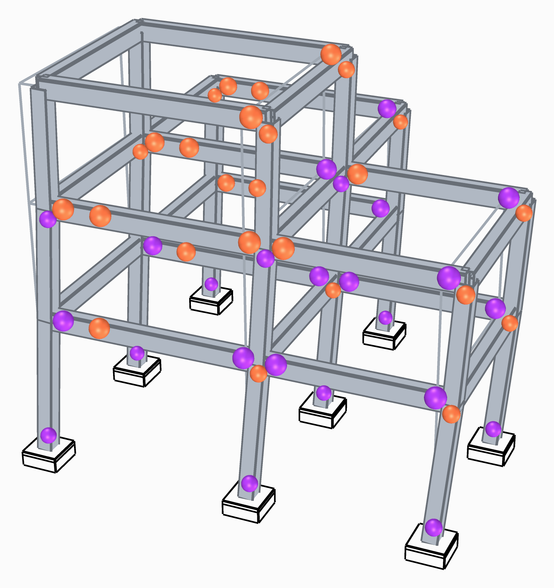
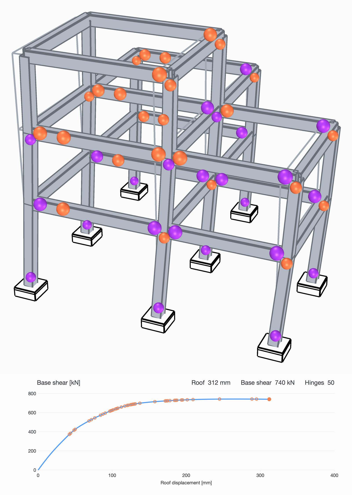
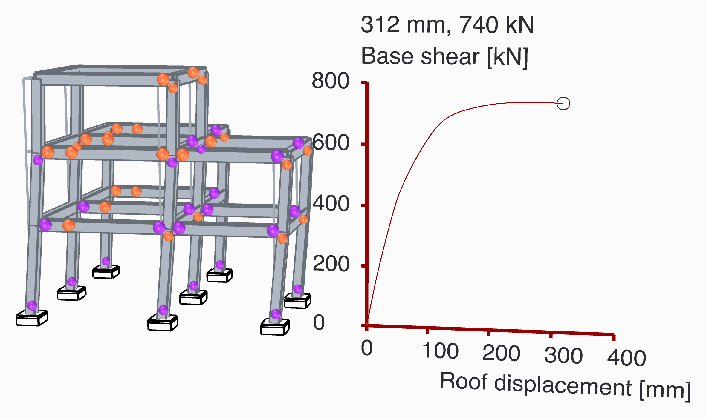

# 📈 Irregular Building Pushover

<figure><figcaption></figcaption></figure>

[irregular-building-pushover](irregular-building-pushover.gh)

A small reinforced concrete building that is not regular, in three ways: an L in plan, a ground
storey taller than the one above it, and a third storey set back over one corner. Every column and
beam is a [ForceBeamColumn](../../docs/basics/elements/force-beam-column.md) on a
[Fiber Section](../../docs/basics/moment-curvature/fiber-section.md), so its concrete cracks and
crushes and its bars yield where the forces take them. It carries its own weight and its floors;
then [Pushover Analysis](../../docs/basics/analysis/pushover.md) pushes it sideways until the top
of the building has moved 3% of its height, and
[Model View](../../docs/basics/visualisation/model-view.md) draws its plastic hinges as they form.

<figure><video src="irregular-building-pushover-pushing.mp4" autoplay loop muted playsinline></video><figcaption>
The push, a frame every third point of the curve, the sway drawn twice as large as it is. A ball marks each plastic hinge: orange where the bars have yielded, purple where the concrete has crushed. Under it, the capacity curve so far, a ring where each hinge formed.
</figcaption></figure>

## The model

| Group | What it does |
| --- | --- |
| 1 - Geometry | The sliders, and a Python component that draws the building from them: the columns, the beams, the columns' feet, every node above the ground with the push on it, and the corner of the top storey's roof, where the push is controlled. |
| 2 - Members | [Concrete01](../../docs/basics/moment-curvature/concrete01.md) C25/30 and [ReinforcingSteel](../../docs/basics/moment-curvature/reinforcing-steel.md) B450C. Two [Fiber Sections](../../docs/basics/moment-curvature/fiber-section.md), each a rectangle meshed into a [Patch](../../docs/basics/moment-curvature/patch.md) of concrete, a fibre a face, and a [Fiber Point](../../docs/basics/moment-curvature/fiber-point.md) for each φ20 bar: a 400 x 400 column with eight, and a 500 x 300 beam with three at the top and three at the bottom. Every member a [ForceBeamColumn](../../docs/basics/elements/force-beam-column.md) on one of them: 20 columns and 24 beams, 44 elements. |
| 3 - Supports | Every column built in at the ground. |
| 4 - Loads | Its own weight, [Gravity Load](../../docs/basics/loads/gravity.md), and **Floor load** on every beam, a [Linear Load](../../docs/basics/loads/beam-load.md), in a [Load Pattern](../../docs/basics/loads/load-pattern.md) on a linear time series, so that they ramp up. The push: a [Point Load](../../docs/basics/loads/point-load.md) on every node above the ground, larger the higher it is. |
| 5 - Pushover | [Assemble](../../docs/basics/assemble.md), and [Pushover Analysis](../../docs/basics/analysis/pushover.md): the top storey's roof pushed along X to **Roof drift** % of the height, in **Steps** steps, with P-Delta. |
| 6 - Results | **Point on the curve**, and a Python component that draws the capacity curve beside the building, the point on it, and hands Model View that point's step. A [Model View](../../docs/basics/visualisation/model-view.md) of the pushed building at that step, drawn twice its sway, with **Plastic hinges** ticked; one of the building at rest, in light grey lines; and a panel of the **Hinges**, in the order they formed. |

## How it is pushed

The building first carries its own weight and 20 kN/m on every beam, about 3 300 kN in all, ramped
up over ten steps and then held. Pushover Analysis then puts a load on every node above the ground,
in proportion to its height, as a building sways in its first mode, and scales them all together. It
controls the displacement of the top storey's roof: 200 steps of 1.56 mm take it to 312 mm, 3% of the
building's 10.4 m, whatever the load does on the way.

On a beam, a fibre section's *y* is the beam's local *y*, which on a horizontal beam points up: so the
beam's section is drawn with its 500 mm depth along x. Its **GJ** is a cracked section's, 3 000 kN m²:
a fibre section's torsion is a fixed elastic stiffness, and Fiber Section's default of 10⁸ is meant
for a section on its own.

## What it shows

The first hinges form at 42 mm and 373 kN, at one end of each first-floor beam along the push. From
69 mm the feet of the ground storey's columns yield too, and their concrete starts to crush
at 119 mm. The base shear levels off at 742 kN, a little over a fifth of the building's weight, at
268 mm; by 312 mm 50 points of its beams and columns have yielded.

Its irregularities show in where it moves. The tall ground storey takes the most of the sway: when the
top has moved 312 mm, the first floor has moved up to 196 mm of it, a drift of nearly 5% over its 4 m,
against 3% for the building as a whole. That is a soft storey. And the L twists: across the first floor,
one side has moved 103 mm and the other 196 mm.

<figure><figcaption>
The end of the push, and the whole curve.
</figcaption></figure>

Drag **Point on the curve** to see the building at any point of it, its hinges as they were then. The
capacity curve beside it in Rhino shows where the point is, and the **Hinges** panel names every
hinge with the point it formed at.

<figure><figcaption>
The building and its curve, as the example opens in Rhino.
</figcaption></figure>

## Try

- **Ground storey** down to 3.2 m: the sway spreads more evenly up the building, the ground storey's
  drift down from nearly 5% to 4.4%, and twice as many of the top storey's columns yield.
- **P-Delta** off on Pushover Analysis: the curve keeps climbing, to about 850 kN at 312 mm. The weight
  the columns carry as the building leans takes some 100 kN off by then.
- **Floor load** up: more weight on the columns, and P-Delta takes more off.
- **Plastic hinges** off in Model View, and **Displacement** on, for how far each part has moved.
