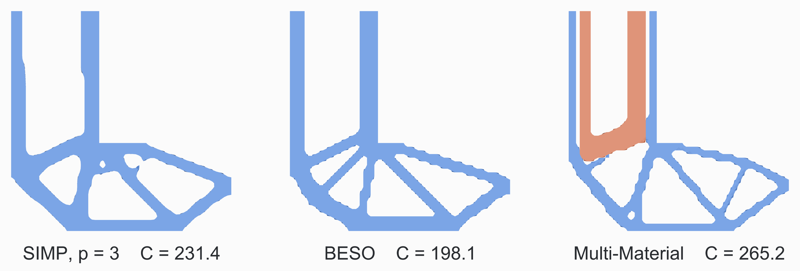
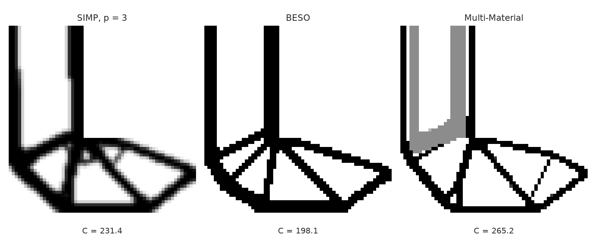

# 📐 L-Bracket

<figure><figcaption></figcaption></figure>

[l-bracket](l-bracket.gh)

The L-bracket: a square without its top right corner, held along the top of its upright leg and
loaded down at the end of its lower one. It is the usual test of stress-based topology optimisation,
because the inner corner where the legs meet concentrates stress. This example finds it with all
three methods of [Topology Optimisation](../../docs/basics/optimisation/topology-optimisation.md):
SIMP, BESO and Multi-Material, side by side.

It is in unit values, as the papers have it: Young's modulus 1, Poisson's ratio 0.3, bricks 1 a
side, and a load of 1. The square is 60 bricks a side, without its top right 36 x 36, so each leg is
24 bricks wide; it is one brick deep, and every method keeps 40% of it.

::: info
Without a license, Topology Optimisation runs on models of up to 500 elements. This one has 2 304,
so it needs one.
:::

## The model

| Group | What it does |
| --- | --- |
| 1 - The domain | The two legs' sides meshed in unit squares with **Mesh Plane**, a copy moved 1 along y, and [SSP Bricks](../../docs/basics/elements/brick.md) between the two by [Mesh Series to Brick](../../docs/basics/utility/mesh-series-to-brick.md), one leg a branch. |
| 2 - Unit values | The material, E = 1 and Poisson's ratio 0.3; and a softer one, E = 0.5, for Multi-Material. |
| 3 - Held and loaded | A [Support](../../docs/basics/elements/support.md) on every node of the top of the upright leg; a [Point Load](../../docs/basics/loads/point-load.md) of 1 down at the middle of the end of the lower leg, half on each face. |
| 4 - Assemble Model | [Assemble](../../docs/basics/assemble.md). [Model View](../../docs/basics/visualisation/model-view.md) is disabled: enable it to see the supports and the load. |
| 5 - Three ways | Three Topology Optimisation components: on SIMP with **Run SIMP**, on BESO with **Run BESO**, on Multi-Material with **Run Multi-Material**, 60% of the volume in the stiff material and 40% in the soft. **VolumeFraction** and **Iterations** are shared. A panel beside each shows its compliance. |
| 6 - Side by side | SIMP's design on the left, BESO's on the right; Multi-Material draws its own, in its materials' colours, where the model is. Each is named with a **Text Tag 3D**. |

## Running it

1. Set **Run SIMP**, **Run BESO** and **Run Multi-Material** to `true`, together or one after the
   other. Each component runs on its own thread, and its design draws in group 6 as it goes.
   Run together on an M2 Pro, all three finish in about 40 s.
2. **Compliance**, the work of the load, is in unit values.

<figure><figcaption>
The densities, black solid and white void; Multi-Material's soft material in grey.
</figcaption></figure>

## What it shows

| Method | Iterations | Compliance | Grey elements |
| --- | --- | --- | --- |
| SIMP, p = 3 | 225 | 231.4 | 25% |
| BESO | 64 | 198.1 | none |
| Multi-Material | 262 | 265.2 | |

Grey elements are those with a density between 0.1 and 0.9.

All three take the load back to the support the same way: the upright leg becomes two columns, one
along each edge, and the lower leg a truss, its diagonals fanning out from the inner corner to a
chord along the bottom and one to the load. The inner corner stays sharp, with material right up to
it: these designs make the bracket as stiff as they can, and stiffness does not see the stress
concentrating there. Stress-based methods are tried on the L-bracket to show them rounding that
corner off; Alpaca4d's three methods minimise compliance, so they do not.

BESO is again the stiffest, and Multi-Material the softest: its soft material makes a panel between
the columns of the upright leg, and its stiff material the columns and the truss.

## Good to know

- This bracket is of a single isotropic material, and only its stiffness is optimised: there is no
  stress or failure check, as studies of the L-bracket in composite layers have.
- **FilterRadius** is 1.5 bricks for SIMP and Multi-Material, top3d's; BESO uses its own default,
  two bricks.
- The same problem runs without Grasshopper in the Alpaca4d repository's tests, `./run.sh bench
  classic lbracket` in `Alpaca4d.Test/TopologyMethods`, and gives the same iterations and
  compliances.
