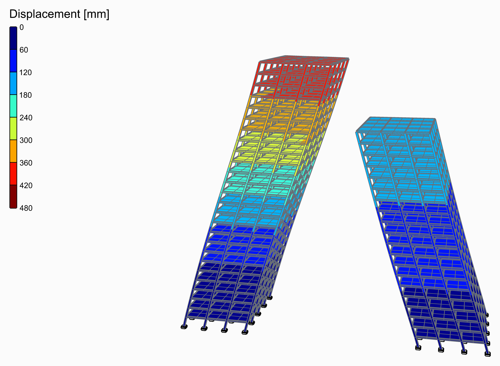
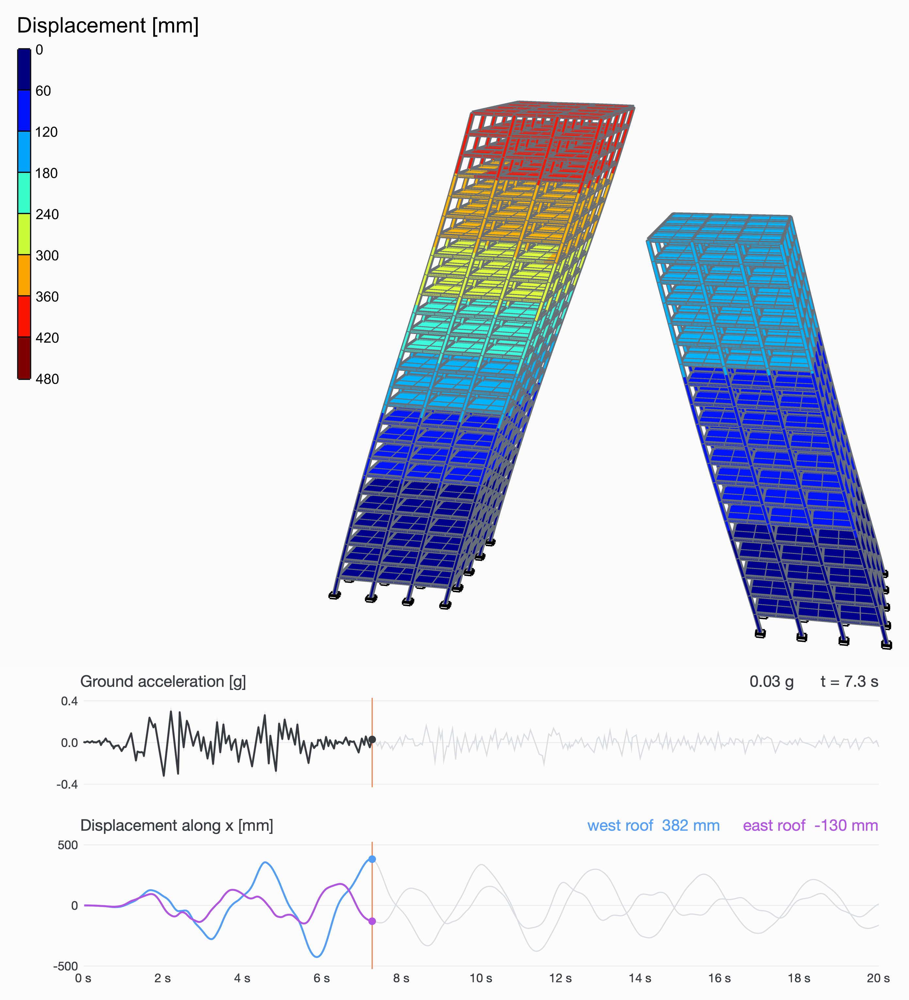

# 📐 Leaning Towers in an Earthquake

<figure><figcaption></figcaption></figure>

[leaning-towers-earthquake](leaning-towers-earthquake.gh)

Two towers leaning 15° towards each other over a street 60 m wide at the ground, the west one twenty-six storeys tall and the east one twenty: each floor sits 0.96 m further over the street than the one under it. Each is a steel frame of three bays by four of 7.5 m with a 200 mm slab at every floor. The El Centro earthquake shakes the ground along x, the way they lean.

<figure><video src="leaning-towers-earthquake-shaking.mp4" autoplay loop muted playsinline></video><figcaption>
The first 20 s of El Centro, as they happened, the movement drawn larger than it is. Beside it, the ground's acceleration and the movement along x of the top of each tower's leaning face, over the same 20 s.
</figcaption></figure>

## The model

| Group | What it does |
| --- | --- |
| 1 - Geometry | The sliders - **Bays along x** and **y**, **Bay**, **Storeys** of each tower, **Storey height**, **Lean** and **Apart at the ground** - and a Python component that draws both frames from them, each floor moved over the street by the storey's height times the tangent of **Lean**: the columns, the beams cut twice a bay, a slab mesh at every floor, the columns' feet, and the top of each tower's leaning face, which the charts follow. |
| 2 - Members | S355 from [Material Library](../../docs/basics/materials/MaterialDatabase.md); box columns 600 × 40 mm, a [Rectangle Hollow CS](../../docs/basics/sections/rectangular-hollow.md), and HEB600 beams from [Steel Section Library](../../docs/basics/sections/library.md), as [ForceBeamColumn](../../docs/basics/elements/force-beam-column.md); 200 mm of concrete, a [Plate Fiber Section](../../docs/basics/sections/plate-fiber.md), as [ASD Shell](../../docs/basics/elements/shell.md)s. |
| 3 - Supports | Every column built in at the ground, with a [Support](../../docs/basics/elements/support.md). |
| 4 - Ground motion | The El Centro record from a Python component, its first **Duration** seconds times **Ground motion scale**; a Path Time Series of it; a Load Pattern of the UniformExcitation type, along the direction it shakes. |
| 5 - Transient analysis | [Assemble](../../docs/basics/assemble.md), with an [MPCO Recorder](../../docs/basics/mpco-recorder.md) of the displacements alone, which is all the view reads; [Damping](../../docs/basics/analysis/damping.md), Rayleigh's from **Damping** and its two frequencies; the Newmark [Integrator](../../docs/basics/analysis/integrator.md); [Analysis Step](../../docs/basics/analysis/analysis-step.md), a step a sample of the record; [Analysis Settings](../../docs/basics/analysis/analysis-settings.md) for a transient analysis with the Linear algorithm, one solve a step, as an elastic model needs; and Run Analysis. |
| 6 - Results | A [Model View](../../docs/basics/visualisation/model-view.md) of the analysed model at **Step**, deformed 15 times, its elements' edges and its supports drawn, its colours in iso-surfaces on the slabs over 0 to 480 mm for every step alike, with a [Legend](../../docs/basics/visualisation/legend.md). Drag **Step** to go through the record. |

Its 6 000 elements are past the free limit of 50: it needs a licence. The analysis takes about four minutes on a laptop; then each step takes a second or a few to draw as you drag **Step**.

## The ground motion

El Centro, 18 May 1940, the north-south component: 0.32 g at its peak, 2 s in, the first 20 s of it. A [Path Time Series](../../docs/basics/time-history/path.md) of its accelerations shakes the ground under the whole structure through a [Load Pattern](../../docs/basics/loads/load-pattern.md)'s UniformExcitation type, and [Run Analysis](../../docs/basics/analysis/run-analysis.md) follows it step by step, 0.02 s at a time, a transient analysis with Newmark's average acceleration. Damping is Rayleigh's, 5% of critical at two frequencies that bracket the modes that matter. **Ground motion scale** makes the record stronger or weaker, **Duration** takes more or less of it.

## What it shows

Leaning, a tower sways slower than it would upright: the west tower's first period is 3.0 s, against 2.6 s with **Lean** at 0. The two are not the same height, so they sway at their own pace, out of step: the top of the west tower moves 426 mm at the most, the east one 190 mm, and the gap between them opens and closes by up to 512 mm. Two towers this close need room to sway, or a joint that lets them, if a bridge joins them. Only the shaking is analysed: the pull of their own weight, leaning, is not part of it.

<figure><figcaption>
The moment it moves the most, and the record up to then.
</figcaption></figure>

## Try

- **Lean** at 0: upright, both sway quicker and less.
- **Storeys, east tower** at 26, the same as the west one: mirror images, shaken the same way, they sway along x together, step for step.
- **Apart at the ground** and **Lean** together: how close can the tops come before they touch?
