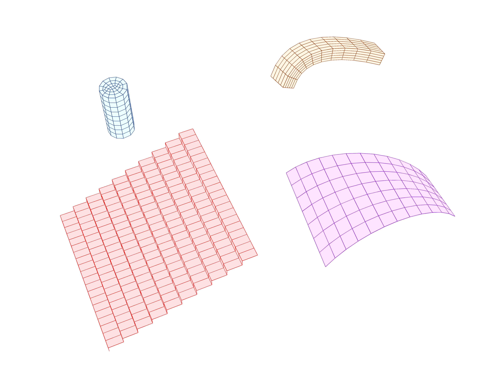

# 🕸️ Mesh Loft - Mesh Series to Bricks

<figure><figcaption></figcaption></figure>

[meshloft-meshbrick](meshloft-meshbrick.gh)

This example illustrates how the **Mesh Loft** and **Mesh Series to Brick** utilities can be used to generate brickable volumes.  
Follow the script to see how a series of meshes is converted into brick elements, and reuse the pattern to create your own 3D solid models for volumetric analysis.
