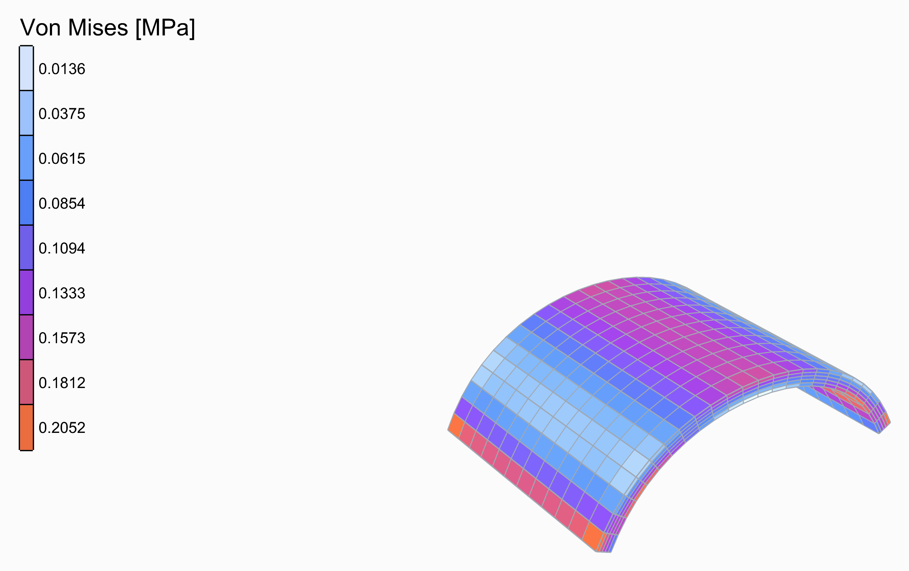
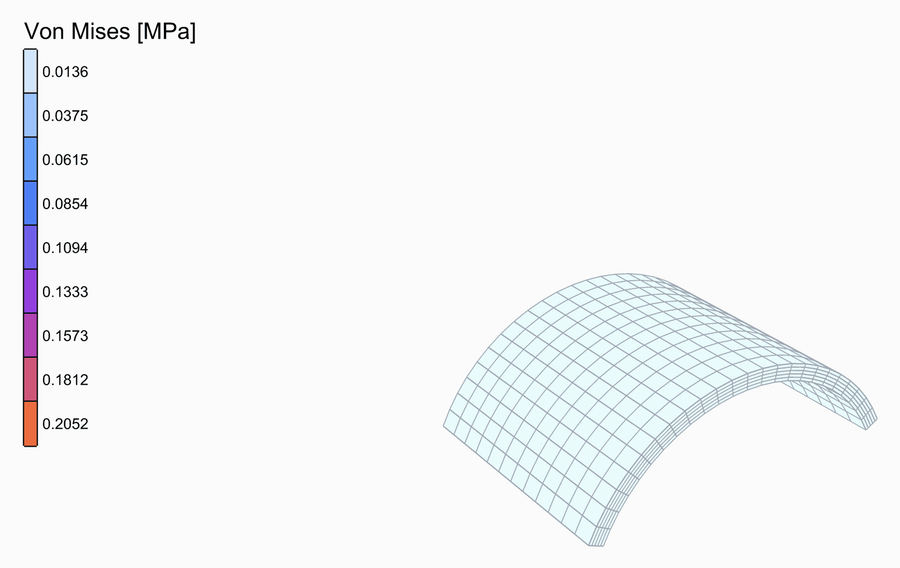

# 🕸️ Mesh Loft - Mesh Series to Bricks

<figure><figcaption></figcaption></figure>

[meshloft-meshbrick](meshloft-meshbrick.gh)

A concrete barrel vault 8 m across, 2.5 m high, 6 m long and 400 mm thick, built of bricks from nothing but polylines. A Python component draws six surfaces through its thickness, from the inside to the outside, each a branch of polylines across the vault, all with the same number of points. [Mesh Loft](../../docs/basics/utility/mesh-loft.md) lofts each branch into a mesh of quads. The meshes match face for face, so [Mesh Series to Brick](../../docs/basics/utility/mesh-series-to-brick.md), taking them in order, makes a layer of eight-node bricks between each two: five layers through the 400 mm. The vault's size, its bricks round the arc and along it, and its layers are sliders.

<figure><figcaption>
The deformed shape, from rest to 2000 times its size and back.
</figcaption></figure>

## The model

| Group | What it does |
| --- | --- |
| 1 - Geometry | The sliders, and a Python component that draws Layers + 1 surfaces as polylines, a branch each, inside to outside, along with the points of both springings. A panel counts the bricks: 5 layers of 24 x 12, 1 440 in all. |
| 2 - Bricks | **Mesh Loft**, a mesh a branch. **Mesh Series to Brick**, a layer of bricks between each two meshes. [SSP Bricks](../../docs/basics/elements/brick.md) of C30/37, an [nD](../../docs/basics/materials/ND.md) material. |
| 3 - Supports | Every node along both springings held, with a [Support](../../docs/basics/elements/support.md). A brick's node has no rotations to hold. |
| 4 - Loads | Its own weight, a [Gravity Load](../../docs/basics/loads/gravity.md). |
| 5 - Analysis | [Assemble](../../docs/basics/assemble.md) and [Run Analysis](../../docs/basics/analysis/run-analysis.md). |
| 6 - Results | A [Model View](../../docs/basics/visualisation/model-view.md) of the vault deformed, coloured by Von Mises stress in MPa, with a [Legend](../../docs/basics/visualisation/legend.md). |

## Two things Mesh Loft needs

- **Every polyline of a branch has the same number of points.** Mesh Loft joins point *i* of one polyline to point *i* of the next, so a curve divided into a different count breaks the mesh.
- **The meshes match face for face.** Mesh Series to Brick joins face *f* of one mesh to face *f* of the next. Draw every surface with the same divisions, in the same order.

## What it shows

The vault works in compression. The stress is highest along the feet, from 0.15 to 0.19 MPa, where its weight and its thrust meet the ground. Elsewhere it falls as low as 0.04 MPa, because a circular arc is not quite the shape its weight wants, so it bends a little on top of its compression. A hand check agrees. A metre of the vault weighs about 97.5 kN over its 9.94 m of arc, so each foot carries about 49 kN/m down and 39 kN/m of thrust. Over the 0.4 m thickness, that comes to 0.16 MPa.

Try a rise of 4 m, 8 layers of bricks or a thickness of 0.25 m, and see how the stress moves.
