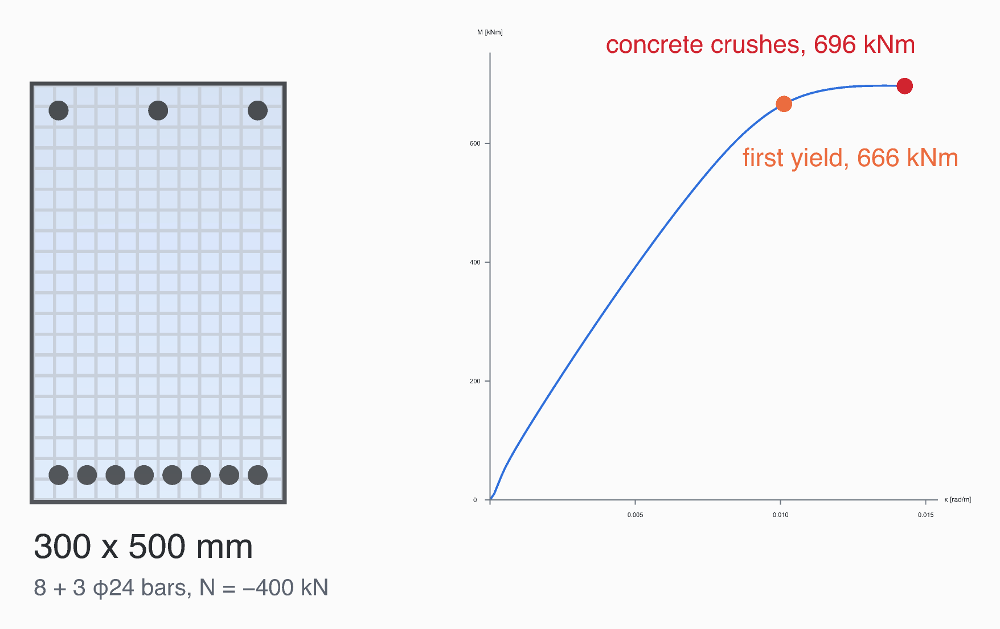

# 📈 Moment Curvature

<figure><figcaption></figcaption></figure>

[moment-curvature](moment-curvature.gh)

A 300 × 500 mm reinforced concrete section, bent until it fails while 400 kN of compression is held
on it: [Moment Curvature](../../docs/basics/moment-curvature/moment-curvature.md) follows it fibre by
fibre, and [Moment Curvature Diagram](../../docs/basics/moment-curvature/moment-curvature-diagram.md)
draws the curve beside the section, with first yield and the ultimate state marked. Use it to see how
the materials and the bars drive a section's stiffness, strength and ductility, and as a start for
studies of your own sections.

## The model

| Group | What it does |
| --- | --- |
| 1 - Materials | [Concrete01](../../docs/basics/moment-curvature/concrete01.md) and [ReinforcingSteel](../../docs/basics/moment-curvature/reinforcing-steel.md), with their presets. |
| 2 - The section | The outline, a Rectangle 3Pt 300 × 500 mm, meshed into 12 × 20 faces by Mesh Plane: a [Patch](../../docs/basics/moment-curvature/patch.md) of concrete, one fibre a face. φ24 bars 30 mm in from its short faces, eight along the bottom and three along the top, a [Fiber Point](../../docs/basics/moment-curvature/fiber-point.md) each. Both into a [Fiber Section](../../docs/basics/moment-curvature/fiber-section.md). Sizes in metres: a fibre section is in metres and its materials in kN/m². |
| 3 - Moment Curvature | **Axial** -400 kN, compression, held while the curvature about the section's local y axis grows, in 200 increments, until the first fibre reaches its ultimate strain. **Direction** 180, so that the eight bars are the ones in tension. |
| 4 - Results | Panels with the moment at first yield, the ultimate moment and curvature, the curvature ductility, the cracked stiffness to first yield and which fibre failed; [Moment Curvature Diagram](../../docs/basics/moment-curvature/moment-curvature-diagram.md) draws the curve beside the section, 0.5 m across. |

## What it shows

With the eight bars in tension, the section first yields at 666 kN·m and reaches 696 kN·m at a
curvature of 0.0143 rad/m, where the concrete crushes at its top corner (εcu 3.5 ‰): a curvature
ductility of 1.4. Its cracked stiffness to first yield, EI, is 65 800 kN·m², about half the
uncracked section's.

Bent the other way, **Direction** 0, the three bars are in tension: it yields at 329 kN·m and
reaches 359 kN·m, half as strong, but at 0.0249 rad/m, where a bar reaches its ultimate strain
first, with a ductility of 3.7. Eight bars in tension make the section strong and brittle: the
concrete gives out before the steel has stretched far. Three make it weaker and ductile.

## What to try

* **Sweep the axial force.** Feed a range into **Axial** (negative for compression) and watch the
  ductility fall as the compression grows. For the whole M–N interaction at the ultimate limit
  state use [Interaction Domain](../../docs/basics/moment-curvature/interaction-domain.md) instead.
* **Bend it the other way.** **Direction** 0 bends it about y the other way: the three bars go into
  tension, and the section is weaker but far more ductile.
* **Bend it off its axes.** Give **Direction** an angle, `30` say: the moment holds that direction
  and the neutral axis turns as it needs to.
* **Change the bars.** The bar counts and size are at the top of `MomentCurvature.py`; on the canvas,
  add points and areas to the Fiber Point.
* **Refine the patch mesh.** Each face is one fibre, so the mesh density is the fibre density: Mesh
  Plane's counts.
* **Unpack the fibres.** [Fiber Stress Strain](../../docs/basics/moment-curvature/fiber-stress-strain.md)
  gives the stress and strain history of every fibre.

See [Moment Curvature](../../docs/basics/moment-curvature/README.md) for the reference
documentation on each component.
