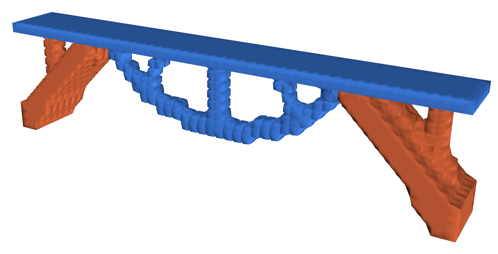
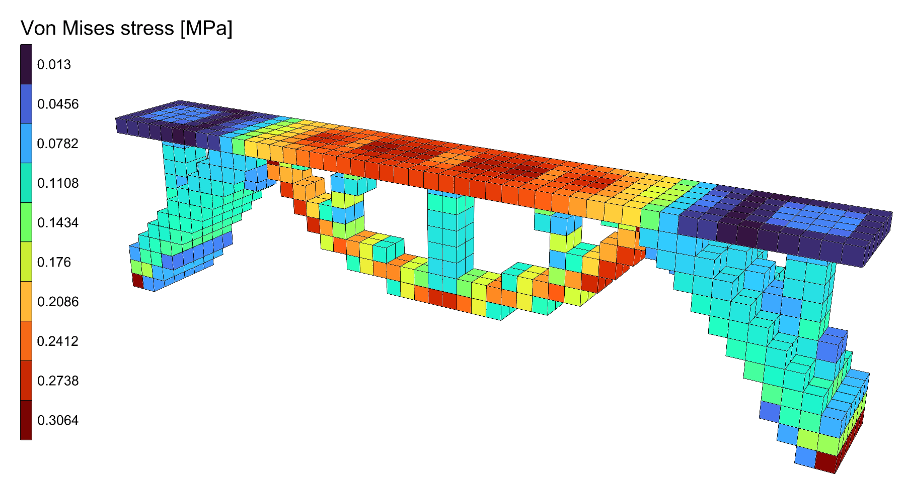

# 🧱 Multi-Material Bridge

<figure><figcaption></figcaption></figure>

[multi-material-bridge](multi-material-bridge.gh)

Where a bridge needs its steel, and where concrete will do, found by
[Multi-Material Topology](../../docs/basics/optimisation/multi-material-topology.md) in a block of bricks.
It is the block of the [Topology Bridge](../topology-bridge/topology-bridge.md): 16 m long, 2 m wide
and 4 m high, pinned along both ends of its bottom, its top layer a steel deck kept solid under
10 kN/m². Brick by brick, the optimisation chooses between steel (E = 210 GPa) and concrete
(E = 33 GPa), with at most 5% of the block below the deck in steel and 15% in concrete.

::: info
Without a license, Multi-Material Topology runs on models of up to 500 elements. At 3 bricks per
metre this one has 3 456, so it needs one; at 1 brick per metre, 128 bricks, it runs without.
:::

## The model

| Group | What it does |
| --- | --- |
| 1 - How fine | **Bricks per metre**, the same every way. The Expressions turn it into the bricks along and across, the height of a layer and the number of levels. |
| 2 - The design domain and the deck | The plan, a 16 x 2 m rectangle, meshed once with **Mesh Plane**, copied up level by level and made into bricks between each pair of levels by [Mesh Series to Brick](../../docs/basics/utility/mesh-series-to-brick.md). The domain runs from the bottom to the deck's underside; the deck is the one layer above. |
| 3 - Steel and concrete, and the bricks | Two [nD](../../docs/basics/materials/ND.md) materials: steel, E = 210 GPa and ν = 0.3, and concrete C30/37, E = 33 GPa and ν = 0.2. The bricks, named **Domain** and **Deck** through their ElementId, are modelled in steel. |
| 4 - Pinned ends, and the deck load | The nodes along the bottom of both ends, held in X, Y and Z by a [Support](../../docs/basics/elements/support.md). The deck load, 10 kN/m² over 32 m², shared among the nodes of the deck's top as [Point Loads](../../docs/basics/loads/point-load.md), in a [Load Pattern](../../docs/basics/loads/load-pattern.md). |
| 5 - Assemble Model | [Assemble](../../docs/basics/assemble.md). [Model View](../../docs/basics/visualisation/model-view.md) is disabled: enable it to see the domain, the supports and the loads. |
| 6 - Multi-Material Topology | **Keep** names the Deck. **Materials** are the steel and the concrete; **VolumeFractions** are the **Steel share**, 0.05, and the **Concrete share**, 0.15. **Iterations** 300, **Run**, and **Step** to look back over the run. Panels show the compliance, whether the run converged, and its history. The component draws each material in its colour: steel blue, concrete orange. |
| 7 - The design, analysed | [Run Analysis](../../docs/basics/analysis/run-analysis.md) on **AlpacaModel**, the design as a model of its own with each brick of its material, and View Results colouring it by Von Mises stress, with a Legend. Run Analysis and Legend are disabled: enable them once the run has stopped. |

## Running it

1. Set **Run** to `true`. The run goes on its own thread, so Rhino stays free, and the preview and
   the outputs follow it about once a second. At 3 bricks per metre it converges after 265
   iterations, in under a minute on an Apple M2 Pro.
2. The densities sharpen to one material or none every 50 iterations, so the compliance jumps a
   little each time; the design only becomes clear after iteration 200 or so.
3. Drag **Step** back to watch the run again, design by design.
4. Once the run has stopped, select **Run Analysis** and **Legend** and enable them. The design is
   analysed as it would be built, each brick of its material.

<figure><figcaption></figcaption></figure>

## What it shows

The concrete goes into two broad legs that rise from the supports to the deck, a quarter of the
way in from each end. The steel goes into an arch slung under the middle of the deck, hung from
it by a column at mid-span. Concrete is six times softer than steel, so it is used where it can be
thick; the little steel there is goes where the deck needs stiffening most.

Only stiffness is optimised, and only the Young's moduli count. The steel ends up under the deck
because that is where it stiffens most for its volume, not because it is good in tension:
change the shares and see how the split moves.
