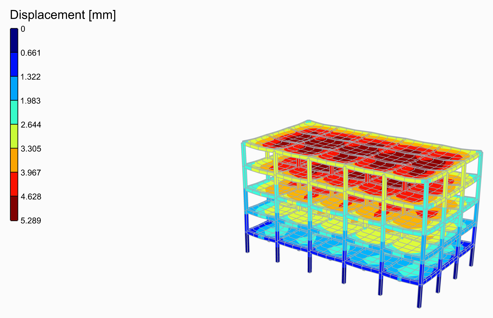
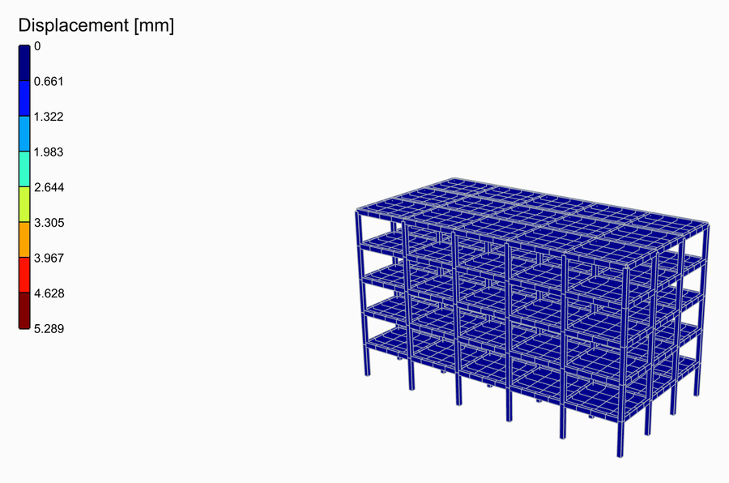
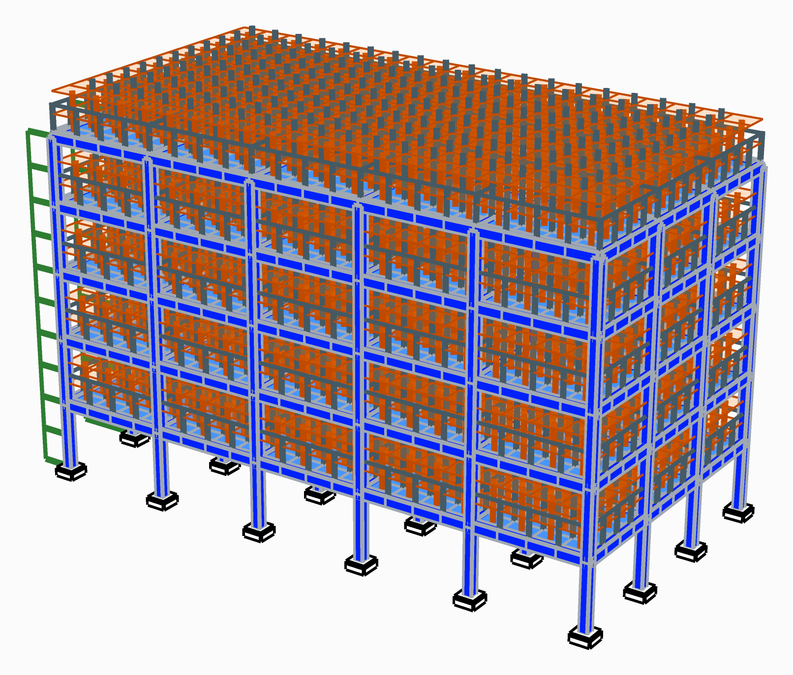
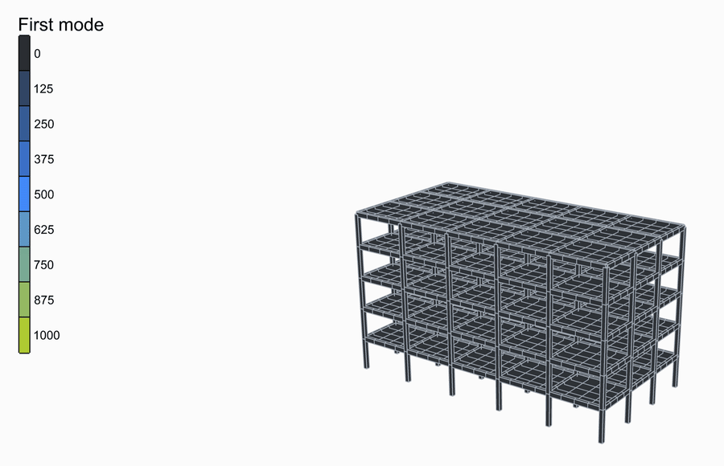

# 🏢 Multi-Storey Building

<figure><figcaption></figcaption></figure>

[multi-storey-building](multi-storey-building.gh)

A reinforced concrete frame 30 x 15 m on plan and five storeys of 3.5 m. It has a column at every crossing of the grid, a beam along every grid line on every floor, and a 200 mm slab on the beams. The slab is meshed four quads a bay each way, and the beams are cut at the same points, so slab and beams share their nodes and bend together. Bays, storeys, their sizes and the mesh are sliders. Beside the static analysis, a natural vibration analysis gives its first six modes.

<figure><figcaption>
The deformed shape, from rest to 200 times its size and back.
</figcaption></figure>

## The model

| Group | What it does |
| --- | --- |
| 1 - Geometry | The sliders, and a Python component that draws the columns, the beams cut at the slab's mesh, the slab of every floor as a mesh, the feet and the width of wall each windward column takes wind from. A panel counts them: 120 columns, 760 beams, 1 200 slab quads. |
| 2 - Members | C30/37 from the [Material Library](../../docs/basics/materials/MaterialDatabase.md). Columns 400 x 400 and beams 300 x 500, [Rectangular](../../docs/basics/sections/rectangular.md) [Force Beam Columns](../../docs/basics/elements/force-beam-column.md). The slabs are 200 mm [ASD Shells](../../docs/basics/elements/shell.md) on a [Plate Fiber Section](../../docs/basics/sections/plate-fiber.md). |
| 3 - Supports | Every column built in at the ground, with a [Support](../../docs/basics/elements/support.md). |
| 4 - Loads | The own weight ([Gravity Load](../../docs/basics/loads/gravity.md)), plus the finishes and the people on every slab as [Mesh Loads](../../docs/basics/loads/shell-load.md). The wind on the face at x = 0 is a [Linear Load](../../docs/basics/loads/beam-load.md) on its columns. Three [Load Patterns](../../docs/basics/loads/load-pattern.md): permanent, imposed and wind. |
| 5 - Analysis | [Assemble](../../docs/basics/assemble.md) and [Run Analysis](../../docs/basics/analysis/run-analysis.md), all three patterns together. A [Natural Vibration Analysis](../../docs/basics/analysis/natural-vibration.md) of the same model gives six modes, with their frequencies in a panel. |
| 6 - Results | A [Model View](../../docs/basics/visualisation/model-view.md) of the building deformed, coloured by its displacement in bands, with a [Legend](../../docs/basics/visualisation/legend.md). A second one draws the first mode, and a third the supports and the loads. |

## The loads

The loads are typed in kN/m² and are unfactored, as they are for the deflections: finishes 1.5 kN/m², people 3.0 kN/m² and wind 0.8 kN/m². The wind falls on the face at x = 0, and each column there takes it over the width of wall it carries. Factor the Load Patterns for the ultimate limit state.

<figure><figcaption>
The supports and the loads, as <strong>Model View</strong> draws them: the slab loads on every quad, the wind on the columns of one face.
</figcaption></figure>

## What it shows

The slabs sag most in the middle of each bay, and the building moves at most 5.3 mm, on the top floors, where the sway from the wind adds to the slabs' sag. Its first three modes are at 1.22, 1.23 and 1.40 Hz, and the next at 3.70 Hz. They come from the concrete's own mass alone: the finishes and the people are loads here, not masses. The second Model View draws the first mode; change its **Step** to see the others.

<figure><figcaption>
The first mode, 1.22 Hz.
</figcaption></figure>

Try 10 storeys and watch the first frequency fall. With 1 bay along y, see which way the first mode sways it. Or raise the wind to 1.5 kN/m².
