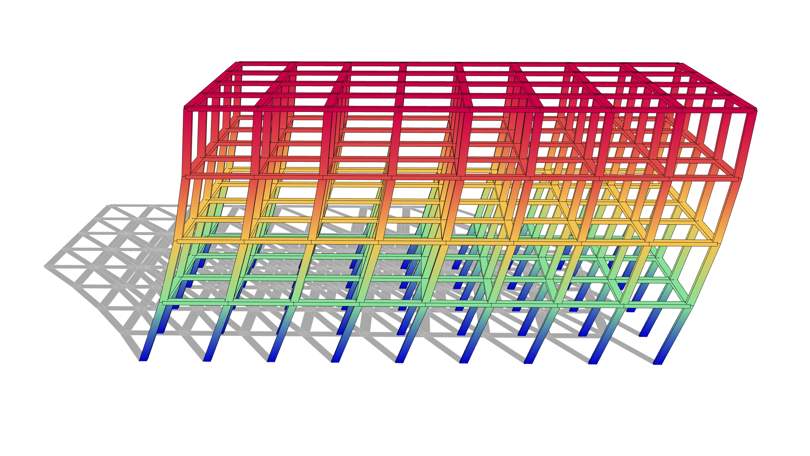

# 🏢 Multi Storey Building

<figure><figcaption></figcaption></figure>

[multi-storey-building](multi-storey-building.gh)

This example shows a typical multi‑storey building model built from beams, columns, slabs and diaphragms.  
Use it to understand the overall Alpaca4d workflow for real‑scale buildings: defining geometry, assigning sections and materials, applying loads, creating load patterns and running global analyses.
