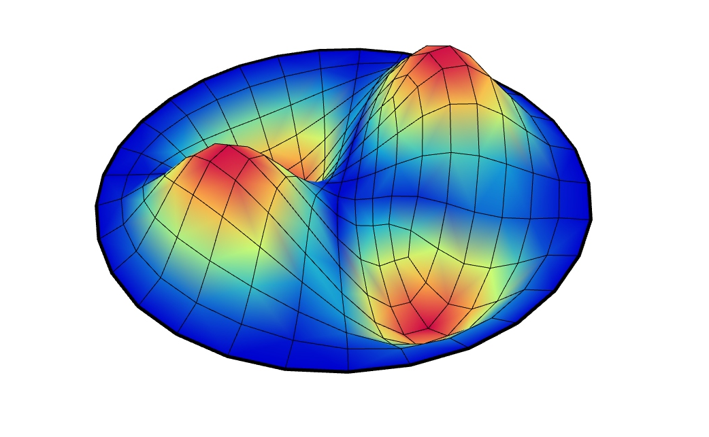
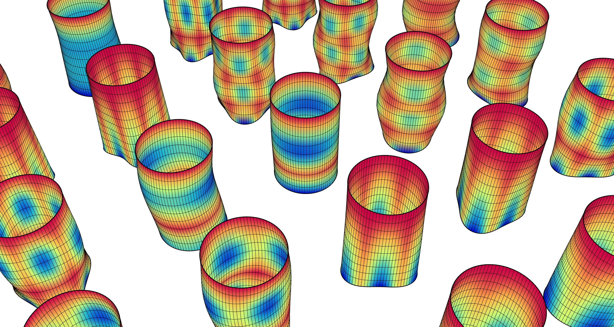

# 🎶 Natural Vibration

<figure><figcaption></figcaption></figure>

<figure><figcaption></figcaption></figure>

[natural-vibration](natural-vibration.gh)

This example focuses on the modal behaviour of a structure, computing its eigenfrequencies and mode shapes.  
Run the script to visualise the main vibration modes and use it as a reference for setting up your own modal analyses and for interpreting dynamic characteristics of more complex models.
