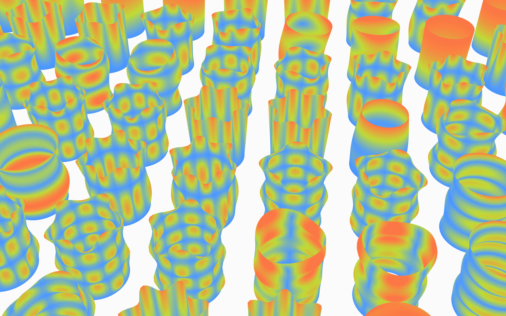
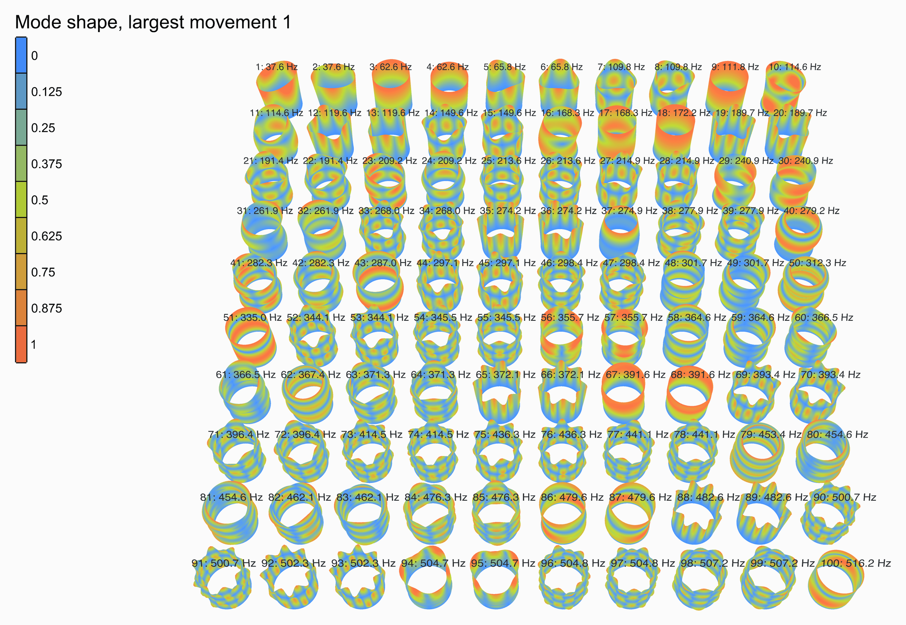

# 🎶 Natural Vibration of a Tank

<figure><figcaption></figcaption></figure>

[natural-vibration](natural-vibration.gh)

A round concrete tank, 4 m across and 5 m tall, its wall 200 mm thick, built in round its base and open at the top. A [Natural Vibration Analysis](../../docs/basics/analysis/natural-vibration.md) finds the ways it swings on its own, its natural modes, and how often each one swings. This example asks for a hundred of them and draws every one at once, each on its own copy of the tank, on a grid of ten by ten. They go from the rim going oval, 37.6 times a second, to shapes with eight lobes round the rim or six bands up the wall, over 500 times a second.

<figure><video src="natural-vibration-swinging.mp4" autoplay loop muted playsinline></video><figcaption>
Every mode at once, swinging through its rest, drawn far larger than it moves.
</figcaption></figure>

## The model

| Group | What it does |
| --- | --- |
| 1 - Geometry | The sliders - **Radius**, **Height**, **Elements around**, **Elements up**, **Wall**, **Modes**, **Columns** and **Spacing** - and a Python component that draws the tank from them: its wall as a mesh of quads standing on the ground, the nodes round its base, and for each mode a move to its place on the grid, **Columns** to a row, **Spacing** apart. |
| 2 - Members | Concrete as an [nD material](../../docs/basics/materials/ND.md), E 30 GPa, ν 0.2 and 2 500 kg/m³; a [Plate Fiber Section](../../docs/basics/sections/plate-fiber.md) **Wall** thick; and the wall as [ASD Shell](../../docs/basics/elements/shell.md)s. |
| 3 - Supports | A [Support](../../docs/basics/elements/support.md) at every node round the base, all six movements held: built in. |
| 5 - Analysis | [Assemble](../../docs/basics/assemble.md), with no load: the mass is the tank's own weight, 31 t, from the concrete's density. A [Natural Vibration Analysis](../../docs/basics/analysis/natural-vibration.md) of the first **Modes** modes, their frequencies in a panel. |
| 6 - Results | A Series of steps, 0 to **Modes** - 1, into the Step of a [Model View](../../docs/basics/visualisation/model-view.md): it draws each mode in turn, deformed and coloured over 0 to 1, the same for every mode. Model View draws only the last mode of a list, so its preview is off: its Geometry output, a coloured mesh a mode, is moved onto the grid with Move, its motions grafted so that each mode gets its own, and drawn by a Mesh parameter, **Every mode**. A Python component, **Mode labels**, writes each mode's number and frequency over its tank with Text Tag 3D; a [Legend](../../docs/basics/visualisation/legend.md) takes the first mode's nine values and colours with List Item, as every mode has the same. |

Its 1 920 shells are past the free limit of 50 elements: it needs a licence. The analysis and the drawing of all hundred modes take a few seconds.

## What it shows

<figure><figcaption>
All hundred modes, each with its number and frequency, reading like a page: the first at the back left.
</figcaption></figure>

| Modes | Frequency | How it swings |
| --- | --- | --- |
| 1 and 2 | 37.6 Hz | The rim goes oval: two lobes round it, the wall moving most at the top |
| 3 and 4 | 62.6 Hz | The whole tank sways, bending over its base |
| 5 and 6 | 65.8 Hz | Three lobes round the rim |
| 9 | 111.8 Hz | It twists about its axis |
| 18 | 172.2 Hz | It bounces up and down along its axis |
| 98 and 99 | 507.2 Hz | Four lobes round the rim and six bands up the wall |

The lowest mode is not the tank swaying as a whole but its open rim going oval: a free edge with nothing round it is the softest part of a shell. A roof, or a ring round the rim, would hold it round.

Most modes come in pairs with the same frequency. A round tank can swing in any shape turned round by any angle, so the analysis gives two of each, a quarter of a wave apart; any mix of the two is a mode too. The modes that are the same all round, twisting and bouncing, come alone.

A mode has no size of its own: Natural Vibration reads each with its largest movement 1, so the legend runs from 0 to 1 and says where the tank moves most, not by how much. How far it actually moves comes from a dynamic analysis under the load that excites it. The tank is empty: water in it would add mass that moves with the wall, and bring the frequencies down.

On a mesh twice as fine, 128 by 60, the first modes move by less than 0.1% and the hundredth by 0.2%: 64 by 30 is fine enough for all hundred.

## Try

- **Wall.** At 100 mm the first mode falls to 31.0 Hz; at 300 mm it rises to 46.2 Hz. The sway of the whole tank stays near 63 Hz, its stiffness and its mass both growing with the wall.
- **Height.** At 8 m, with **Elements up** at 48, the first mode falls to 25.9 Hz.
- **Modes** and **Columns.** Fewer modes are quicker; Columns sets how many to a row.
- **Elements around** and **Elements up.** The higher modes need more elements: count at least three or four a lobe.
