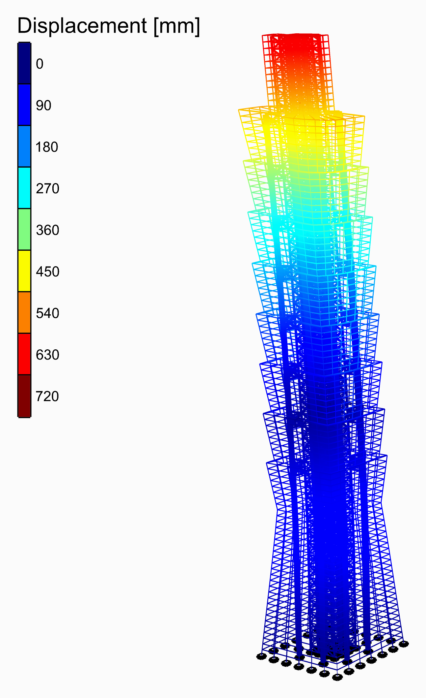
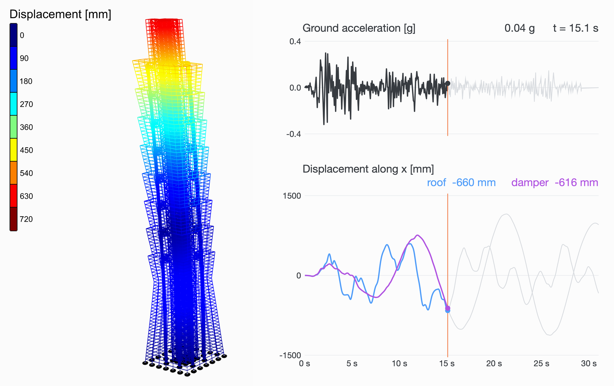

# 🏯 Outriggers and a Damper, after Taipei 101

<figure><figcaption></figcaption></figure>

[outrigger-tower-earthquake](outrigger-tower-earthquake.gh)

A braced steel core of sixteen columns, 22 m square, and eight super columns, two on each face, tied together by outrigger trusses two storeys deep under the foot of every module: when the tower sways, the outriggers make the super columns stretch and squash, and the whole width of the tower bends as one. Eight modules of eight storeys flare out over a base of 25 storeys that narrows as it rises, under a top of 12: 101 storeys, 424 m to the roof. In the core, 660 t hang from the 92nd floor on a spring and a dashpot tuned to the tower's sway. This is the structure of Taipei 101. The El Centro earthquake shakes the ground along x.

<figure><video src="outrigger-tower-earthquake-shaking.mp4" autoplay loop muted playsinline></video><figcaption>
The first 31 s of El Centro, as they happened, the movement drawn larger than it is. Beside it, the ground's acceleration and the movement along x of the roof and of the damper, over the same 31 s.
</figcaption></figure>

## The model

| Group | What it does |
| --- | --- |
| 1 - Geometry | The sliders - **Storey height**, the modules' **half width** and **flare**, and the damper's **mass**, **period** and **damping** - and a Python component that draws the tower from them: the core's columns, beams and braces, the super columns, the perimeter's columns and ring beams, the outriggers, the beams the damper hangs from; the feet; each floor's nodes and the one it is driven from, for the diaphragms; each node's share of its floor's mass; the damper's rod, point and mass, and its spring's stiffness and dashpot from its mass and period; and the roof and the damper, which the charts follow. |
| 2 - Members | S355 from [Material Library](../../docs/basics/materials/MaterialDatabase.md); [Rectangle Hollow CS](../../docs/basics/sections/rectangular-hollow.md)s - core columns 1 200 × 80 mm, braces 800 × 60 mm, super columns 2 400 × 3 000 × 200 mm, their steel thick for the concrete that fills them, outriggers 1 200 × 80 mm - and HEM600 and HEM1000 sections from [Steel Section Library](../../docs/basics/sections/library.md), all as [ForceBeamColumn](../../docs/basics/elements/force-beam-column.md). The damper: a rod, a Truss, which holds it up; a [Link](../../docs/basics/elements/spring-link.md) along the rod with an elastic [Uniaxial](../../docs/basics/materials/Uniaxial.md) material across it each way, its E the spring's stiffness and its Eta the dashpot; and a [Mass Point](../../docs/basics/loads/mass-point.md) of the damper's mass at its foot. |
| 3 - Supports and floors | Every column and wall built in at the ground, with a [Support](../../docs/basics/elements/support.md); and every floor a [Rigid Diaphragm](../../docs/basics/constraints/diaphragm.md) - its nodes move together in its plane, as a concrete floor makes them - driven from one of its nodes. |
| 4 - Ground motion and masses | The El Centro record, as in the other earthquakes, along x. A [Mass Point](../../docs/basics/loads/mass-point.md) at every node of every floor: **Floor mass** kg/m² of the floor's area - its slab, finishes, facade and some of what is in it - shared between its nodes. The damper's mass is a Mass Point of its own. |
| 5 - Transient analysis | [Assemble](../../docs/basics/assemble.md), with an [MPCO Recorder](../../docs/basics/mpco-recorder.md) of the displacements alone, which is all the view reads; [Damping](../../docs/basics/analysis/damping.md), Rayleigh's from **Damping** and its two frequencies; the Newmark [Integrator](../../docs/basics/analysis/integrator.md); [Analysis Step](../../docs/basics/analysis/analysis-step.md), a step a sample of the record; [Analysis Settings](../../docs/basics/analysis/analysis-settings.md) for a transient analysis with the Linear algorithm, one solve a step, as an elastic model needs; and Run Analysis. |
| 6 - Results | A [Model View](../../docs/basics/visualisation/model-view.md) of the analysed model at **Step**, deformed 20 times, its supports drawn, its colours over 0 to 720 mm for every step alike, with a [Legend](../../docs/basics/visualisation/legend.md). Drag **Step** to go through the record. |

Its 13 000 elements are past the free limit of 50: it needs a licence. The analysis takes about three minutes on a laptop; then each step takes a second or a few to draw as you drag **Step**.

## The ground motion

El Centro, 18 May 1940, the north-south component: 0.32 g at its peak, 2 s in, the first 31 s of it. A [Path Time Series](../../docs/basics/time-history/path.md) of its accelerations shakes the ground under the whole structure through a [Load Pattern](../../docs/basics/loads/load-pattern.md)'s UniformExcitation type, and [Run Analysis](../../docs/basics/analysis/run-analysis.md) follows it step by step, 0.02 s at a time, a transient analysis with Newmark's average acceleration. Damping is Rayleigh's, 2% of critical at two frequencies that bracket the modes that matter. **Ground motion scale** makes the record stronger or weaker, **Duration** takes more or less of it.

## What it shows

The tower sways along x, its roof 660 mm off at the most, 15.1 s in. On its own its first period is 9.7 s; the damper, tuned to it, splits it in two, at 9.9 s and 9.1 s, the tower and the damper swinging together and against each other. The damper swings the most of all, 1155 mm at the most, almost twice as far as the roof, and takes a little of its movement: with **Damper** at 1 t, next to no damper, the roof moves about 2% more at the most, and 4% more late in the record, as the tower swings on its own. A damper this size is there for the wind, which sways a tower at its own period for hours; an earthquake is over too soon for it to help much. It is a model of how the tower's structure works, made from its published shape and sizes, not a model of the tower itself: its members' sizes and its floors' mass are a designer's guesses, it is built in at the ground rather than standing on its foundations, and the real tower has much more in it.

<figure><figcaption>
The moment it moves the most, and the record up to then.
</figcaption></figure>

## Try

- **Damper** at 3 000 t, four and a half times as heavy: the roof moves about 5% less at the most, and 8% less late in the record.
- **Damper period** at 5 s: out of tune, it hardly helps.
- Take the outriggers out of Assemble: the core bends alone, and the tower sways slower and further.
