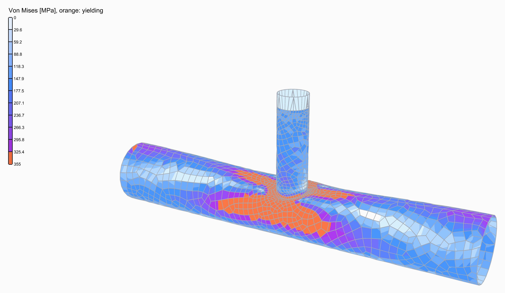
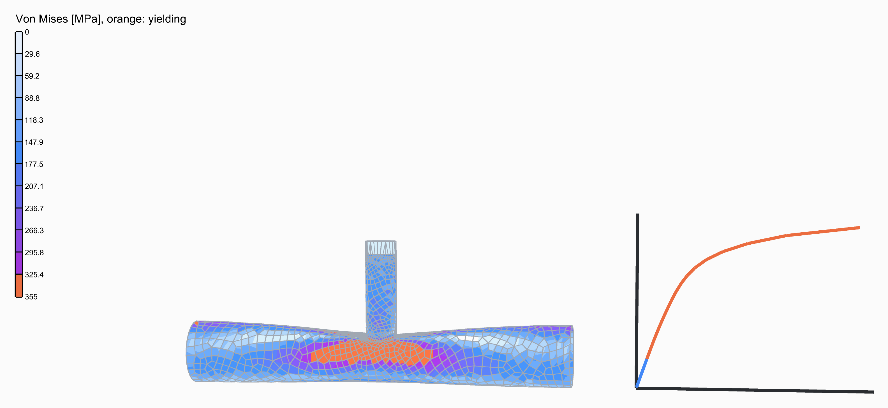
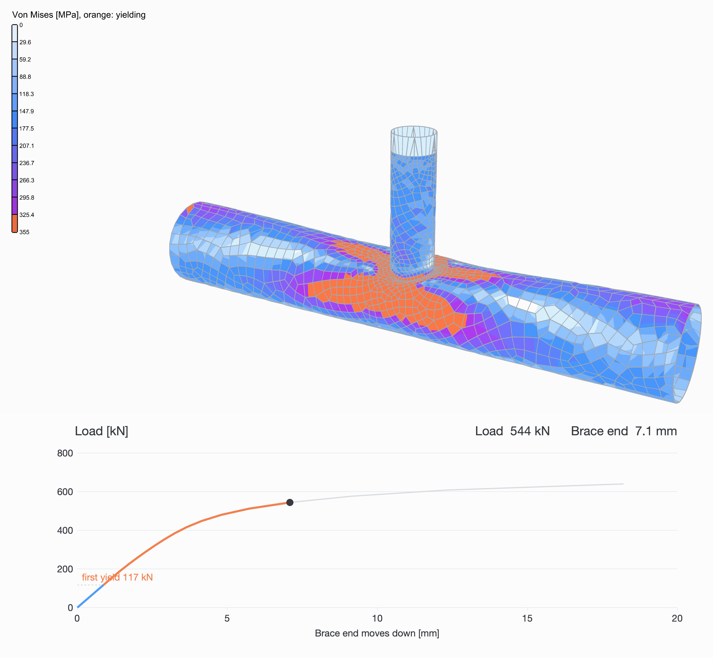

# 🔗 Pipe T-Joint

<figure><figcaption></figcaption></figure>

[pipe-t-joint](pipe-t-joint.gh)

A brace 150 x 8 mm standing on a chord 300 x 10 mm, 1.8 m long, both S355, as 2 434
[ASD Shells](../../docs/basics/elements/shell.md) through the middle of their walls. The brace is
pushed down into the chord. The steel is the [nD](../../docs/basics/materials/ND.md) component's
**J2Plasticity** unit, so where the Von Mises stress reaches 355 MPa the wall yields and the load
moves round it. Twenty steps take the brace to 640 kN.

<figure><video src="pipe-t-joint-pushing.mp4" autoplay loop muted playsinline></video><figcaption>
The push, a step a frame, drawn 10 times its deformation. Orange is steel at yield. Under it, how far the brace's end has gone down, against the load.
</figcaption></figure>

## The model

| Group | What it does |
| --- | --- |
| 1 - The mesh | The shells as gmsh wrote them: the nodes, and the corners of each face, in three parts - the chord, the brace, and the brace's top 60 mm. The chord's wall runs on inside the brace's foot, as a welded joint's does. |
| 2 - Steel | J2Plasticity S355, perfectly plastic, in a [Layered Shell](../../docs/basics/sections/layered-shell.md) of ten layers for each tube: 10 mm for the chord, 8 mm for the brace. The brace's top stays elastic and 30 mm thick, as the end plate the load comes in through makes it. Each part has its own Local X, along its tube. |
| 3 - Supports | Both ends of the chord held, every node of their rings, as end plates welded to something stiff. |
| 4 - Load | 640 kN down the brace, shared among the nodes of its top, as [Point Loads](../../docs/basics/loads/point-load.md) in a [Load Pattern](../../docs/basics/loads/load-pattern.md) on a [Linear Time Series](../../docs/basics/time-history/linear.md). |
| 5 - Assemble | [Assemble](../../docs/basics/assemble.md), with a tolerance of 0.5 mm. |
| 6 - Pushed in steps | Newton, a [Test](../../docs/basics/analysis/test.md) of the displacement increment to 1 µm, and 20 steps of [Load Control](../../docs/basics/analysis/integrator.md) of 5%. |
| 7 - Von Mises | A [Model View](../../docs/basics/visualisation/model-view.md) of the Von Mises stress at the **Step** the slider picks, in Alpaca4d's colours: light blue through blue to purple for the elastic range, orange where the steel yields. |
| 8 - The curve | [Nodal Displacements](../../docs/basics/results/nodal-displacements.md) and Shell Stresses at every step, and a Python component that draws how far the brace's end goes down against the load: light blue while every point is elastic, orange after. |

<figure><figcaption>
As the example opens, at step 17: the joint, and the curve Grasshopper draws under it.
</figcaption></figure>

## What it shows

The first steel to yield is at the line the brace meets the chord, at about 120 kN: a hot spot, where
the brace's stiff wall pushes on the chord's soft one. From there the yielding spreads over the
chord's face and down its sides, the chord's wall bending in round the brace's foot - what
EN 1993-1-8 calls chord face failure. The curve bends over and keeps climbing more and more slowly.

EN 1993-1-8 gives this joint 388 kN for chord face failure (Table 7.2, with γM5 = 1). Its limit is a
deformation rather than a collapse: a chord wall that yields keeps carrying more as it dents, so these
joints are judged at an indentation of 3% of the chord's diameter, 9 mm here. The model reaches it at
about 580 kN: the code's formula is a lower bound fitted to tests, and the margin is what to expect.
Past it, the chord, held at its ends, also starts to yield there as a beam.

<figure><figcaption>
The joint at 544 kN, and the whole curve.
</figcaption></figure>

## Try

- Move **Step** to watch the yielding start at the brace's foot and spread.
- **Load** higher, and the dent grows faster than the load: the joint has passed its deformation limit.
- **Fy** lower, for a weaker chord.
- The shells take the steel through a Layered Shell; Alpaca4d writes them with `-noeas -drillingNL`,
  without which a shell yielding in its own plane stops converging. The model has 2 434 elements, so it
  needs a license.
