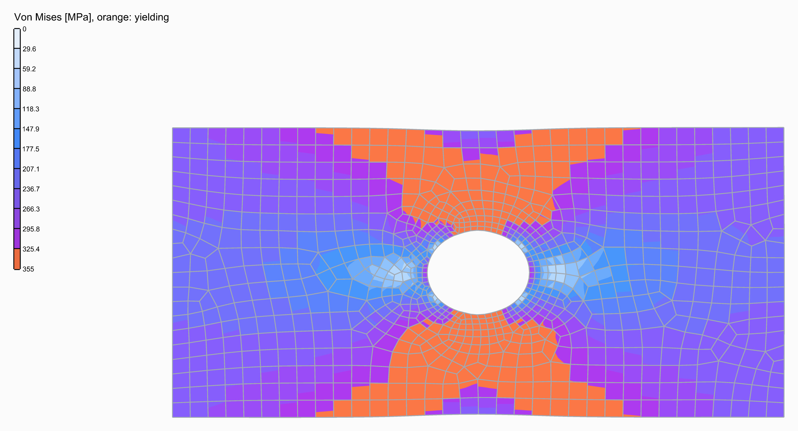
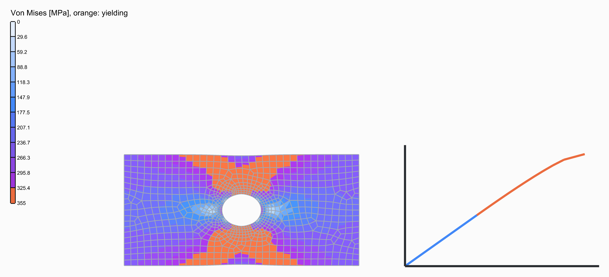
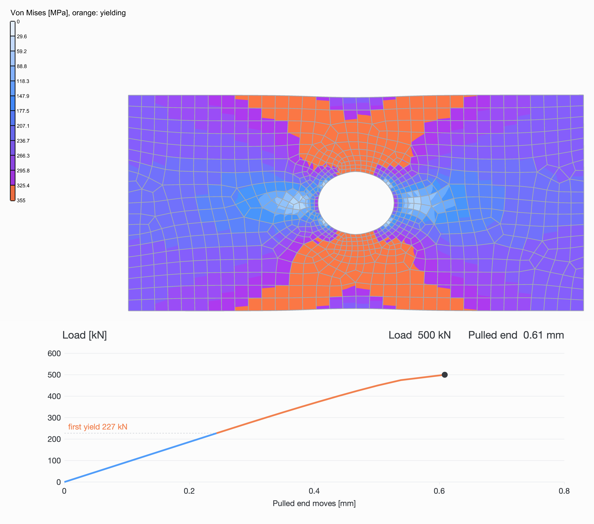

# ⭕ Plate with a Hole

<figure><figcaption></figcaption></figure>

[plate-with-a-hole](plate-with-a-hole.gh)

An S355 plate 400 x 200 mm and 10 mm thick with a hole 60 mm across in its middle, pulled along its
length, as 925 [ASD Shells](../../docs/basics/elements/shell.md), finer round the hole. The textbook
case of a stress concentration, here pushed past it: the steel is the
[nD](../../docs/basics/materials/ND.md) component's **J2Plasticity** unit. Twenty steps take the pull
to 500 kN.

<figure><video src="plate-with-a-hole-pushing.mp4" autoplay loop muted playsinline></video><figcaption>
The pull, a step a frame, drawn 30 times its deformation. Orange is steel at yield: first at the edge of the hole, then across the net section above and below it. Under it, how far the pulled end moves against the load.
</figcaption></figure>

## The model

| Group | What it does |
| --- | --- |
| 1 - The mesh | The shells as gmsh wrote them, finer round the hole, with a node at the middle of each short edge for the supports. |
| 2 - Steel | J2Plasticity S355, perfectly plastic, in a Layered Shell of ten layers. |
| 3 - Supports | In its own plane: every node held in Z; the left edge along X; its middle along Y too. Three supports on three sets of nodes, none on two. |
| 4 - Load | 500 kN on the right edge, each node its share of the edge's length, as [Point Loads](../../docs/basics/loads/point-load.md) in a [Load Pattern](../../docs/basics/loads/load-pattern.md) on a [Linear Time Series](../../docs/basics/time-history/linear.md). |
| 5 - Assemble | [Assemble](../../docs/basics/assemble.md), with a tolerance of 0.5 mm. |
| 6 - Pushed in steps | Newton and 20 steps of [Load Control](../../docs/basics/analysis/integrator.md) of 5%. |
| 7 - Von Mises | A [Model View](../../docs/basics/visualisation/model-view.md) of the Von Mises stress at the **Step** the slider picks, in Alpaca4d's colours, orange where the steel yields. |
| 8 - The curve | [Nodal Displacements](../../docs/basics/results/nodal-displacements.md) and Shell Stresses at every step, and a Python component that draws how far the pulled end moves against the load: light blue while every point is elastic, orange after. |

<figure><figcaption>
As the example opens: the plate, and the curve Grasshopper draws beside it.
</figcaption></figure>

## What it shows

At the edge of the hole, across the pull, the stress is 2.34 times the average over the net section
(Heywood: Kt = 2 + (1 - d/W)³ for d/W = 0.3). So the steel there yields when the average is
355 / 2.34 = 152 MPa, at 212 kN. The model shows it at 227 kN: it reads its stresses at the points
inside the elements, a little in from the edge.

From there the yielding fans out from the hole to the plate's edges, and the plate levels off when the
whole net section has yielded: Fy times (200 - 60) x 10 mm², 497 kN. The model reaches 500 kN and would
level off at 510, 2.6% over, as a plane stress model of the plate also does: across the net section the
steel is held a little sideways as well, and von Mises lets it carry a little more for it.

<figure><figcaption>
The plate at 500 kN, and the whole curve.
</figcaption></figure>

## Try

- Move **Step** to watch the yielding start at the edge of the hole.
- A bigger hole: the net section's load drops with its area, Kt with Heywood's formula.
- **Load** past 510 kN, and the analysis stops converging: the net section has nothing more to give.
- The plate has 925 elements, so it needs a license.
